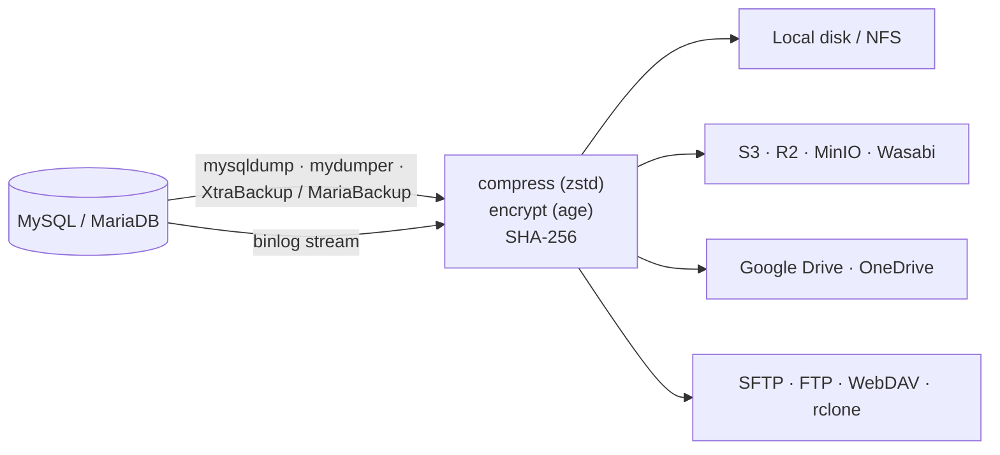
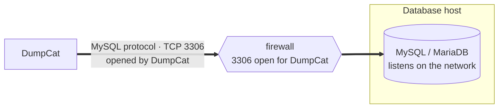
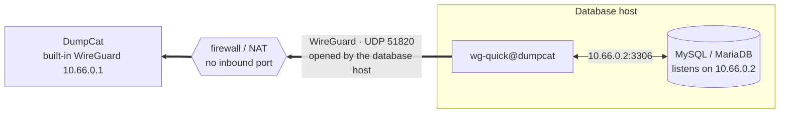
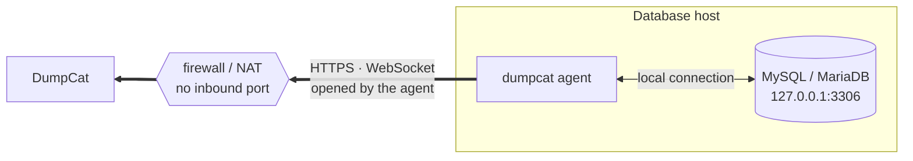

<p align="center">
  
</p>

<h1 align="center">DumpCat</h1>

<p align="center">
  <strong>Backup, restore and point-in-time recovery for MySQL and MariaDB.</strong><br>
  One self-hosted binary with a web UI. No database locks, no runtime to install, works offline.
</p>

<p align="center">
  <a href="LICENSE"></a>
  
  
  
</p>

<p align="center">
  <a href="https://dumpcat.cc"><b>dumpcat.cc</b></a> · <a href="https://dumpcat.cc/#download">Download</a> ·
  <a href="https://dumpcat.cc/demo/">Live demo</a> ·
  <a href="https://github.com/theweakestharrison/DumpCat">GitHub</a> ·
  <b>English</b> · <a href="README.vi.md">Tiếng Việt</a>
</p>

---

DumpCat takes care of the whole backup lifecycle of a MySQL or MariaDB server from your browser. It schedules backups,
compresses and encrypts them, copies them to the storages you choose, checks that they can be read back, and restores
them when you need to, down to the second with binlog archiving. It runs on Linux or Windows next to your database, as a
single Go binary with the UI built in.

## Highlights

- **No locking.** InnoDB is backed up from a consistent snapshot while your application keeps reading and writing.
- **Three backup engines.** `mysqldump` / `mariadb-dump`, parallel `mydumper` / `myloader`, and hot physical backups with
  Percona XtraBackup or MariaBackup, including incrementals.
- **Point-in-time recovery.** Continuous binlog archiving restores to a timestamp, a binlog position or the moment just
  before a GTID, for example just before an accidental `DROP TABLE`.
- **Storage anywhere.** Local disk or NFS, S3 and compatibles (Cloudflare R2, MinIO, Wasabi…), Google Drive,
  OneDrive / SharePoint, FTP / FTPS, SFTP, WebDAV, Backblaze B2, Azure Blob, Dropbox and every rclone backend. One job can
  write to several storages, each with its own retention.
- **Databases behind a firewall.** A small agent on the database host connects out to DumpCat, or the host joins
  DumpCat's built-in WireGuard (off by default), so no port has to be opened to the database. Backups, restores and
  point-in-time recovery work through either.
- **Encrypted and verified.** zstd compression, [age](https://age-encryption.org) encryption before anything leaves the
  server, SHA-256 for every file, and every backup read back right after it is written: decrypted, decompressed and
  checked, so a broken copy shows up at once instead of at restore time.
- **Restore drills.** On a schedule, DumpCat restores the newest backup into a sandbox server under temporary names,
  compares every table and its row count with what the backup recorded, runs your SQL assertions, records how long the
  restore took (RTO) and drops the copies. Backups that passed are marked **Restore-tested**; a failed drill alerts you.
- **Careful restores.** Restore under new database names or onto another instance or version (with `DEFINER`,
  collation and `GTID_PURGED` rewrites), test-decrypt every file before anything is dropped, fast load mode, and
  automatic rollback when a physical restore replaces the datadir.
- **Built for teams.** Admin, operator and viewer roles, TOTP two-factor login, API tokens, an audit log, and
  notifications by HTML email, Telegram, Slack, Discord or HMAC-signed webhook.
- **Standard formats.** Every backup carries a `manifest.json` and uses zstd / gzip / age / xbstream, so you can restore
  it with `age`, `zstd` and `mysql` alone, or import the catalog into a fresh DumpCat.
- **Safe self-updates.** `dumpcat update` waits for running jobs, backs up its own database, can require signed
  releases, and rolls back if the new version fails to start.

## How it works



Restores run the same pipeline in reverse. Logical backups stream straight into `mysql` with no temporary files;
mydumper and physical backups are unpacked first, then loaded with `myloader` or prepared with XtraBackup / MariaBackup.

## Connecting to your databases

DumpCat reaches a database in one of three ways, chosen per server (**Database servers → Add server → Connect**). The
backups, restores and point-in-time recovery work the same through all three.

**1. Direct, through the MySQL port.** DumpCat connects to the database like any client: `host:3306`, TLS optional, or a
unix socket when DumpCat runs on the database host itself. Use it when both machines are on the same network or VPC.



**2. Built-in VPN (WireGuard).** DumpCat runs a WireGuard endpoint itself — nothing to install on the backup server, off
until you turn it on. The database host joins with the standard WireGuard tools and keeps the tunnel open from its side,
so it can stay behind NAT and accept no inbound connections. [How to set it up](docs/manual.md#38-built-in-wireguard)



**3. Agent.** A small `dumpcat agent` on the database host connects out to DumpCat over HTTPS and opens the database
connections DumpCat asks for — only to the addresses on its allow list. MySQL stays exactly as it is, even if it listens
on 127.0.0.1 only. [How to set it up](docs/manual.md#37-database-hosts-that-accept-no-inbound-connections-agent)



| | 1. Direct | 2. Built-in VPN (WireGuard) | 3. Agent |
|---|---|---|---|
| Who opens the connection | DumpCat → database | The database host → DumpCat | The database host → DumpCat |
| Port to open on the database host | MySQL (3306) for DumpCat's address | None | None |
| The database host reaches DumpCat on | — (DumpCat connects to it) | UDP 51820 | HTTPS (the web UI port) |
| To install on the database host | Nothing | WireGuard (`wg-quick`) and the file DumpCat generates | `dumpcat agent` (one installer command) |
| MySQL settings | Backup user allowed from DumpCat's address | Listens on the VPN address; user allowed from 10.66.0.1 | Unchanged |
| Physical backups (XtraBackup / MariaBackup) | Yes, when DumpCat runs on the database host | No (needs DumpCat on the database host) | Yes, with `--allow-physical`: the agent runs the tool on the database host and streams the backup back |
| Best for | Same network or VPC, or DumpCat on the database host | Teams that already use WireGuard; one gateway to a whole private network | Hosts behind NAT or a strict firewall; no change to MySQL or the network |
| Set up in | Database servers | WireGuard page, then Database servers | Agents page, then Database servers |

## Supported platforms

| | |
|---|---|
| **Databases** | MySQL 5.7, 8.0, 8.4 · Percona Server · MariaDB 10.x, 11.x |
| **DumpCat host** | Linux amd64 / arm64 with systemd · Windows Server 2016+ / Windows 10+ 64-bit, as a Windows service |
| **Backup tools** | mysqldump / mariadb-dump · mydumper / myloader · Percona XtraBackup · MariaBackup (the Linux installer picks the versions that match your server) |
| **Storage** | Local directories and NFS / SMB shares, plus everything [rclone](https://rclone.org) supports |
| **Databases behind a firewall** | The agent (`dumpcat agent`) on Linux with systemd or on Windows, outbound HTTPS only · or standard WireGuard (`wg-quick`), outbound UDP |

mydumper and XtraBackup exist only for Linux. For databases of hundreds of GB and for physical MySQL backups, run
DumpCat on Linux ([what works on Windows](docs/manual.md#35-windows)).

## Quick start

Want to look around first? The **[demo](https://dumpcat.cc/demo/)** runs the real web UI with sample data, right in your
browser.

### 1. Install

The latest version, its release notes and checksums are on **[dumpcat.cc](https://dumpcat.cc/#download)**. The packages
are served from `https://downloads.dumpcat.cc/<version>/`.

**Linux**, as root:

```bash
curl -fLO https://downloads.dumpcat.cc/1.3.1/dumpcat-1.3.1-linux.tar.gz
tar xzf dumpcat-1.3.1-linux.tar.gz
cd dumpcat-1.3.1-linux
sudo ./install.sh
```

The installer puts the binary in `/opt/dumpcat`, creates the `dumpcat` systemd service, and installs rclone, the
MySQL / MariaDB client and the backup tools that match the database server on the machine.
Options: `--port 9090`, `--listen 127.0.0.1`, `--tls-auto`, `--no-deps`, `--uninstall [--purge]`.
On a database host that accepts no inbound connections, the same package installs only the [agent](docs/manual.md#37-database-hosts-that-accept-no-inbound-connections-agent):
`sudo ./install.sh --agent --server https://backup.example.com --key dca_…` (the **Agents** page shows the command with
the key).

**Windows**, in PowerShell run as Administrator:

```powershell
Invoke-WebRequest https://downloads.dumpcat.cc/1.3.1/dumpcat-1.3.1-windows-amd64.zip -OutFile dumpcat-1.3.1-windows-amd64.zip
Expand-Archive dumpcat-1.3.1-windows-amd64.zip -DestinationPath .
cd dumpcat-1.3.1-windows-amd64
powershell -ExecutionPolicy Bypass -File .\install.ps1
```

To check a download, compare it with
[SHA256SUMS](https://downloads.dumpcat.cc/1.3.1/SHA256SUMS) (`sha256sum -c --ignore-missing SHA256SUMS`, or `Get-FileHash` on
Windows). To build the packages yourself, see [Building from source](#building-from-source).

### 2. Run your first backup

1. Open `http://<server-ip>:6369` and create the admin account. The setup page asks for the one-time **setup token**
   that the installer prints, so nobody else who reaches the port can claim the admin account first. To show it again,
   run `sudo dumpcat setup-token` (Windows, as Administrator: `& "C:\Program Files\DumpCat\dumpcat.exe" setup-token`)
   or look in the service log. (The default port spells *MEOW* on a phone keypad.)
2. Create a MySQL user with read-only backup privileges ([the grants](docs/manual.md#4-getting-started)).
3. **Database servers → Add server → Test connection.** Choose how DumpCat connects: directly, through WireGuard or
   through an agent ([the three ways](#connecting-to-your-databases)). DumpCat shows the version, the size of each database, missing privileges and which backup methods
   work.
4. **Storage → Add storage → Test.**
5. **Backup jobs → New job.** Pick the server, method, databases, schedule, encryption, storage and retention, then
   **Save & run now**. Each backup is verified right after it is written (one copy by default).

For production, put DumpCat behind HTTPS with the [nginx sample or the built-in TLS](docs/manual.md#34-behind-nginx--https-recommended-for-production)
and restrict who can reach it.

## Choosing a backup method

| | mysqldump | mydumper | XtraBackup / MariaBackup |
|---|---|---|---|
| Locks InnoDB | No | A few milliseconds | No (a very brief backup lock at the end) |
| Restore speed | Slowest | Fast, in parallel | Very fast: file copy + prepare |
| Incremental | No | No | Yes |
| Restore one database or rename it | Yes | Yes | No, whole instance |
| Good for | Under 20–50 GB | Large databases restored one at a time | 100 GB to several TB, low RTO |

More detail and recommendations: [Choosing a backup method](docs/manual.md#2-choosing-a-backup-method).

## Documentation

The full manual is in [docs/manual.md](docs/manual.md) ([Tiếng Việt](docs/manual.vi.md)) and ships in every package.

| Topic | |
|---|---|
| Installing on Linux and Windows, HTTPS | [Installation](docs/manual.md#3-installation) |
| Database hosts that accept no inbound connections | [Agent](docs/manual.md#37-database-hosts-that-accept-no-inbound-connections-agent) · [WireGuard](docs/manual.md#38-built-in-wireguard) |
| S3, Google Drive, OneDrive, FTP, SFTP… | [Configuring storage](docs/manual.md#5-configuring-storage) |
| Schedules, incrementals, retention | [Jobs, schedules, retention](docs/manual.md#6-jobs-schedules-retention) |
| Logical and physical restores | [Restore](docs/manual.md#7-restore) |
| Binlog archiving, recovering to a point in time | [PITR](docs/manual.md#8-binlog-archiving--point-in-time-recovery-pitr) |
| Restoring without DumpCat, reinstalling DumpCat | [Manual recovery](docs/manual.md#9-manual-recovery-without-dumpcat) · [Disaster recovery](docs/manual.md#10-disaster-recovery) |
| Roles, 2FA, encryption at rest | [Security](docs/manual.md#11-security) |
| REST API, webhooks | [API & automation](docs/manual.md#12-api--automation) |
| Environment variables, command line | [System configuration](docs/manual.md#13-system-configuration) |
| Updates, release server, signed releases | [Updating](docs/manual.md#36-updating) |
| Common errors | [Troubleshooting](docs/manual.md#14-troubleshooting) |

## Building from source

You need Go 1.26 or newer. No C compiler is required: binaries are built with `CGO_ENABLED=0` and SQLite is pure Go.

```bash
go vet ./...
go test ./...
go build -o dumpcat ./cmd/dumpcat
```

Run it locally, serving the UI from disk so UI changes need no rebuild:

```bash
DUMPCAT_DATA_DIR=./data DUMPCAT_LISTEN=127.0.0.1:6369 DUMPCAT_WEB_DIR=./web ./dumpcat serve
```

Build the release packages (on Windows: `.\build.ps1`):

```bash
./build.sh
```

This writes Linux amd64 / arm64 and Windows amd64 binaries, `dumpcat-<version>-linux.tar.gz`,
`dumpcat-<version>-windows-amd64.zip` and the update feed in `dist/update/`. The version comes from `VERSION` and the
release notes from `CHANGELOG.md`. Publishing updates and signing releases are covered in
[Updating](docs/manual.md#36-updating).

```
cmd/dumpcat    command line: serve, agent, user, decode, update, release
internal/      API, backup runner, engines, storage, compression and encryption pipeline, SQLite store, agent and
               WireGuard tunnels, notifications, updater…
web/           UI in plain HTML, CSS and JavaScript, embedded into the binary
scripts/       Linux and Windows installers (also for the agent), release upload (publish-release.sh),
               site generators (build-site.py, build-demo.py)
deploy/        systemd units for DumpCat and the agent, sample env files, nginx config
site/          dumpcat.cc: landing page, comparison pages and the demo (site/demo, generated from web/), served by the
               Cloudflare Worker in wrangler.jsonc
site-src/      sources of the generated pages: comparison data, the demo's mock API and sample data
docs/          manual in English and Vietnamese, website runbook (website.vi.md)
```

## Contributing

Bug reports, fixes, documentation and translations are welcome. Please read [CONTRIBUTING.md](CONTRIBUTING.md) first.
Report security problems privately, as described in [SECURITY.md](SECURITY.md).

## License

DumpCat is licensed under the [Apache License 2.0](LICENSE).
Copyright 2026 [theweakestharrison](https://github.com/theweakestharrison); see [NOTICE](NOTICE).

The binaries contain Go modules under their own licenses, listed with their full license texts in
[THIRD_PARTY_NOTICES.md](THIRD_PARTY_NOTICES.md); the MPL-2.0 driver github.com/go-sql-driver/mysql is used unmodified,
and its source is available upstream at https://github.com/go-sql-driver/mysql.

DumpCat runs external tools such as mysqldump, mydumper, Percona XtraBackup, MariaBackup and rclone. They are installed
separately and keep their own licenses.
