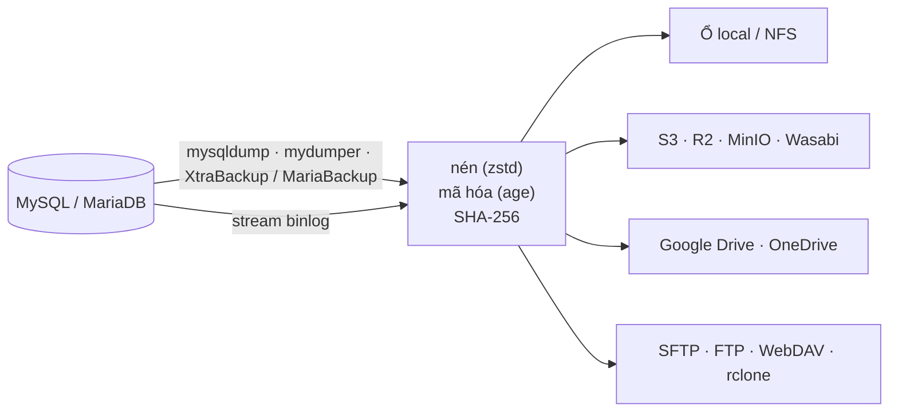
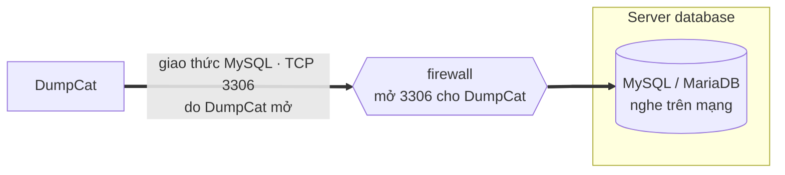
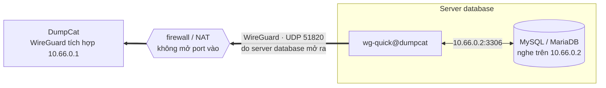
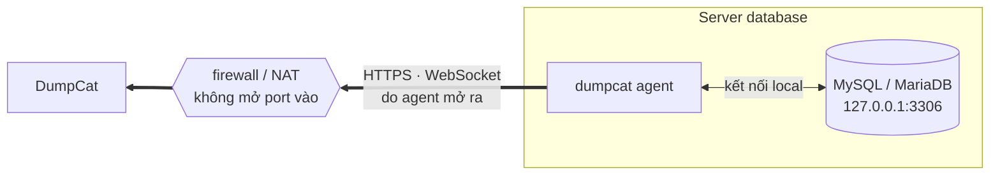

<p align="center">
  
</p>

<h1 align="center">DumpCat</h1>

<p align="center">
  <strong>Backup, restore và khôi phục theo thời điểm cho MySQL và MariaDB, và giờ có cả PostgreSQL.</strong><br>
  Một file chạy duy nhất, tự host, có giao diện web. Không khóa database, không cần cài runtime, chạy offline.
</p>

<p align="center">
  <a href="LICENSE"></a>
  
  
  
</p>

<p align="center">
  <a href="https://dumpcat.cc"><b>dumpcat.cc</b></a> · <a href="https://dumpcat.cc/#download">Tải về</a> ·
  <a href="https://dumpcat.cc/demo/">Dùng thử demo</a> ·
  <a href="https://github.com/theweakestharrison/DumpCat">GitHub</a> ·
  <a href="README.md">English</a> · <b>Tiếng Việt</b>
</p>

---

DumpCat quản lý toàn bộ vòng đời backup của các server MySQL, MariaDB và PostgreSQL ngay trên trình duyệt. Nó lên lịch backup,
nén và mã hóa, chép bản sao lên những nơi lưu trữ bạn chọn, kiểm tra xem bản backup có đọc lại được không, và restore khi
cần, đến đúng từng giây nhờ lưu trữ binlog. DumpCat chạy trên Linux hoặc Windows ngay cạnh database, dưới dạng một file
binary Go có sẵn giao diện.

## Điểm nổi bật

- **Không khóa database.** InnoDB được backup từ một snapshot nhất quán trong khi ứng dụng vẫn đọc ghi bình thường.
- **Ba công cụ backup.** `mysqldump` / `mariadb-dump`, `mydumper` / `myloader` chạy song song, và backup vật lý nóng bằng
  Percona XtraBackup hoặc MariaBackup, có cả incremental.
- **Có cả PostgreSQL.** `pg_dump` định dạng thư mục, dump và restore các bảng song song, role lấy từ
  `pg_dumpall --globals-only`, restore dưới tên mới hoặc sang server khác, diễn tập restore; `pg_basebackup` cho cả
  cluster. Công cụ client cùng major với từng server được chọn tự động.
- **Khôi phục theo thời điểm.** Lưu binlog liên tục để restore về một mốc thời gian, một vị trí binlog hoặc ngay trước một
  GTID, ví dụ ngay trước một câu `DROP TABLE` lỡ tay; với PostgreSQL, WAL được lưu liên tục (`pg_receivewal` qua một
  replication slot) để khôi phục về một mốc thời gian, một restore point hoặc một vị trí WAL.
- **Lưu ở đâu cũng được.** Ổ local hoặc NFS, S3 và các dịch vụ tương thích (Cloudflare R2, MinIO, Wasabi…), Google Drive,
  OneDrive / SharePoint, FTP / FTPS, SFTP, WebDAV, Backblaze B2, Azure Blob, Dropbox và mọi backend của rclone. Một job có
  thể ghi ra nhiều nơi, mỗi nơi có chính sách giữ bản riêng.
- **Database nằm sau firewall.** Một agent nhỏ trên server database chủ động kết nối ra DumpCat, hoặc server đó tham gia
  WireGuard tích hợp của DumpCat (tắt mặc định), nên không cần mở port nào tới database. Backup, restore và khôi phục
  theo thời điểm đều chạy được qua cả hai cách.
- **Mã hóa và kiểm tra.** Nén zstd, mã hóa bằng [age](https://age-encryption.org) trước khi dữ liệu rời khỏi server,
  SHA-256 cho từng file, và mỗi bản backup được đọc lại ngay sau khi ghi: giải mã, giải nén, kiểm tra, nên bản hỏng lộ
  ra ngay chứ không đợi tới lúc restore.
- **Biết ngay khi backup ngừng chạy.** Mỗi job được đối chiếu với lịch chạy của chính nó: quá hạn mà chưa có bản backup
  thành công, hoặc việc lưu binlog bị chậm, DumpCat báo một lần và báo lại khi đã ổn. Báo cáo tuần qua email tóm tắt cả
  tuần, và endpoint Prometheus `/metrics` (tắt mặc định) cấp số liệu cho dashboard và luật cảnh báo của bạn.
- **Diễn tập restore.** Theo lịch, DumpCat restore bản backup mới nhất vào một server sandbox dưới tên tạm, so từng bảng
  và số dòng với những gì backup đã ghi nhận, chạy các assertion SQL của bạn, ghi lại thời gian restore (RTO) rồi xóa
  bản sao. Backup đạt được đánh dấu **Restore-tested**; diễn tập thất bại sẽ gửi cảnh báo.
- **Restore cẩn thận.** Restore sang tên database mới hoặc sang instance / phiên bản khác (tự gỡ `DEFINER`, đổi
  collation, bỏ `GTID_PURGED`), thử giải mã mọi file trước khi xóa bất cứ thứ gì, chế độ nạp nhanh, và tự rollback khi
  restore vật lý thay datadir.
- **Dùng được cho cả đội.** Vai trò admin, operator, viewer, đăng nhập hai lớp TOTP, API token, nhật ký thao tác, và thông
  báo qua email HTML, Telegram, Slack, Discord hoặc webhook có ký HMAC.
- **Định dạng chuẩn.** Mỗi bản backup có `manifest.json` và dùng zstd / gzip / age / xbstream, nên bạn restore được chỉ
  với `age`, `zstd` và `mysql`, hoặc import catalog vào một DumpCat cài mới.
- **Tự cập nhật an toàn.** `dumpcat update` chờ các job đang chạy, backup database của chính nó, có thể bắt buộc bản phát
  hành phải được ký, và rollback nếu phiên bản mới không khởi động được.

## Cách hoạt động



Restore chạy cùng đường ống theo chiều ngược lại. Backup logical được stream thẳng vào `mysql`, không cần file tạm;
backup mydumper và backup vật lý được giải nén trước, rồi nạp bằng `myloader` hoặc prepare bằng XtraBackup / MariaBackup.

## Ba cách kết nối tới database

DumpCat tới được database theo một trong ba cách, chọn riêng cho từng server (**Database servers → Add server →
Connect**). Backup, restore và khôi phục theo thời điểm chạy như nhau với cả ba cách.

**1. Kết nối trực tiếp qua port MySQL.** DumpCat kết nối tới database như mọi client: `host:3306`, có thể bật TLS, hoặc
qua unix socket khi DumpCat chạy ngay trên server database. Dùng khi hai máy cùng mạng hoặc cùng VPC.



**2. VPN tích hợp sẵn (WireGuard).** DumpCat tự chạy một endpoint WireGuard — không cần cài gì thêm trên server backup,
tắt cho tới khi bạn bật. Server database tham gia bằng công cụ WireGuard chuẩn và tự giữ tunnel từ phía nó, nên có thể
nằm sau NAT và không nhận kết nối vào. [Cách cài đặt](docs/manual.vi.md#38-wireguard-tích-hợp)



**3. Agent.** Một `dumpcat agent` nhỏ trên server database chủ động kết nối ra DumpCat bằng HTTPS và mở các kết nối
database mà DumpCat cần — chỉ tới những địa chỉ trong danh sách cho phép của nó. MySQL giữ nguyên, kể cả khi chỉ nghe
trên 127.0.0.1. [Cách cài đặt](docs/manual.vi.md#37-server-database-không-cho-kết-nối-vào-agent)



| | 1. Trực tiếp | 2. VPN tích hợp (WireGuard) | 3. Agent |
|---|---|---|---|
| Ai mở kết nối | DumpCat → database | Server database → DumpCat | Server database → DumpCat |
| Port phải mở trên server database | MySQL (3306) cho địa chỉ của DumpCat | Không | Không |
| Server database đi ra tới DumpCat qua | — (DumpCat tự kết nối tới) | UDP 51820 | HTTPS (port giao diện web) |
| Cài trên server database | Không cần | WireGuard (`wg-quick`) và file DumpCat tạo sẵn | `dumpcat agent` (một lệnh cài) |
| Cấu hình MySQL | User backup được phép từ địa chỉ của DumpCat | Nghe trên địa chỉ VPN; user được phép từ 10.66.0.1 | Giữ nguyên |
| Backup vật lý (XtraBackup / MariaBackup) | Có, khi DumpCat chạy trên server database | Không (cần DumpCat trên server database) | Có, khi bật `--allow-physical`: agent chạy công cụ trên server database và stream bản backup về |
| Hợp với | Cùng mạng hoặc VPC, hoặc DumpCat chạy trên server database | Đội đã dùng WireGuard; một gateway dẫn tới cả mạng nội bộ | Máy sau NAT hoặc firewall chặt; không đụng tới MySQL hay mạng |
| Thiết lập ở | Database servers | Trang WireGuard, rồi Database servers | Trang Agents, rồi Database servers |

## Nền tảng hỗ trợ

| | |
|---|---|
| **Database** | MySQL 5.7, 8.0, 8.4 · Percona Server · MariaDB 10.x, 11.x · PostgreSQL 10 trở lên |
| **Máy chạy DumpCat** | Linux amd64 / arm64 có systemd · Windows Server 2016+ / Windows 10+ 64-bit, chạy như Windows service |
| **Công cụ backup** | mysqldump / mariadb-dump · mydumper / myloader · Percona XtraBackup · MariaBackup · pg_dump / pg_restore / pg_dumpall / pg_basebackup / pg_receivewal (bộ cài Linux tự chọn phiên bản khớp với server; `--postgres 16` cài thêm client PostgreSQL 16) |
| **Lưu trữ** | Thư mục local và ổ chia sẻ NFS / SMB, cùng mọi thứ [rclone](https://rclone.org) hỗ trợ |
| **Database sau firewall** | Agent (`dumpcat agent`) trên Linux có systemd hoặc Windows, chỉ cần HTTPS đi ra · hoặc WireGuard chuẩn (`wg-quick`), UDP đi ra |

mydumper và XtraBackup chỉ có cho Linux. Với database hàng trăm GB và backup vật lý MySQL, hãy chạy DumpCat trên Linux
([những gì chạy được trên Windows](docs/manual.vi.md#35-windows)).

## Bắt đầu nhanh

Muốn xem trước? **[Bản demo](https://dumpcat.cc/demo/)** chạy giao diện thật với dữ liệu mẫu ngay trong trình duyệt.

### 1. Cài đặt

Mới làm quen với server? **[Hướng dẫn cài từng bước](https://dumpcat.cc/vi/install/)** đi qua mọi thứ, từ cách mở cửa
sổ dòng lệnh tới bản backup đầu tiên.

**Linux**: một lệnh trên server, bằng user có `sudo`:

```bash
curl -fsSL https://dumpcat.cc/install.sh | sudo sh
```

Lệnh này tải gói mới nhất từ `https://downloads.dumpcat.cc`, kiểm tra SHA-256 theo `SHA256SUMS` của bản phát hành rồi
chạy `install.sh` trong gói. Bộ cài đặt chép binary vào `/opt/dumpcat`, tạo service systemd `dumpcat`, và cài rclone,
MySQL / MariaDB client cùng các công cụ backup khớp với database server trên máy. Tùy chọn đặt sau `sh -s --`, ví dụ
`curl -fsSL https://dumpcat.cc/install.sh | sudo sh -s -- --port 9090`: `--port 9090`, `--listen 127.0.0.1`, `--tls-auto`,
`--no-deps`, `--uninstall [--purge]`.
Trên server database không cho kết nối vào, cùng bộ cài này chỉ cài [agent](docs/manual.vi.md#37-server-database-không-cho-kết-nối-vào-agent):
`--agent --server https://backup.example.com --key dca_…` (trang **Agents** hiện sẵn lệnh kèm khóa).

**Windows**: tải file `.zip` trên [dumpcat.cc](https://dumpcat.cc/#download), giải nén (chuột phải, **Extract All**) rồi bấm
đúp **Install DumpCat**; Windows sẽ hỏi quyền quản trị. Hoặc, trong PowerShell chạy bằng quyền Administrator:

```powershell
irm https://dumpcat.cc/install.ps1 | iex
```

**Tự tải gói về**: phiên bản mới nhất, ghi chú phát hành và mã kiểm tra có trên [dumpcat.cc](https://dumpcat.cc/#download),
các gói nằm ở `https://downloads.dumpcat.cc/<phiên bản>/`. Gói nào cũng có `START-HERE.txt`; trên Linux, giải nén rồi chạy
`sudo ./install.sh`. Kiểm tra file tải về bằng `SHA256SUMS` của bản phát hành (`sha256sum -c --ignore-missing SHA256SUMS`,
hoặc `Get-FileHash` trên Windows). Muốn tự build gói cài đặt, xem [Build từ mã nguồn](#build-từ-mã-nguồn).

### 2. Chạy bản backup đầu tiên

1. Mở `http://<ip-server>:6369` và tạo tài khoản admin. Trang thiết lập sẽ hỏi **mã thiết lập** (setup token) dùng một lần
   mà bộ cài đặt đã in ra, để người khác truy cập được cổng này không thể giành tài khoản admin trước bạn. Muốn xem lại mã,
   chạy `sudo dumpcat setup-token` (Windows, quyền Administrator: `& "C:\Program Files\DumpCat\dumpcat.exe" setup-token`)
   hoặc xem log của service. (Cổng mặc định bấm trên bàn phím điện thoại sẽ ra chữ *MEOW*.)
2. Tạo một user MySQL có quyền backup chỉ đọc ([các lệnh GRANT](docs/manual.vi.md#4-bắt-đầu-sử-dụng)).
3. **Database servers → Add server → Test connection.** Chọn cách DumpCat kết nối: trực tiếp, qua WireGuard hoặc qua
   agent ([ba cách kết nối](#ba-cách-kết-nối-tới-database)). DumpCat hiển thị version, dung lượng từng database, các quyền còn thiếu và phương thức backup nào dùng được.
4. **Storage → Add storage → Test.**
5. **Backup jobs → New job.** Chọn server, phương thức, database, lịch chạy, mã hóa, nơi lưu và retention, rồi bấm
   **Save & run now**. Mỗi bản backup được kiểm tra ngay sau khi ghi (mặc định kiểm một bản).

Khi chạy thật, hãy đặt DumpCat sau HTTPS bằng [cấu hình nginx mẫu hoặc TLS có sẵn](docs/manual.vi.md#34-đặt-sau-nginx--https-khuyến-nghị-cho-môi-trường-thật)
và giới hạn ai được truy cập.

## Chọn phương thức backup

| | mysqldump | mydumper | XtraBackup / MariaBackup |
|---|---|---|---|
| Khóa InnoDB | Không | Vài mili giây | Không (một backup lock rất ngắn ở cuối) |
| Tốc độ restore | Chậm nhất | Nhanh, song song | Rất nhanh: copy file + prepare |
| Incremental | Không | Không | Có |
| Restore một database hoặc đổi tên | Có | Có | Không, cả instance |
| Hợp với | Dưới 20–50 GB | Database lớn cần restore từng DB | 100 GB đến vài TB, cần RTO thấp |

Server PostgreSQL được backup bằng `pg_dump` (định dạng thư mục, các bảng song song, không khóa ghi) hoặc
`pg_basebackup` (cả cluster, làm nền cho việc lưu WAL và khôi phục theo thời điểm): xem
[PostgreSQL](docs/manual.vi.md#postgresql).

Chi tiết và khuyến nghị: [Chọn phương thức backup](docs/manual.vi.md#2-chọn-phương-thức-backup).

## Tài liệu

Hướng dẫn đầy đủ nằm ở [docs/manual.vi.md](docs/manual.vi.md) ([English](docs/manual.md)) và có sẵn trong mọi gói cài đặt.

| Chủ đề | |
|---|---|
| Cài trên Linux và Windows, HTTPS | [Cài đặt](docs/manual.vi.md#3-cài-đặt) |
| Server database không cho kết nối vào | [Agent](docs/manual.vi.md#37-server-database-không-cho-kết-nối-vào-agent) · [WireGuard](docs/manual.vi.md#38-wireguard-tích-hợp) |
| S3, Google Drive, OneDrive, FTP, SFTP… | [Cấu hình nơi lưu trữ](docs/manual.vi.md#5-cấu-hình-nơi-lưu-trữ) |
| Lịch chạy, incremental, retention | [Job, lịch chạy, retention](docs/manual.vi.md#6-job-lịch-chạy-retention) |
| Restore logical và vật lý | [Restore](docs/manual.vi.md#7-restore) |
| Lưu binlog, khôi phục về một thời điểm | [PITR](docs/manual.vi.md#8-lưu-trữ-log--khôi-phục-theo-thời-điểm-pitr) |
| Restore không cần DumpCat, cài lại DumpCat | [Khôi phục thủ công](docs/manual.vi.md#9-khôi-phục-thủ-công-khi-không-có-dumpcat) · [Khôi phục thảm họa](docs/manual.vi.md#10-khôi-phục-thảm-họa) |
| Phân quyền, 2FA, mã hóa dữ liệu lưu trữ | [Bảo mật](docs/manual.vi.md#11-bảo-mật) |
| REST API, webhook | [API & tự động hóa](docs/manual.vi.md#12-api--tự-động-hóa) |
| Biến môi trường, dòng lệnh | [Cấu hình hệ thống](docs/manual.vi.md#13-cấu-hình-hệ-thống) |
| Cập nhật, release server, ký bản phát hành | [Cập nhật](docs/manual.vi.md#36-cập-nhật) |
| Lỗi thường gặp | [Xử lý sự cố](docs/manual.vi.md#14-xử-lý-sự-cố) |

## Build từ mã nguồn

Cần Go 1.26 trở lên. Không cần trình biên dịch C: binary được build với `CGO_ENABLED=0` và SQLite viết thuần Go.

```bash
go vet ./...
go test ./...
go build -o dumpcat ./cmd/dumpcat
```

Chạy thử trên máy, lấy giao diện trực tiếp từ thư mục để sửa UI không cần build lại:

```bash
DUMPCAT_DATA_DIR=./data DUMPCAT_LISTEN=127.0.0.1:6369 DUMPCAT_WEB_DIR=./web ./dumpcat serve
```

Build các gói phát hành (trên Windows: `.\build.ps1`):

```bash
./build.sh
```

Lệnh này tạo binary Linux amd64 / arm64 và Windows amd64, `dumpcat-<version>-linux.tar.gz`,
`dumpcat-<version>-windows-amd64.zip` và nguồn cập nhật trong `dist/update/`. Số phiên bản lấy từ `VERSION`, ghi chú phát
hành lấy từ `CHANGELOG.md`. Cách phát hành bản cập nhật và ký bản phát hành nằm ở [Cập nhật](docs/manual.vi.md#36-cập-nhật).

```
cmd/dumpcat    dòng lệnh: serve, agent, user, decode, update, release
internal/      API, bộ chạy backup, các engine, lưu trữ, đường ống nén và mã hóa, SQLite, tunnel agent và WireGuard,
               thông báo, bộ cập nhật…
web/           giao diện bằng HTML, CSS và JavaScript thuần, nhúng vào binary
scripts/       bộ cài cho Linux và Windows (cả cho agent), script upload bản phát hành (publish-release.sh),
               script sinh website (build-site.py, build-demo.py)
deploy/        systemd unit cho DumpCat và agent, file env mẫu, cấu hình nginx
site/          dumpcat.cc: landing page, trang so sánh và bản demo (site/demo, sinh từ web/), chạy bằng Cloudflare Worker
               khai báo trong wrangler.jsonc
site-src/      nguồn của các trang được sinh ra: dữ liệu so sánh, API giả và dữ liệu mẫu của bản demo
docs/          hướng dẫn tiếng Anh và tiếng Việt, cách deploy website (website.vi.md)
```

## Đóng góp

Mọi báo lỗi, bản sửa, tài liệu và bản dịch đều được hoan nghênh. Vui lòng đọc [CONTRIBUTING.md](CONTRIBUTING.md) (tiếng
Anh) trước. Lỗ hổng bảo mật xin báo riêng theo hướng dẫn trong [SECURITY.md](SECURITY.md).

## Giấy phép

DumpCat phát hành theo [Apache License 2.0](LICENSE).
Copyright 2026 [theweakestharrison](https://github.com/theweakestharrison); xem [NOTICE](NOTICE).

Các file chạy có chứa những module Go mang giấy phép riêng, được liệt kê kèm toàn văn giấy phép trong
[THIRD_PARTY_NOTICES.md](THIRD_PARTY_NOTICES.md); driver github.com/go-sql-driver/mysql (MPL-2.0) được dùng nguyên bản,
không sửa đổi, và mã nguồn của nó có sẵn tại upstream: https://github.com/go-sql-driver/mysql.

DumpCat gọi các công cụ bên ngoài như mysqldump, mydumper, Percona XtraBackup, MariaBackup và rclone. Các công cụ này được
cài riêng và giữ giấy phép của chúng.
