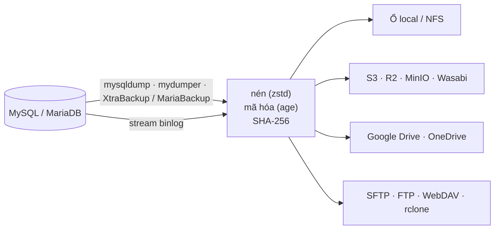

<p align="center">
  
</p>

<h1 align="center">DumpCat</h1>

<p align="center">
  <strong>Backup, restore và khôi phục theo thời điểm cho MySQL và MariaDB.</strong><br>
  Một file chạy duy nhất, tự host, có giao diện web. Không khóa database, không cần cài runtime, chạy offline.
</p>

<p align="center">
  <a href="LICENSE"></a>
  
  
  
</p>

<p align="center">
  <a href="https://dumpcat.cc"><b>dumpcat.cc</b></a> · <a href="https://dumpcat.cc/#download">Tải về</a> ·
  <a href="https://github.com/theweakestharrison/DumpCat">GitHub</a> ·
  <a href="README.md">English</a> · <b>Tiếng Việt</b>
</p>

---

DumpCat quản lý toàn bộ vòng đời backup của một server MySQL hoặc MariaDB ngay trên trình duyệt. Nó lên lịch backup,
nén và mã hóa, chép bản sao lên những nơi lưu trữ bạn chọn, kiểm tra xem bản backup có đọc lại được không, và restore khi
cần, đến đúng từng giây nhờ lưu trữ binlog. DumpCat chạy trên Linux hoặc Windows ngay cạnh database, dưới dạng một file
binary Go có sẵn giao diện.

## Điểm nổi bật

- **Không khóa database.** InnoDB được backup từ một snapshot nhất quán trong khi ứng dụng vẫn đọc ghi bình thường.
- **Ba công cụ backup.** `mysqldump` / `mariadb-dump`, `mydumper` / `myloader` chạy song song, và backup vật lý nóng bằng
  Percona XtraBackup hoặc MariaBackup, có cả incremental.
- **Khôi phục theo thời điểm.** Lưu binlog liên tục để restore về một mốc thời gian, một vị trí binlog hoặc ngay trước một
  GTID, ví dụ ngay trước một câu `DROP TABLE` lỡ tay.
- **Lưu ở đâu cũng được.** Ổ local hoặc NFS, S3 và các dịch vụ tương thích (Cloudflare R2, MinIO, Wasabi…), Google Drive,
  OneDrive / SharePoint, FTP / FTPS, SFTP, WebDAV, Backblaze B2, Azure Blob, Dropbox và mọi backend của rclone. Một job có
  thể ghi ra nhiều nơi, mỗi nơi có chính sách giữ bản riêng.
- **Database nằm sau firewall.** Một agent nhỏ trên server database chủ động kết nối ra DumpCat, nên không cần mở port
  nào tới database. Backup, restore và khôi phục theo thời điểm đều chạy qua agent.
- **Mã hóa và kiểm tra.** Nén zstd, mã hóa bằng [age](https://age-encryption.org) trước khi dữ liệu rời khỏi server,
  SHA-256 cho từng file, và bước kiểm tra toàn vẹn giải mã, giải nén lại bản backup khi bạn bấm hoặc sau mỗi lần chạy.
- **Restore cẩn thận.** Restore sang tên database mới hoặc sang instance / phiên bản khác (tự gỡ `DEFINER`, đổi
  collation, bỏ `GTID_PURGED`), thử giải mã mọi file trước khi xóa bất cứ thứ gì, chế độ nạp nhanh, và tự rollback khi
  restore vật lý thay datadir.
- **Dùng được cho cả đội.** Vai trò admin, operator, viewer, đăng nhập hai lớp TOTP, API token, nhật ký thao tác, và thông
  báo qua email, Telegram, Slack, Discord hoặc webhook có ký HMAC.
- **Định dạng chuẩn.** Mỗi bản backup có `manifest.json` và dùng zstd / gzip / age / xbstream, nên bạn restore được chỉ
  với `age`, `zstd` và `mysql`, hoặc import catalog vào một DumpCat cài mới.
- **Tự cập nhật an toàn.** `dumpcat update` chờ các job đang chạy, backup database của chính nó, có thể bắt buộc bản phát
  hành phải được ký, và rollback nếu phiên bản mới không khởi động được.

## Cách hoạt động



Restore chạy cùng đường ống theo chiều ngược lại. Backup logical được stream thẳng vào `mysql`, không cần file tạm;
backup mydumper và backup vật lý được giải nén trước, rồi nạp bằng `myloader` hoặc prepare bằng XtraBackup / MariaBackup.

## Nền tảng hỗ trợ

| | |
|---|---|
| **Database** | MySQL 5.7, 8.0, 8.4 · Percona Server · MariaDB 10.x, 11.x |
| **Máy chạy DumpCat** | Linux amd64 / arm64 có systemd · Windows Server 2016+ / Windows 10+ 64-bit, chạy như Windows service |
| **Công cụ backup** | mysqldump / mariadb-dump · mydumper / myloader · Percona XtraBackup · MariaBackup (bộ cài Linux tự chọn phiên bản khớp với server) |
| **Lưu trữ** | Thư mục local và ổ chia sẻ NFS / SMB, cùng mọi thứ [rclone](https://rclone.org) hỗ trợ |

mydumper và XtraBackup chỉ có cho Linux. Với database hàng trăm GB và backup vật lý MySQL, hãy chạy DumpCat trên Linux
([những gì chạy được trên Windows](docs/manual.vi.md#35-windows)).

## Bắt đầu nhanh

### 1. Cài đặt

Phiên bản mới nhất, ghi chú phát hành và mã kiểm tra có trên **[dumpcat.cc](https://dumpcat.cc/#download)**. Các gói cài
đặt nằm ở `https://downloads.dumpcat.cc/<phiên bản>/`.

**Linux**, với quyền root:

```bash
curl -fLO https://downloads.dumpcat.cc/1.2.0/dumpcat-1.2.0-linux.tar.gz
tar xzf dumpcat-1.2.0-linux.tar.gz
cd dumpcat-1.2.0-linux
sudo ./install.sh
```

Bộ cài đặt chép binary vào `/opt/dumpcat`, tạo service systemd `dumpcat`, và cài rclone, MySQL / MariaDB client cùng các
công cụ backup khớp với database server trên máy.
Tùy chọn: `--port 9090`, `--listen 127.0.0.1`, `--tls-auto`, `--no-deps`, `--uninstall [--purge]`.

**Windows**, trong PowerShell chạy bằng quyền Administrator:

```powershell
Invoke-WebRequest https://downloads.dumpcat.cc/1.2.0/dumpcat-1.2.0-windows-amd64.zip -OutFile dumpcat-1.2.0-windows-amd64.zip
Expand-Archive dumpcat-1.2.0-windows-amd64.zip -DestinationPath .
cd dumpcat-1.2.0-windows-amd64
powershell -ExecutionPolicy Bypass -File .\install.ps1
```

Kiểm tra file tải về bằng [SHA256SUMS](https://downloads.dumpcat.cc/1.2.0/SHA256SUMS) (`sha256sum -c --ignore-missing SHA256SUMS`,
hoặc `Get-FileHash` trên Windows). Muốn tự build gói cài đặt, xem [Build từ mã nguồn](#build-từ-mã-nguồn).

### 2. Chạy bản backup đầu tiên

1. Mở `http://<ip-server>:6369` và tạo tài khoản admin. Trang thiết lập sẽ hỏi **mã thiết lập** (setup token) dùng một lần
   mà bộ cài đặt đã in ra, để người khác truy cập được cổng này không thể giành tài khoản admin trước bạn. Muốn xem lại mã,
   chạy `sudo dumpcat setup-token` (Windows, quyền Administrator: `& "C:\Program Files\DumpCat\dumpcat.exe" setup-token`)
   hoặc xem log của service. (Cổng mặc định bấm trên bàn phím điện thoại sẽ ra chữ *MEOW*.)
2. Tạo một user MySQL có quyền backup chỉ đọc ([các lệnh GRANT](docs/manual.vi.md#4-bắt-đầu-sử-dụng)).
3. **Database servers → Add server → Test connection.** DumpCat hiển thị version, dung lượng từng database, các quyền còn
   thiếu và phương thức backup nào dùng được trên máy này.
4. **Storage → Add storage → Test.**
5. **Backup jobs → New job.** Chọn server, phương thức, database, lịch chạy, mã hóa, nơi lưu và retention, rồi bấm
   **Save & run now**.

Khi chạy thật, hãy đặt DumpCat sau HTTPS bằng [cấu hình nginx mẫu hoặc TLS có sẵn](docs/manual.vi.md#34-đặt-sau-nginx--https-khuyến-nghị-cho-môi-trường-thật)
và giới hạn ai được truy cập.

## Chọn phương thức backup

| | mysqldump | mydumper | XtraBackup / MariaBackup |
|---|---|---|---|
| Khóa InnoDB | Không | Vài mili giây | Không (một backup lock rất ngắn ở cuối) |
| Tốc độ restore | Chậm nhất | Nhanh, song song | Rất nhanh: copy file + prepare |
| Incremental | Không | Không | Có |
| Restore một database hoặc đổi tên | Có | Có | Không, cả instance |
| Hợp với | Dưới 20–50 GB | Database lớn cần restore từng DB | 100 GB đến vài TB, cần RTO thấp |

Chi tiết và khuyến nghị: [Chọn phương thức backup](docs/manual.vi.md#2-chọn-phương-thức-backup).

## Tài liệu

Hướng dẫn đầy đủ nằm ở [docs/manual.vi.md](docs/manual.vi.md) ([English](docs/manual.md)) và có sẵn trong mọi gói cài đặt.

| Chủ đề | |
|---|---|
| Cài trên Linux và Windows, HTTPS | [Cài đặt](docs/manual.vi.md#3-cài-đặt) |
| Server database không cho kết nối vào | [Agent](docs/manual.vi.md#37-server-database-không-cho-kết-nối-vào-agent) |
| S3, Google Drive, OneDrive, FTP, SFTP… | [Cấu hình nơi lưu trữ](docs/manual.vi.md#5-cấu-hình-nơi-lưu-trữ) |
| Lịch chạy, incremental, retention | [Job, lịch chạy, retention](docs/manual.vi.md#6-job-lịch-chạy-retention) |
| Restore logical và vật lý | [Restore](docs/manual.vi.md#7-restore) |
| Lưu binlog, khôi phục về một thời điểm | [PITR](docs/manual.vi.md#8-lưu-trữ-binlog--khôi-phục-theo-thời-điểm-pitr) |
| Restore không cần DumpCat, cài lại DumpCat | [Khôi phục thủ công](docs/manual.vi.md#9-khôi-phục-thủ-công-khi-không-có-dumpcat) · [Khôi phục thảm họa](docs/manual.vi.md#10-khôi-phục-thảm-họa) |
| Phân quyền, 2FA, mã hóa dữ liệu lưu trữ | [Bảo mật](docs/manual.vi.md#11-bảo-mật) |
| REST API, webhook | [API & tự động hóa](docs/manual.vi.md#12-api--tự-động-hóa) |
| Biến môi trường, dòng lệnh | [Cấu hình hệ thống](docs/manual.vi.md#13-cấu-hình-hệ-thống) |
| Cập nhật, release server, ký bản phát hành | [Cập nhật](docs/manual.vi.md#36-cập-nhật) |
| Lỗi thường gặp | [Xử lý sự cố](docs/manual.vi.md#14-xử-lý-sự-cố) |

## Build từ mã nguồn

Cần Go 1.26 trở lên. Không cần trình biên dịch C: binary được build với `CGO_ENABLED=0` và SQLite viết thuần Go.

```bash
go vet ./...
go test ./...
go build -o dumpcat ./cmd/dumpcat
```

Chạy thử trên máy, lấy giao diện trực tiếp từ thư mục để sửa UI không cần build lại:

```bash
DUMPCAT_DATA_DIR=./data DUMPCAT_LISTEN=127.0.0.1:6369 DUMPCAT_WEB_DIR=./web ./dumpcat serve
```

Build các gói phát hành (trên Windows: `.\build.ps1`):

```bash
./build.sh
```

Lệnh này tạo binary Linux amd64 / arm64 và Windows amd64, `dumpcat-<version>-linux.tar.gz`,
`dumpcat-<version>-windows-amd64.zip` và nguồn cập nhật trong `dist/update/`. Số phiên bản lấy từ `VERSION`, ghi chú phát
hành lấy từ `CHANGELOG.md`. Cách phát hành bản cập nhật và ký bản phát hành nằm ở [Cập nhật](docs/manual.vi.md#36-cập-nhật).

```
cmd/dumpcat    dòng lệnh: serve, user, decode, update, release
internal/      API, bộ chạy backup, các engine, lưu trữ, đường ống nén và mã hóa, SQLite, bộ cập nhật…
web/           giao diện bằng HTML, CSS và JavaScript thuần, nhúng vào binary
scripts/       bộ cài cho Linux và Windows, script upload bản phát hành (publish-release.sh)
deploy/        systemd unit, file env mẫu, cấu hình nginx
site/          landing page dumpcat.cc, chạy bằng Cloudflare Worker khai báo trong wrangler.jsonc
docs/          hướng dẫn tiếng Anh và tiếng Việt, cách deploy website (website.vi.md)
```

## Đóng góp

Mọi báo lỗi, bản sửa, tài liệu và bản dịch đều được hoan nghênh. Vui lòng đọc [CONTRIBUTING.md](CONTRIBUTING.md) (tiếng
Anh) trước. Lỗ hổng bảo mật xin báo riêng theo hướng dẫn trong [SECURITY.md](SECURITY.md).

## Giấy phép

DumpCat phát hành theo [Apache License 2.0](LICENSE).
Copyright 2026 [theweakestharrison](https://github.com/theweakestharrison); xem [NOTICE](NOTICE).

Các file chạy có chứa những module Go mang giấy phép riêng, được liệt kê kèm toàn văn giấy phép trong
[THIRD_PARTY_NOTICES.md](THIRD_PARTY_NOTICES.md); driver github.com/go-sql-driver/mysql (MPL-2.0) được dùng nguyên bản,
không sửa đổi, và mã nguồn của nó có sẵn tại upstream: https://github.com/go-sql-driver/mysql.

DumpCat gọi các công cụ bên ngoài như mysqldump, mydumper, Percona XtraBackup, MariaBackup và rclone. Các công cụ này được
cài riêng và giữ giấy phép của chúng.
