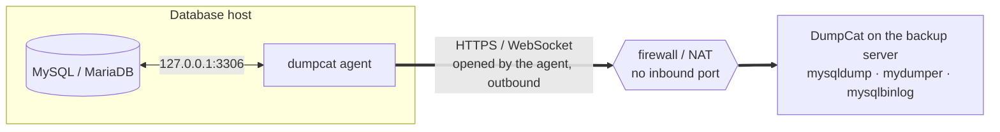
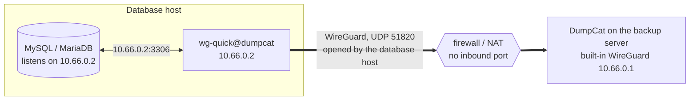

English · [Tiếng Việt](manual.vi.md) · [Back to the README](../README.md)

# DumpCat manual

The complete guide to installing, configuring and operating DumpCat. For an overview, see the [README](../README.md).

## Table of contents

1. [Features](#1-features)
2. [Choosing a backup method](#2-choosing-a-backup-method)
3. [Installation](#3-installation)
4. [Getting started](#4-getting-started)
5. [Configuring storage](#5-configuring-storage)
6. [Jobs, schedules, retention](#6-jobs-schedules-retention)
7. [Restore](#7-restore)
8. [Log archiving & point-in-time recovery (PITR)](#8-log-archiving--point-in-time-recovery-pitr)
9. [Manual recovery without DumpCat](#9-manual-recovery-without-dumpcat)
10. [Disaster recovery (reinstalling DumpCat)](#10-disaster-recovery)
11. [Security](#11-security)
12. [API & automation](#12-api--automation)
13. [System configuration](#13-system-configuration)
14. [Troubleshooting](#14-troubleshooting)
15. [Development](#15-development)

---

## 1. Features

| Area | Details |
|---|---|
| Databases | MySQL, MariaDB and Percona Server; **PostgreSQL** 10 and newer ([PostgreSQL](#postgresql)) |
| Methods | `mysqldump`/`mariadb-dump` (logical), `mydumper`/`myloader` (parallel logical), Percona XtraBackup / MariaBackup (physical, hot, **full + incremental**); PostgreSQL: `pg_dump` (directory format, tables in parallel) + `pg_dumpall --globals-only`, `pg_basebackup` (physical, the whole cluster) |
| Scope | All databases, selected databases, all except selected databases, per-table exclusions; routines, triggers, events; **users & grants** (separate `_users.sql` file) |
| Compression / encryption | zstd (default), multi-threaded gzip, none · **age** encryption (ChaCha20-Poly1305 + scrypt) with a passphrase |
| Integrity | SHA-256 for every file, size check after upload, **Verify integrity** (re-read → decrypt → decompress → check the `Dump completed` line / tar structure) on demand or automatically after every backup (new jobs: one copy, the cheapest to read back; or every copy) |
| Storage | Several targets per job (e.g. local + S3 + Google Drive); write to local storage first and then upload, or **stream directly** to the cloud without a temporary disk; bandwidth limit; **copy** an existing backup to another storage; browse the files on a storage |
| Scheduling | Cron (`0 2 * * *`, `@daily`, `@every 6h`), a separate schedule for incrementals, configurable time zone, preview of the next 5 runs |
| Retention | Keep the last N backups / N days / the last backup of each day, week and month (GFS), **per storage** (e.g. local keeps 3 backups, S3 keeps 30 days), incremental chains respected |
| Restore | Restore to any server (**another instance, host or version**, with DEFINER / collation / GTID rewrites), **restore under new names**, partial restore, drop target databases first, no binlog, Fast mode, restore users; physical: download the full + incremental chain → prepare → (optionally) **replace the datadir automatically** with rollback; PostgreSQL physical: a data directory recovered on the DumpCat host, optionally swapped in for the local cluster |
| Restore drills | On a schedule (MySQL, MariaDB and PostgreSQL), the newest backup is **restored into a sandbox** under temporary names, every table and its **row count** compared with the backup, custom SQL assertions run, the restore time (**RTO**) recorded and the copies dropped; backups that passed are marked **Restore-tested** |
| Point-in-time recovery | **Continuous log archiving**: MySQL/MariaDB binlogs (`mysqlbinlog --raw --stop-never`) and PostgreSQL WAL (`pg_receivewal` through a replication slot), compressed/encrypted like backups and uploaded to every storage of the job. Recovery to **a point in time / a binlog position / just before a GTID** (MySQL) or **a point in time / a restore point / a WAL position** (PostgreSQL) — picks the newest base backup automatically, downloads and checks every file before changing any data; retention follows the oldest kept backup |
| Connectivity | Directly, through the **agent** (the database host connects out over HTTPS; with `--allow-physical` it also runs physical backups there) or through the **built-in WireGuard** — no inbound port on the database host ([3.7](#37-database-hosts-that-accept-no-inbound-connections-agent), [3.8](#38-built-in-wireguard)) |
| Operations | Real-time progress (bytes, speed, %), live logs, task cancellation, limit on concurrent jobs, low priority (nice/ionice), pre/post commands, timeouts |
| Notifications | Email (SMTP, HTML with a plain-text version), Telegram, Slack, Discord, Webhook (HMAC-signed) — on failure and/or success |
| Monitoring | **Overdue-backup alerts** per job (from its schedule, or a max age) and **log archive lag** alerts (binlog / WAL), once per incident with a message when it clears; a **weekly digest** by email; Prometheus **`/metrics`** (bearer token or this machine only) |
| AI assistants | An **MCP** endpoint and `dumpcat mcp` for Claude Desktop, Claude Code and other MCP clients: status, backups, logs and failures, read-only by default; backups, verifications and drills with a full-access token |
| Security | bcrypt passwords, HttpOnly sessions + CSRF, lockout after repeated failed logins, TOTP 2FA, **single sign-on** with OpenID Connect (Google, Microsoft Entra ID, Keycloak, Authentik…), API tokens (read-only, full or Manage), roles, audit log, every password/cloud key encrypted at rest with AES-256-GCM, database passwords never on the command line |
| Disaster recovery | Every backup carries a `manifest.json` → install a fresh DumpCat, add the storage, click **Import backup catalog** and every backup is listed again. Backup files use standard formats (zstd/gzip/age/xbstream) — they can be restored even without DumpCat |

## 2. Choosing a backup method

| | mysqldump | mydumper | Physical (XtraBackup/MariaBackup) |
|---|---|---|---|
| Locks the database? | Not for InnoDB (`--single-transaction`) | A global lock for a few milliseconds to synchronize the threads, then no locking (`--trx-tables`); or `SAFE_NO_LOCK` | No InnoDB locking; the final step takes a very brief backup lock (`LOCK INSTANCE FOR BACKUP` / `BACKUP STAGE`) |
| Backup speed | 1 thread per database (several databases in parallel) | Multi-threaded, chunked by row count | Fastest (file copy, multi-threaded) |
| Restore speed | Slowest (1 thread per database) | Fast (parallel, indexes created afterwards) | **Very fast** (file copy + prepare) |
| Incremental | — | — | ✅ |
| Restore one database / rename | ✅ | ✅ | — (whole instance) |
| Other version / migrate to another server | ✅ | ✅ | Same major version |
| Requirements | MySQL client | mydumper/myloader | Runs **on the database server itself** (DumpCat there, or an [agent](#physical-backups-through-the-agent) with `--allow-physical`), tools matching the server version |

**Recommendations**

- Databases < 20–50 GB: nightly `mysqldump`, keep 7–14 backups, one copy local + one in the cloud.
- Large databases that need per-database restores: `mydumper` (8–16 threads, `chunk_rows` 500k).
- Very large databases (100 GB to several TB) or a low RTO: weekly **physical** full + hourly/daily incrementals, plus a weekly `mysqldump`/`mydumper` job for a flexible logical copy.
- Back up from a **replica** so the primary is not affected (enable `--slave-info` for physical backups).
- MyISAM/Aria tables are not guaranteed to be consistent in a lock-free logical backup — DumpCat warns when it finds them.

### PostgreSQL

Choose **PostgreSQL** as the *Database engine* when you add the server (the port becomes 5432; the unix socket field
takes the socket directory, e.g. `/var/run/postgresql`). Everything else works as for MySQL: storages, compression and
encryption, schedules, retention, verification, notifications, monitoring, agents (allow `127.0.0.1:5432`) and
WireGuard, restore drills. There are two methods, **`pg_dump`** (logical, per database) and **`pg_basebackup`**
(physical, the whole cluster, the base of point-in-time recovery).

**`pg_dump`**

- Each selected database is dumped with `pg_dump --format=directory --jobs=<threads>`: the tables of one database are
  dumped in parallel from one consistent snapshot, without locking writers. The directory is written to the staging
  directory (it needs about the size of the data, one database at a time), then stored as `<database>.pgdump.tar`
  through the usual compression, encryption and SHA-256. DumpCat counts the rows of every table from the dump itself
  (for restore drills).
- *Roles and tablespaces* (the job's users option) saves `pg_dumpall --globals-only` as `_globals.sql`: roles, their
  attributes and memberships. Passwords are included only when the backup account is a superuser (otherwise DumpCat
  passes `--no-role-passwords` and the roles are restored without a password).
- *Exclude tables*: `database.table` (a table in the search path, usually `public`) or `database.schema.table`; patterns
  as in `pg_dump --exclude-table`.
- "All databases" skips the templates (`template0`, `template1`) and databases that do not accept connections.
- Not with pg_dump: database-level settings (`ALTER DATABASE … SET`, `GRANT … ON DATABASE`), which pg_dump writes
  only for `--create` dumps. Set them again after restoring a database onto another server.

**`pg_basebackup`**

- Copies the whole cluster while it runs — every database, role and setting — over a **replication connection**:
  nothing to install on the database host, and it works through agents and WireGuard too. DumpCat runs
  `pg_basebackup --format=tar --wal-method=fetch --checkpoint=fast` and writes its tar stream (the data directory, the
  WAL of the backup in `pg_wal/`, `backup_manifest`) straight into the storage pipeline (compression, encryption,
  SHA-256) as `base.tar`, without a copy on the staging disk (on Windows the tar goes through the staging directory
  first: pg_basebackup cannot write binary data to a pipe there).
- A **temporary replication slot**, held by DumpCat while the backup runs, keeps the WAL of the backup on the server
  until it is fetched. The backup records where its WAL starts and ends (LSN), its timeline and the system identifier
  of the cluster.
- Full backups only, and clusters with **additional tablespaces** are not supported yet (use pg_dump for them).
- Restoring it prepares a data directory on the DumpCat host — see [Restore](#7-restore). With **WAL archiving** on the
  job, it is the base of [point-in-time recovery](#8-log-archiving--point-in-time-recovery-pitr).

**Account.** A role that can read everything, e.g. on PostgreSQL 14+:

```sql
CREATE ROLE dumpcat LOGIN PASSWORD 'a_strong_password';
GRANT pg_read_all_data TO dumpcat;
-- restores: a separate account that may create databases (and roles, to restore them)
CREATE ROLE dumpcat_restore LOGIN CREATEDB CREATEROLE PASSWORD 'another_password';
-- pg_basebackup and WAL archiving: the backup role must be allowed to replicate
ALTER ROLE dumpcat REPLICATION;
```

On PostgreSQL 13 and older, use the owner of the databases or grant `USAGE` on every schema and `SELECT` on every
table and sequence. `pg_hba.conf` must let the DumpCat host (or the agent's host) connect, e.g.
`host all dumpcat,dumpcat_restore 10.0.0.5/32 scram-sha-256`; pg_basebackup and WAL archiving also need
`host replication dumpcat 10.0.0.5/32 scram-sha-256`. The **Check** button of the server lists the role's attributes
and what is missing; the method cards say whether pg_basebackup can run.

**Client tools.** `pg_dump` refuses a server newer than itself, and `pg_restore` reads archives of its own version and
older ones. DumpCat finds every installed version (`/usr/lib/postgresql/<major>/bin`, `/usr/pgsql-<major>/bin`,
`C:\Program Files\PostgreSQL\<major>\bin`, the `tools` folder, or a path set in **Settings**) and uses the one of the
server's major version, or the nearest newer one. Install the client tools of your servers' major versions:
`sudo ./install.sh --postgres 16` (several: `--postgres 15,16`) or see [3.3](#33-backup-tools-for-manual-installs).
`pg_basebackup` and `pg_receivewal` come with the client tools. To let DumpCat **recover** a pg_basebackup backup
itself (and replace a local cluster), the PostgreSQL **server** of the backup's major version must be installed on the
DumpCat host too (`postgres`, `pg_ctl`; on a database host it already is); without it the restored directory is left
ready to recover and you start PostgreSQL on it yourself.

**Passwords and names.** The password is written to a private `PGPASSFILE` (mode 0600) in the task's directory, never
on a command line or in the environment. DumpCat builds the connection string itself and quotes every value, so a
database name such as `a=b` stays a name (`pg_dump -d "a=b"` would read it as connection options).

## 3. Installation

### 3.1 Quick install (recommended)

On the server, as a user with `sudo`:

```bash
curl -fsSL https://dumpcat.cc/install.sh | sudo sh
```

This downloads the latest package from `https://downloads.dumpcat.cc`, checks its SHA-256 against the release's
`SHA256SUMS`, unpacks it in a temporary folder and runs the `install.sh` inside it. Options of `install.sh` go after
`sh -s --`, e.g. `curl -fsSL https://dumpcat.cc/install.sh | sudo sh -s -- --port 9090`. A beginner's walkthrough is at
[dumpcat.cc/install](https://dumpcat.cc/install/).

Or download the package yourself: the latest version, its release notes and checksums are listed on
[dumpcat.cc](https://dumpcat.cc/#download), and the packages are served from `https://downloads.dumpcat.cc/<version>/`.

```bash
curl -fLO https://downloads.dumpcat.cc/1.7.0/dumpcat-1.7.0-linux.tar.gz
tar xzf dumpcat-1.7.0-linux.tar.gz
cd dumpcat-1.7.0-linux
sudo ./install.sh
```

The script installs the binary to `/opt/dumpcat/dumpcat` (linked from `/usr/local/bin/dumpcat`), creates `/etc/dumpcat/dumpcat.env`, the data directory
`/var/lib/dumpcat` and the `dumpcat` systemd service, and installs the tools that match the database server on the machine:
`rclone`, the MySQL/MariaDB client, `mariadb-backup` (MariaDB) or the matching Percona XtraBackup version (MySQL 5.7/8.0/8.4), and `mydumper` (if the repositories have it).
At the end it prints the address of the web UI and the one-time setup token for creating the admin account ([4. Getting started](#4-getting-started)).

Options: `--port 9090`, `--listen 127.0.0.1`, `--tls-auto` (self-signed HTTPS), `--postgres 16` (the PostgreSQL client
tools of that major version, from the PostgreSQL project's repository; several: `--postgres 15,16`), `--no-deps`,
`--uninstall [--purge]`.

### 3.2 Manual install

```bash
sudo install -D -m 0755 dumpcat-linux-amd64 /opt/dumpcat/dumpcat && sudo ln -sfn /opt/dumpcat/dumpcat /usr/local/bin/dumpcat
sudo mkdir -p /etc/dumpcat /var/lib/dumpcat && sudo chmod 700 /var/lib/dumpcat
sudo cp dumpcat.env.example /etc/dumpcat/dumpcat.env
sudo cp dumpcat.service /etc/systemd/system/
sudo systemctl daemon-reload && sudo systemctl enable --now dumpcat
```

### 3.3 Backup tools (for manual installs)

```bash
# Ubuntu/Debian
sudo apt install mariadb-client mariadb-backup     # MariaDB
sudo apt install mysql-client                      # MySQL
sudo apt install mydumper                          # optional, large databases
curl https://rclone.org/install.sh | sudo bash     # for S3/Drive/OneDrive/FTP...
# Percona XtraBackup for MySQL 8.0 (8.4: pxb-84-lts / percona-xtrabackup-84)
curl -O https://repo.percona.com/apt/percona-release_latest.generic_all.deb
sudo apt install ./percona-release_latest.generic_all.deb
sudo percona-release enable pxb-80 && sudo apt update && sudo apt install percona-xtrabackup-80
# PostgreSQL: the client tools of the server's major version (here 16), from apt.postgresql.org
sudo apt install postgresql-common && sudo /usr/share/postgresql-common/pgdg/apt.postgresql.org.sh -y
sudo apt install postgresql-client-16
sudo apt install postgresql-16          # optional: lets DumpCat recover pg_basebackup backups on this host
# RHEL/Rocky/Alma: the PGDG repository, then
sudo dnf install postgresql16
sudo dnf install postgresql16-server    # optional, as above
```

On Windows, install PostgreSQL (or only its command line tools) with the installer from postgresql.org:
`C:\Program Files\PostgreSQL\<major>\bin` is found automatically.

The **System** page in the UI lists which tools are present or missing, their versions and the commands to install them.

> **The physical backup tool must match the server version**: MariaBackup the same version as MariaDB; XtraBackup 8.0 ↔ MySQL 8.0, 8.4 ↔ 8.4, 2.4 ↔ 5.7. The server detail page tells you clearly when they do not match.

### 3.4 Behind nginx + HTTPS (recommended for production)

Set `DUMPCAT_LISTEN=127.0.0.1:6369` and `DUMPCAT_TRUST_PROXY=1`, and use the sample file `/etc/dumpcat/nginx-dumpcat.conf`
(buffering is disabled so large backup files can be downloaded). Or use the built-in HTTPS: `DUMPCAT_TLS_CERT`/`DUMPCAT_TLS_KEY`, or `DUMPCAT_TLS_AUTO=1`.

### 3.5 Windows

DumpCat also runs on Windows Server 2016+ / Windows 10+ (64-bit), as a Windows service.
The simplest way: download the `.zip` from [dumpcat.cc](https://dumpcat.cc/#download), unzip it and double-click
**Install DumpCat** (`Install DumpCat.cmd`); it asks Windows for administrator rights, runs `install.ps1` and opens the
web UI. Or in PowerShell **Run as administrator**, either the one-line installer:

```powershell
irm https://dumpcat.cc/install.ps1 | iex
```

or the same steps by hand:

```powershell
Invoke-WebRequest https://downloads.dumpcat.cc/1.7.0/dumpcat-1.7.0-windows-amd64.zip -OutFile dumpcat-1.7.0-windows-amd64.zip
Expand-Archive dumpcat-1.7.0-windows-amd64.zip -DestinationPath .
cd dumpcat-1.7.0-windows-amd64
powershell -ExecutionPolicy Bypass -File .\install.ps1
```

The script:

- copies `dumpcat.exe` to `C:\Program Files\DumpCat` and downloads `rclone.exe` into `C:\Program Files\DumpCat\tools`;
- creates the configuration `C:\ProgramData\DumpCat\dumpcat.env` and the data folder `C:\ProgramData\DumpCat\data`
  (only SYSTEM and Administrators can read it: it holds the database and the master key);
- registers the **DumpCat** service (automatic delayed start, restarted on failure), starts it and prints the address of the web UI
  and the one-time setup token for creating the admin account ([4. Getting started](#4-getting-started)).

Options: `-Port 9090`, `-Listen 127.0.0.1`, `-TlsAuto` (self-signed HTTPS), `-OpenFirewall` (opens the port for Domain/Private networks),
`-NoRclone`, `-NoService` (copy the files and write the configuration only — no admin rights needed; run `dumpcat.exe serve` yourself),
`-Uninstall [-Purge]`. Running the script again upgrades DumpCat in place and keeps the configuration and data.

- Service: `Restart-Service DumpCat` (after editing `dumpcat.env`), `Get-Service DumpCat`.
- Log: `C:\ProgramData\DumpCat\data\dumpcat.log` (rotated at 20 MB); backup/restore logs are in the web UI as usual.
- Command line (elevated PowerShell): `& "C:\Program Files\DumpCat\dumpcat.exe" user passwd -u admin`.
- Backup tools are found automatically in `C:\Program Files\MySQL\MySQL Server *\bin`, `C:\Program Files\MariaDB *\bin`,
  XAMPP, Laragon and WAMP. Otherwise copy `mysqldump.exe`/`mariadb-dump.exe`, `mysql.exe`, `mysqlbinlog.exe`… into the
  `tools` folder, list extra folders in `DUMPCAT_TOOLS_DIR` (separated by `;`), or set the paths on the **Settings** page.
  The **System** page shows what was found.

What works on Windows:

| Feature | Windows |
|---|---|
| Logical backup & restore (mysqldump / mariadb-dump), schedules, retention, verification, encryption | ✅ |
| All storages (local folder, network share, S3, Google Drive, OneDrive, FTP, SFTP… via rclone) | ✅ |
| Binlog archiving & point-in-time recovery from logical backups | ✅ |
| Physical backup of MariaDB (mariabackup), incl. incremental | ✅ backup + prepare; copying it into the datadir is manual (the restore log lists the steps) |
| mydumper / myloader | ❌ no Windows version |
| Physical backup of MySQL / Percona (XtraBackup) | ❌ XtraBackup only exists for Linux |
| Automatic datadir replacement, PITR from a physical backup | ❌ Linux only |
| PostgreSQL: pg_dump, pg_basebackup, WAL archiving, point-in-time recovery into a directory | ✅ (with the PostgreSQL server installed, DumpCat recovers the directory itself) |
| PostgreSQL: replacing the local cluster's data directory | ❌ Linux only |
| Lower CPU/IO priority for the backup tools (nice/ionice) | ❌ |

For large databases (hundreds of GB) and physical MySQL backups, run DumpCat on Linux.

### 3.6 Updating

DumpCat updates itself from a release server. The official packages use the project's server, `https://downloads.dumpcat.cc`.
If you build DumpCat yourself, you can host your own: any web server that serves static files will do.

**Publishing a release.** Set the version in `VERSION`, describe it under `## <version>` in `CHANGELOG.md`
(that section becomes the release notes shown in the UI), then build:

```bash
UPDATE_URL=https://downloads.dumpcat.cc ./build.sh
```

`UPDATE_URL` is optional; it becomes the default release server of the binaries you build (on Windows:
`.\build.ps1 -UpdateUrl https://…`). Upload the **content** of `dist/update/` to that address, so that it serves:

```
https://downloads.dumpcat.cc/latest.json
https://downloads.dumpcat.cc/1.7.0/dumpcat-linux-amd64    (… -linux-arm64, -windows-amd64.exe, SHA256SUMS, packages)
```

Upload the version folder first and `latest.json` last, so that installations never see a release whose files are not there yet.
The release server must use HTTPS.

**Pointing an installation at it:** **Settings → Updates** (or `DUMPCAT_UPDATE_URL`, or the address built in). DumpCat checks once a day
and shows "x.y.z available" to admins; nothing is installed automatically.

**Installing an update:** **System → Updates → Install**, or on the server:

```bash
sudo dumpcat update          # -check: only check · -yes: no prompt · -force: reinstall
```

(Windows, elevated PowerShell: `& "C:\Program Files\DumpCat\dumpcat.exe" update`.) What happens:

1. `latest.json` is read (and its **signature** checked, when a release key is configured — see below), the binary for this platform is
   downloaded and checked against its **SHA-256** and size, and the new binary is test-run.
2. DumpCat **waits for running backups, restores, verifications and copies** to finish (up to 12 hours; the update can be cancelled while it waits).
   Binlog archiving keeps running and resumes after the restart.
3. New tasks are held back for the few seconds of the restart; scheduled backups that become due meanwhile run right after it.
4. The **DumpCat database is backed up** (`<data>/update/dumpcat-<version>-<time>.db`, the last 3 are kept), together with the current binary.
5. The binary is replaced and DumpCat restarts (Linux: in place, systemd keeps tracking it; Windows: the service is restarted).
6. **Automatic rollback:** if the new version does not start — failed database upgrade, crash, port not available — the previous binary and the
   database snapshot are put back and the previous version starts again (right away after a startup error, on the 4th start after a crash loop).
   The System page shows what happened.

**Rolling back by hand:** **System → Updates → Roll back** (or `dumpcat update -rollback`) returns to the previous version and restores the
database from before the update. Changes made since the update (backup history, jobs, settings) are lost; backup files on your storages are not
touched — use **Import catalog** to list newer backups again.

With the service stopped, `dumpcat update` replaces the files directly; the update completes (or rolls back) when the service starts.
Installing a newer package with `install.sh` / `install.ps1` keeps working as before.

**Signed releases (recommended).** HTTPS and the SHA-256 values catch a broken or swapped download, but both come from the release
server: whoever takes over that server could publish a malicious binary. With a release key, installations only install a release whose
`latest.json` was signed with your **private key**, which never goes near the server (`latest.json` holds the SHA-256 of every binary, so
the signature covers the binaries too).

1. Create the key pair once, on the build machine (better: an offline machine or an encrypted disk):

   ```bash
   dumpcat release keygen -out ~/dumpcat-keys
   ```

   It writes `dumpcat-release.key` (private, mode 0600) and `dumpcat-release.pub` (public, base64) and prints the public key.

2. Build with the key:

   ```bash
   UPDATE_SIGNING_KEY=~/dumpcat-keys/dumpcat-release.key UPDATE_URL=https://downloads.dumpcat.cc ./build.sh
   ```

   (Windows: `.\build.ps1 -SigningKey D:\keys\dumpcat-release.key`, or `$env:UPDATE_SIGNING_KEY`.) The public key is built into the
   binaries and `dist/update/latest.json.sig` is written next to `latest.json`. Upload the version folder first, then `latest.json.sig`, then
   `latest.json`; a check that runs between the last two uploads fails once with a signature error and succeeds on the next one.
   Do not edit `latest.json` after signing — the signature covers its exact bytes. By hand: `dumpcat release sign -key dumpcat-release.key
   dist/update/latest.json`; to check before uploading: `dumpcat release verify -pub dumpcat-release.pub dist/update/latest.json`.

3. Installations running a build with the key refuse unsigned or modified releases from then on. Installations still running a build
   without a key accept unsigned releases until they install a signed build; to enforce signatures on them right away, set
   `DUMPCAT_UPDATE_PUBLIC_KEY=<public key>` in their env file (several keys: comma-separated). Keys from the environment are added to the
   built-in ones, they never replace them; a malformed key stops DumpCat from starting instead of silently turning the check off.
   **System → Updates** shows "Release signature: required" with the trusted keys, or "not checked" when integrity relies on HTTPS + SHA-256 only.

**Keeping the private key safe.** Whoever has `dumpcat-release.key` can push code to every installation.

- Never put it on the release server, in the source repository or in CI logs. Keep it on the build machine with mode 0600 (Windows: in a
  folder only your account can read), ideally on an encrypted or offline disk that is connected only to build a release.
- Keep an offline backup (encrypted USB stick, password manager). Without the key, installations that trust it can no longer be updated
  through the updater — only by installing a new package with `install.sh` / `install.ps1`.
- The public key and the `.pub` file are not secret.

**Rotating the key** (a new key, or the old one may have leaked). An installation accepts a release signed by **any** of its trusted keys,
and `latest.json.sig` can hold several signatures:

1. Create the new pair: `dumpcat release keygen -out ~/dumpcat-keys-new`.
2. Publish a transition release, still signed with the old key, whose binaries trust both keys:

   ```bash
   UPDATE_SIGNING_KEY=~/dumpcat-keys/dumpcat-release.key UPDATE_PUBLIC_KEYS="$(cat ~/dumpcat-keys-new/dumpcat-release.pub)" ./build.sh
   ```

   (Windows: `.\build.ps1 -SigningKey <old key file> -PublicKeys <new public key>`.) Updated installations show 2 trusted keys.
3. From the next release on, sign with the new key only: `UPDATE_SIGNING_KEY=~/dumpcat-keys-new/dumpcat-release.key ./build.sh` — those
   binaries trust only the new key. For installations that skipped the transition release, add the old signature as well:
   `dumpcat release sign -key old.key -key new.key dist/update/latest.json`.
4. Destroy the old private key once no installation trusts it anymore.

If the old key leaked, skip the double signature in step 3 and get installations onto a build without the old key quickly: until then
they would accept a release signed with it. Reinstall the package by hand where in doubt.

### 3.7 Database hosts that accept no inbound connections (agent)

When DumpCat cannot connect to the database (no port open to it, a firewall or NAT in between, MySQL listening on
127.0.0.1 only), install the **agent** on the database host. The agent is the same `dumpcat` binary: it connects **out**
to DumpCat over HTTPS (a WebSocket on the port of the web UI) and carries the database connections DumpCat asks for.
Nothing has to be opened on the database host; it only has to reach DumpCat. If you prefer a VPN, see
[3.8 Built-in WireGuard](#38-built-in-wireguard).



The agent opens the connection, so the firewall or NAT in front of the database host lets it out; the database traffic
then flows both ways inside it. DumpCat's tools connect to local ports on the backup server.

1. **Agents → Add agent** in the web UI (admins). DumpCat shows the agent key — once — and the install commands.
2. On the database host, as root:

   ```bash
   curl -fsSL https://dumpcat.cc/install.sh | sudo sh -s -- --agent --server https://backup.example.com --key dca_...
   ```

   (or, in the unpacked package: `sudo ./install.sh --agent --server … --key …`)

   On Windows, in the unzipped package, in PowerShell run as administrator:
   `powershell -ExecutionPolicy Bypass -File .\install.ps1 -Agent -Server https://backup.example.com -Key dca_...`
3. The agent shows as **Online** on the Agents page. Then **Database servers → Add server**, choose
   **Connect: Through agent …** and enter the database address **as seen from the agent host** — usually `127.0.0.1`
   port `3306`, or a socket. MySQL sees the connections coming from the agent host itself, so a backup user created for
   `'dumpcat'@'localhost'` / `'dumpcat'@'127.0.0.1'` works.

Everything that only needs a database connection works through an agent: mysqldump and mydumper backups, restores (also
to a server behind another agent), binlog archiving and point-in-time recovery. DumpCat gives its tools a local port per
database and the agent dials the database. Physical backups (XtraBackup / MariaBackup) copy the datadir, so the tool must
run on the database host: an agent started with `--allow-physical` does that (below).

- **What the agent may reach.** Only the local MySQL/MariaDB by default: `127.0.0.1:3306`, `[::1]:3306` and the usual
  socket paths. Allow other addresses with `--allow` (Windows: `-Allow`), comma separated, e.g.
  `--allow 127.0.0.1:3307,10.0.0.5:3306,unix:/var/lib/mysql/mysql.sock`; `*` allows any address. A leaked key therefore
  cannot be used to reach other machines on the database host's network. A server whose address is not allowed fails
  with *… is not on this agent's allow list* in the connection test and in the backup log.
- **Configuration**: `/etc/dumpcat/agent.env` (Windows: `C:\ProgramData\DumpCat\agent.env`), readable by root /
  Administrators only: `DUMPCAT_AGENT_SERVER`, `DUMPCAT_AGENT_KEY`, `DUMPCAT_AGENT_ALLOW`, `DUMPCAT_AGENT_INSECURE`,
  `DUMPCAT_AGENT_ALLOW_PHYSICAL`, `DUMPCAT_AGENT_DATADIR` (see `agent.env.example`). After editing: `systemctl restart dumpcat-agent` (Windows: `Restart-Service DumpCatAgent`).
  Running the installer again with new `--server`, `--key` or `--allow` values updates the file.
- **Service**: `dumpcat-agent` on Linux — it runs as a throwaway unprivileged user (systemd `DynamicUser`) without
  access to the file system (with `--allow-physical`: as the owner of the datadir); `DumpCatAgent` on Windows. Log: `journalctl -u dumpcat-agent -f`
  (Windows: `C:\ProgramData\DumpCat\agent.log`). By hand, in the foreground:
  `dumpcat agent -server https://backup.example.com -key dca_... [-allow ...] [-insecure] [-allow-physical]`.
- **Encryption**: the database traffic travels inside the agent's connection. Serve DumpCat over HTTPS when it crosses
  an untrusted network; with a self-signed certificate (`DUMPCAT_TLS_AUTO=1`) add `--insecure` to the agent. Behind
  nginx, the sample `nginx-dumpcat.conf` already passes WebSocket upgrades on `/api/agent/` with a long timeout.
- **Address in the commands**: the **Base URL** from **Settings** when set, otherwise the address your browser uses —
  set the Base URL when the database host reaches DumpCat under another name.
- **Keys** are shown once and stored hashed. **Rotate key** issues a new one and disconnects the agent at once (put it in
  `agent.env`, or run the installer again with `--key`). An agent still used by a server cannot be deleted.
- **Offline agent**: jobs fail with *agent … is offline — start it on the database host*. The agent reconnects by
  itself (every 2 s, backing off to 1 min) and binlog archiving resumes where it stopped. The Agents page shows the
  version of each agent; upgrade it by running the installer of the new version.
- **Uninstall**: `sudo ./install.sh --agent --uninstall [--purge]`, Windows: `.\install.ps1 -Agent -Uninstall [-Purge]`.

#### Physical backups through the agent

Physical backups read the database's files, so XtraBackup / MariaBackup has to run on the database host. Allow it on the
agent (it is off by default) and the agent runs the tool there when a job asks, streaming the backup back to DumpCat:

```bash
sudo ./install.sh --agent --server https://backup.example.com --key dca_... --allow-physical
```

(Windows: `-AllowPhysical`; by hand: `dumpcat agent ... -allow-physical`; in `agent.env`:
`DUMPCAT_AGENT_ALLOW_PHYSICAL=1`.) Install the backup tool on the database host — `mariadb-backup` for MariaDB, the
Percona XtraBackup series matching MySQL — and choose the **Physical** method for a server connected through the agent.

- **What happens**: DumpCat sends the job's settings and the backup user's credentials with each backup over the agent's
  authenticated connection. The agent writes them into a private option file, runs
  `mariabackup|xtrabackup --backup --stream=xbstream` and streams its output back; the option file is deleted when the
  tool exits — nothing is stored on the agent. DumpCat compresses, encrypts, uploads, verifies and applies retention
  exactly as for a local physical backup, and the tool's own log lines appear in the run log. Incrementals work the same
  way (`--incremental-lsn` from the previous backup).
- **Read access to the datadir**: on Linux, `--allow-physical` adds a systemd drop-in
  (`/etc/systemd/system/dumpcat-agent.service.d/physical.conf`) so the agent runs as the owner of the datadir (usually
  `mysql`, found from `my_print_defaults` or `/var/lib/mysql`) instead of a throwaway user. The Windows service runs as
  LocalSystem.
- **The Agents page** shows what each agent reported when it connected: the backup tool and its version, the OS user,
  and whether the datadir is readable (`DUMPCAT_AGENT_DATADIR`, default `/var/lib/mysql` or the usual location; each
  backup checks the server's own `@@datadir` again). The server page and the job editor say why the method is not ready:
  *start the agent with --allow-physical*, *mariabackup is not installed on …*, *cannot read the datadir …*, a tool that
  does not match the server version, or an agent too old to run physical backups (agents before this version keep
  working for everything else).
- **Cancelling** the run stops the tool on the database host. If the connection to the agent drops, the run fails and
  nothing partial is kept; rotating the agent's key also stops its running backups.
- **Limits of what DumpCat may ask**: the agent only backs up databases on its allow list, builds the command line
  itself and passes a job's *extra arguments* only when they are plain `--name[=value]` options that name no file,
  directory, program or other server (e.g. `--galera-info`, `--use-memory=1G`, `--kill-long-queries-timeout=30`).
- **Restore** happens where DumpCat runs (see [7. Restore](#7-restore)): DumpCat downloads and prepares the backup; copy the
  prepared directory to the database host and run `--copy-back` there (the restore log lists the commands), or restore
  onto an instance on the DumpCat host. *Apply right away* is not available through an agent.

### 3.8 Built-in WireGuard

An alternative to the agent: DumpCat can run a **WireGuard** endpoint itself, and the database hosts join it with the
standard WireGuard tools. It is **off by default** and nothing is installed for it: WireGuard runs inside DumpCat in
userspace, without a network interface, route or firewall rule on the DumpCat host — only DumpCat can reach the peers,
and only the database addresses of the servers you add.



The database host opens the tunnel and keeps it alive; DumpCat then reaches `10.66.0.2:3306` inside it.

1. **WireGuard** page (admins): tick **Turn on WireGuard**, keep or change the UDP port (`51820`) and DumpCat's VPN
   address (`10.66.0.1/24`), and set the **Endpoint for the peers** — the public name or IP the database hosts reach this
   server at (empty: the host of the Base URL). Open the UDP port in the firewall of the DumpCat host
   (`ufw allow 51820/udp`, Windows: an inbound UDP rule).
2. **Add peer** for each database host. DumpCat gives it the next free address (`10.66.0.2`…) and shows its
   `dumpcat.conf` — once, as it holds the peer's private key — with the commands to install it:

   ```bash
   apt install wireguard-tools        # RHEL / Rocky / Alma: dnf install wireguard-tools
   # save the file shown by DumpCat as /etc/wireguard/dumpcat.conf, then
   chmod 600 /etc/wireguard/dumpcat.conf
   systemctl enable --now wg-quick@dumpcat
   ```

   On Windows: install WireGuard, **Import tunnel from file**, **Activate**. The file routes only DumpCat's VPN address
   through the tunnel (`AllowedIPs = 10.66.0.1/32`) and sends a keepalive every 25 s, so the host can stay behind NAT and
   accept no inbound connections — it only needs to reach DumpCat on UDP.
3. On the database host, MySQL must accept the connections that arrive over WireGuard:
   - listen on the WireGuard address: `bind-address = 0.0.0.0`, or `127.0.0.1,10.66.0.2` (MySQL 8.0.13+, MariaDB 10.11+);
   - the backup user must be allowed from DumpCat's VPN address: `'dumpcat'@'10.66.0.1'` (DumpCat shows the SQL);
   - the host firewall must let the WireGuard interface in: `ufw allow in on dumpcat to any port 3306`.
4. **Database servers → Add server**, **Connect: Through WireGuard: <peer>**, host = the peer's address (`10.66.0.2`),
   port `3306`.

Notes:

- **Networks behind a peer**: a peer can be a gateway to other database servers on its network — add the network
  (e.g. `192.168.10.0/24`) to the peer and enter those servers' addresses. The gateway must forward the traffic
  (`net.ipv4.ip_forward=1` and a masquerade rule, or a route back to `10.66.0.1/32`).
- Through WireGuard, a server's host must be an IP address routed to its peer; unix sockets are not possible.
- **Status**: the WireGuard page shows for each peer the last handshake (connected = within 3 minutes), where it connects
  from and the traffic. DumpCat remembers where every peer was last seen, so after DumpCat restarts or WireGuard is
  turned off and on, it reconnects at once instead of waiting for the peer's next handshake.
- **Errors** are specific: *peer … has not connected yet* (WireGuard not running on the host, or UDP blocked), *no answer
  from …* (the host went away, or its firewall drops the WireGuard interface), *nothing listens on …* (MySQL does not
  listen on the WireGuard address).
- **Rotate keys** issues a new configuration for a peer; the old one stops working at once. Changing the port or the
  address of DumpCat does not change the peers' keys, but every `dumpcat.conf` must then be updated (Endpoint / AllowedIPs).
- Agent or WireGuard? The [agent](#37-database-hosts-that-accept-no-inbound-connections-agent) needs only outbound HTTPS
  and reaches MySQL on 127.0.0.1 with no MySQL changes. WireGuard uses standard, widely audited tools and UDP, but MySQL
  must listen on the WireGuard address. Physical backups work through an agent started with `--allow-physical`, not
  through WireGuard.

## 4. Getting started

1. Open `http://<server-ip>:6369` — the default port is **6369**, which spells *MEOW* on a phone keypad. While no account exists, the first visit shows the **Initial setup** screen:
   enter the **setup token**, choose the admin username and password, and you are signed in right away.
   The setup token is a one-time code that DumpCat creates when it starts without any account, so that nobody else who reaches the port
   can create the admin first. The installer prints it; to show it again:
   - Linux: `sudo dumpcat setup-token`, or the service log `journalctl -u dumpcat`;
   - Windows (PowerShell as Administrator): `& "C:\Program Files\DumpCat\dumpcat.exe" setup-token`, or the log `C:\ProgramData\DumpCat\data\dumpcat.log`.

   Every start of DumpCat creates a new token, and the token stops working once the admin account exists. After 5 wrong tokens, that
   IP address has to wait 15 minutes. You can also skip the web setup and create the admin from the command line:
   `sudo dumpcat user add -u admin -r admin`.
2. **Create a MySQL user for backups** (minimal, read-only privileges):
   ```sql
   -- MySQL 8 / Percona
   CREATE USER 'dumpcat'@'localhost' IDENTIFIED BY 'strong_password';
   GRANT SELECT, SHOW VIEW, TRIGGER, EVENT, LOCK TABLES, PROCESS, RELOAD,
         REPLICATION CLIENT, SHOW DATABASES ON *.* TO 'dumpcat'@'localhost';
   GRANT BACKUP_ADMIN ON *.* TO 'dumpcat'@'localhost';                -- physical backup
   GRANT SELECT ON performance_schema.log_status TO 'dumpcat'@'localhost';
   -- MariaDB
   GRANT SELECT, SHOW VIEW, TRIGGER, EVENT, LOCK TABLES, PROCESS, RELOAD,
         BINLOG MONITOR, CONNECTION ADMIN, SLAVE MONITOR, SHOW DATABASES ON *.* TO 'dumpcat'@'localhost';
   ```
   For **binlog archiving / PITR** (section 8) also: `GRANT REPLICATION SLAVE ON *.* TO 'dumpcat'@'localhost';`.
   Restores need write privileges → set up a **separate restore account** in the server form (*Separate account for restores*).
3. **Database servers** → *Add server* → *Test connection*: shows the version, datadir, binlog, the size of each database, privilege warnings, non-InnoDB tables and **which backup methods can be used** on this machine.
4. **Storage** → add at least one storage → click **Test** (test write/read/delete).
5. **Backup jobs** → *New job*: choose the server, method, databases, schedule, compression/encryption, storage and retention → *Save & run now*.
6. Follow the progress and the live log on the detail page; click **Verify integrity** to verify the backup; **Restore** when needed.

## 5. Configuring storage

| Type | Notes |
|---|---|
| **Local directory / NFS** | Fastest to restore from. Put it on a different disk than the datadir; mounted NFS/SMB shares work too. |
| **S3** | Enter the Access Key/Secret, region, bucket and prefix. For R2/MinIO/Wasabi... enter the *Endpoint*. Leave the key empty to use the EC2 instance's IAM role. Large files are uploaded as parallel multipart uploads (64 MiB chunks). Enable *Don't check/create the bucket* if the key is not allowed to create buckets. Bucket Object Lock / lifecycle rules can protect backups against ransomware. |
| **Google Drive** | **Option 1 (OAuth)**: create an OAuth Client ID of type *Desktop app* in the Google Cloud Console (with the Google Drive API enabled) → enter the Client ID/Secret → *Authorize with Google* → sign in → the browser is redirected to `http://127.0.0.1:53682/...` (and reports that the page cannot be reached — this is expected) → copy the whole URL and paste it into DumpCat. **Option 2**: on a machine with a browser, run `rclone authorize "drive"` and paste the JSON into the Token field. **Option 3**: a Service Account JSON (requires a Shared Drive or a shared folder, because service accounts have no storage quota of their own). |
| **OneDrive / SharePoint** | Create an App registration in Microsoft Entra ID, platform *Mobile and desktop applications* with the redirect `http://localhost:53682/` (or use `rclone authorize "onedrive"`). The Drive ID and drive type are detected automatically. |
| **FTP / FTPS** | Host, port, user, password; choose Explicit TLS (FTPES) or Implicit TLS (990). |
| **SFTP** | Password or private key (PEM). Good for pushing backups to another server or a NAS. |
| **WebDAV / Nextcloud / B2 / Azure / Dropbox** | Fill in the corresponding form. |
| **rclone (custom)** | Paste a complete rclone config section (`type = ...`) to use the remaining 70+ backends (Mega, pCloud, Box, SMB, Swift...). |

If a **Base URL** (HTTPS) is set in **Settings**, OAuth can use the *Automatic callback* mode with the redirect `https://<base-url>/api/oauth/callback`.

rclone refreshes OAuth tokens automatically, and DumpCat saves the new token (encrypted).

## 6. Jobs, schedules, retention

- **Schedule**: 5-field cron `minute hour day month weekday`. Examples: `0 2 * * *` (2 AM every day), `30 1 * * 0` (1:30 AM on Sundays), `0 */6 * * *` (every 6 hours), `@every 30m`. Empty = manual runs only.
- **Incremental (physical)**: a full schedule (e.g. weekly) + an incremental schedule (e.g. hourly). An incremental needs the previous full/incremental backup to be intact; otherwise a full backup runs automatically.
- **Retention policy** (a backup is kept if it matches *any* rule): `Keep last N backups`, `Keep for N days`, `Last backup of each day/week/month`. The newest backup is always kept. Each storage can override the number of backups/days. An incremental chain is only deleted together with its base full backup.
- **Concurrency**: at most 2 jobs at a time by default (**Settings**). A job never overlaps itself (a scheduled run that would overlap is skipped).
- **Reducing server load**: *Low priority* (nice + ionice), upload bandwidth limit, number of threads, backing up from a replica.
- **Pre/post command** (admin only): e.g. pause the application's cron jobs; the post-command receives the variables `DUMPCAT_STATUS`, `DUMPCAT_RUN_ID`, `DUMPCAT_JOB`, `DUMPCAT_DIR`, `DUMPCAT_METHOD`, `DUMPCAT_TYPE`.

### Monitoring: overdue backups, binlog lag, weekly digest

A failed backup sends its own notification, but a backup that never runs — DumpCat stopped, a schedule paused by
mistake, a run that hangs — sends nothing. So DumpCat checks every minute that every job has a recent backup.

- **Overdue jobs.** A job is overdue when its newest successful backup is older than 1.5 × the time between two of its
  scheduled runs plus a grace period (**Settings → Monitoring**, 60 minutes by default): a daily `0 2 * * *` job 37 hours
  after its last good backup, an hourly one after 2.5 hours. Exactly: the next backup is due half an interval plus the
  grace after the first run scheduled after the last good one, so gaps in a schedule count — with `0 2 * * 1-5`,
  Monday's backup is due on Monday at 14:00 + grace, not on Tuesday. Physical jobs with incrementals use the more
  frequent schedule. **Max age of the newest backup** on the job (*9. Notifications & status*) replaces the rule with a
  fixed number of hours, and also watches jobs without a schedule (backups started through the API). The job editor
  shows the window that applies.
- **Binlog lag.** For jobs with binlog or WAL archiving, an alert is raised when the archive has been behind the server
  for longer than the threshold (30 minutes by default, 0 = no alerts): the stream is down or not keeping up, or closed
  binlogs / WAL segments are waiting for upload.
- **Once per incident.** The alert goes once to the channels that send failures (for jobs with *Notify on failure*),
  with the last good backup, when the next one was due and the error of the last run; *Backups are fresh again* or
  *Binlog archiving caught up* follows when it clears. Open incidents survive a restart. Webhooks receive `kind`
  `stale` or `binlog_lag`, with `status` `failed` and then `recovered`.
- **Dashboard.** The overview uses the same rule: an *overdue* badge on the job and a warning with the time the backup
  was due.
- **Weekly digest.** Tick **Send the weekly digest** on an email channel (**Notifications**) to receive, at the day and
  hour set in **Settings → Monitoring** (Monday 08:00 by default), a summary of the last 7 days: backups per job
  (succeeded / failed), the size of the newest backup and its growth over the week, integrity checks, overdue jobs, the
  results of the restore drills (passed / failed, restore time, the error of a failed one), what every storage holds and
  the free space of local storages. **Preview** in Settings shows it with your data; **Send digest now** on the channel
  sends it at once.

### Directory layout on the storage

```
<storage root>/
  <job-name>/
    20261018-020000-full/
      manifest.json              # metadata: databases, files, sha256, binlog/GTID, LSN, versions...
      shop.sql.zst.age           # mysqldump: 1 file per database
      crm.sql.zst.age
      _users.sql.zst.age         # users & grants
    20261018-030000-full/
      mydumper.tar.age           # mydumper: the dump directory packed as a tar (the files inside are compressed by mydumper)
    20261019-010000-incr/
      backup.xbstream.zst        # physical: xbstream
    20261019-020000-full/
      shop.pgdump.tar.zst.age    # pg_dump: one directory-format archive per database, as a tar
      _globals.sql.zst.age       # roles and tablespaces (pg_dumpall --globals-only)
    20261020-020000-full/
      base.tar.zst.age           # pg_basebackup: the data directory and the WAL of the backup, as a tar
    binlog/                      # continuous binlog archive (PITR), compressed + encrypted like backups
      20261019/
        mysql-bin.000123.zst.age
    wal/                         # continuous WAL archive (PostgreSQL PITR), the same way
      20261020/
        00000001000000000000001A.zst.age
        00000002.history.zst.age # timeline history (kept by retention)
```

## 7. Restore

Open **Backups** → pick a backup → **Restore**.

**Logical (mysqldump / mydumper)**
- Restore to the source server or to another server; choose the databases; **restore under new names** (e.g. `shop` → `shop_restore` to compare without touching the live database).
- *Drop target databases before restoring* (you must type `RESTORE` to confirm). Before dropping anything, DumpCat opens and test-decrypts **every file** to be restored — a wrong passphrase or an unreachable storage stops the restore, and the current databases stay intact.
- *Fast mode*: temporarily sets `innodb_flush_log_at_trx_commit=2`, `sync_binlog=0` during the load and restores them afterwards (the original values are saved, even if DumpCat restarts midway) → much faster for large databases.
- *Don't write binlog* (`sql_log_bin=0`, also applied to DROP/CREATE DATABASE) so the restore is not replicated to replicas.
- Data is streamed: download → decrypt → decompress → `mysql` (no temporary files). mydumper backups are extracted to a temporary directory and loaded by `myloader` in parallel (indexes are created after the data is loaded).

**Physical (XtraBackup / MariaBackup)** — runs on the machine where DumpCat runs (also for backups taken through an
[agent](#physical-backups-through-the-agent): prepare them here, then copy the prepared directory to the database host
and run `--copy-back` there):
1. Download and extract the full backup + the whole incremental chain → `--prepare` (incrementals are applied in the correct order).
2. By default it stops here; the log prints instructions for a manual copy-back.
3. (Admin) *Apply right away*: stop the service → rename the old datadir to `datadir.before-restore-<timestamp>` → `--copy-back`/`--move-back` → `chown` → start. If any step fails, it **rolls back automatically** to the old datadir.

**PostgreSQL (pg_dump)**
- Each database is downloaded and extracted to the staging directory, created when it is missing (`TEMPLATE template0`
  with the source's encoding and locale; without the locale when the target does not have it) and loaded with
  `pg_restore --jobs=<threads> --exit-on-error`. The pg_restore used is at least as new as the pg_dump that wrote the
  backup.
- A database that already exists keeps its other objects: the objects in the backup are dropped and recreated
  (`--clean --if-exists`), like `DROP TABLE IF EXISTS` in a MySQL dump. *Drop target databases before restoring* drops
  the whole database first (sessions connected to it stop the drop).
- *Restore roles* runs `_globals.sql` first, statement by statement: roles the target does not have yet are created
  with their attributes, memberships and settings; roles that exist are left alone, and so are the restore account
  itself and the `pg_*` roles. Tablespaces are not created.
- *Skip ownership* (`--no-owner`) and *Skip privileges* (`--no-privileges`): for another server where the roles that own
  the objects (or that GRANTs name) do not exist. Both are suggested automatically for any server other than the
  source; leave them off when you restore the roles too.
- The target must be a PostgreSQL server; restoring onto an older major version may fail on features of the newer one
  (DumpCat warns).

**PostgreSQL (pg_basebackup)** — the cluster becomes a data directory on the machine running DumpCat:
1. `base.tar` is downloaded, decrypted and extracted into the extraction directory (default
   `<data dir>/restore/<job>-<backup>`, admins can choose another one; it must be empty).
2. **Recovery**: when the PostgreSQL server of the backup's major version is installed on this machine, DumpCat starts
   a temporary server on the directory — with its own configuration: 127.0.0.1 on a free port, no unix socket, no
   archiving, no preloaded libraries; as the *OS user* (default `postgres`) when DumpCat runs as root — waits until it
   has replayed the WAL (of the backup, or up to the point-in-time target, then promoted on a new timeline) and stops
   it. The directory is then a clean data directory: start PostgreSQL on it (it keeps the source's
   `postgresql.auto.conf`). As root, the OS user must be able to reach the directory: choose one such as
   `/srv/dumpcat-restore` (missing folders are created so that it can; the default under DumpCat's data directory is
   not reachable, and `/tmp` and `/var/tmp` are refused: they are the service's own, invisible to others and deleted
   when DumpCat stops). A cluster that kept its configuration outside the data directory (Debian/Ubuntu
   `/etc/postgresql`) gets a minimal `postgresql.conf`, `pg_hba.conf` (local connections) and `pg_ident.conf`, so that
   it starts on its own. Without the server binaries, the directory is left
   **ready to recover**: the recovery settings are in `postgresql.auto.conf` and `recovery.signal`, the WAL in
   `dumpcat_wal/`; copy it to the database host and start PostgreSQL there.
3. (Admin, Linux) *Replace PostgreSQL's data directory on this machine*: the backup is extracted and recovered **next
   to** the data directory (`<datadir>.dumpcat-restore-<time>`, same filesystem), then the service is stopped (detected:
   `postgresql@<major>-main`, `postgresql-<major>`, `postgresql`), the old directory renamed to
   `<datadir>.before-restore-<time>`, the recovered one moved in and the service started. Any error moves the old one
   back. The same checks as for MySQL datadirs apply (no system directory, nothing inside DumpCat's own data
   directory, a non-empty directory must contain `PG_VERSION`), and the version of the existing directory must match.

To go back to **any moment** (not only when a backup ran), use *Point-in-time recovery* — see
[section 8](#8-log-archiving--point-in-time-recovery-pitr) (MySQL / MariaDB binlogs, PostgreSQL WAL).

### Restoring to another instance (clone, migration, staging)

A logical backup can be restored to **any server DumpCat can reach** — another host, another port on the same host,
another MySQL / MariaDB version — for example to refresh a staging copy from production or to move to new hardware.

1. Pick the target in *Restore to server*, or click **New server** to add it in place (use a restore account with write
   privileges, see *Separate account for restores*).
2. DumpCat connects to it with the restore account and shows its version and flavor, the databases already on it,
   and any compatibility notes. Every database that would be overwritten on that target is listed in red and needs the
   typed `RESTORE` confirmation, whichever server it is.
3. *Compatibility with the target* — ticked automatically from what DumpCat found, and editable:
   - **Remove DEFINER** from views, routines, triggers and events: they are created with the restore account as definer.
     Needed when the original accounts don't exist on the target, or the restore user lacks `SET_USER_ID` / `SUPER`.
     Suggested for any server other than the source.
   - **Convert collations**: MySQL 8 `utf8mb4_0900_*` and MariaDB `*_uca1400_*` → `utf8mb4_unicode_ci` (or
     `utf8mb4_bin` for case-sensitive ones), `utf8mb3_*` → `utf8_*`. Suggested for MySQL 8 → MariaDB, MySQL 8 → 5.7 and
     MariaDB → MySQL.
   - **Skip GTID_PURGED** (mysqldump): drops `SET @@GLOBAL.GTID_PURGED`, which fails on a server that already has a GTID
     history and needs `SUPER`. Suggested when the dump contains it; keep it only to build a replica of the source.

   Only schema statements are rewritten while streaming: `INSERT` lines (row data) are passed through untouched.
   For mydumper backups the schema files are rewritten after extraction.
4. Combine with *restore under new names* to keep a copy next to existing databases, and with *Point-in-time recovery*
   to clone the source as it was at a given moment (binlogs cannot be replayed across MySQL and MariaDB).

Physical backups are restored on the machine running DumpCat (another instance on the same host: choose it in the
*Apply* box, which fills its datadir, service and owner). The target must run the same flavor and version series.
To restore a physical backup on **another machine**, install DumpCat there, add the same storage and use
**Import backup catalog** (section 10).

A physical restore takes about as long as decompression + prepare + copy (no SQL is replayed statement by statement) → usually tens of times faster than a logical restore for large databases.

### Restore drills (scheduled restore tests)

A backup that was never restored is a hope, not a backup. A **restore drill** proves on a schedule that a job's
backups really restore: DumpCat takes the newest successful backup of the job, restores it into a **sandbox server**
under temporary names, checks the copy and drops it again. Open **Restore drills** → **New drill** (or **Set up a
restore drill** on a backup, or **Restore drills** in a job's menu).

1. **What and where**: the backup job, the sandbox server (any server in **Database servers**; DumpCat connects with
   its restore account), optionally a subset of the databases. A staging or spare server is best.
2. **Schedule**: cron like jobs (e.g. `0 5 * * 0`, weekly on Sunday morning) — pick a quiet time after the backup; a
   drill takes one execution slot, like a backup. Empty = on demand only (**Run**, or **Drill this backup** on the
   backup page to test one particular backup).
3. **Checks** — always: the restore succeeds; every table of the backup exists in the copy (and no other); each table
   holds **exactly the rows the backup recorded**. DumpCat counts the rows of every table while it writes a dump
   (mysqldump and mydumper with INSERT statements), keeps them in the catalog and in `manifest.json`
   (`tables`), and shows the total per database on the backup page. Optionally, **assertions**: one `SELECT` each, run
   in a read-only session inside the copy of the chosen database; it passes when the first column of the first row is
   true (not NULL, 0 or empty), e.g. `SELECT MAX(created_at) > NOW() - INTERVAL 1 DAY FROM orders`.
4. **Maximum restore time**: your recovery time objective — the drill fails when downloading and loading the
   backup takes longer. Every result records the restore time (**RTO**) and the time the checks took.

Each run has its own page with progress, the checks (expected / actual, the tables whose rows differ) and the log.
A passed drill marks the backup **Restore-tested** in the backup list (a failed one **Drill failed**); the job list and
the backup page show the last result; a failing drill is reported on the dashboard and, with *Notify when a drill
fails*, through the notification channels (event kind `drill`; status `partial` when the copy passed but could not be
dropped).

**Safety**

- The copies are named `<database>__drill_<run id>` (cut to 64 characters; 63 bytes on PostgreSQL). Before creating anything the drill checks
  that none of these names exists on the sandbox and refuses to run otherwise: **a drill only ever drops the
  databases it created**. The names are recorded first, so the copies of a drill interrupted by a restart are dropped
  when DumpCat starts again.
- Definitions that name the source database (`TRIGGER shop.t … ON shop.items`, `` `shop`.`p` ``) are pointed at the
  copy, so nothing is created in the original database (this applies to every restore under a new name).
- The drill never restores users and grants, never changes global settings (no fast mode) and never replays binlogs.
  Portability rewrites (DEFINER, collations, GTID_PURGED) are applied as a restore onto that sandbox would suggest.
- The sandbox may be the job's **own source server**: the copies cannot collide with its databases, and nothing is
  written to its binary log (replicas and the binlog archive stay clean; the restore account needs `SUPER` /
  `BINLOG ADMIN`). The restore still loads the production server — a separate sandbox is safer. *Keep the drill out
  of the sandbox's binary log* does the same on any other sandbox.
- PostgreSQL: rows are counted with `SELECT count(*) FROM ONLY <table>` (each table on its own, as pg_dump copies it).
  For very large tables choose *Estimate after ANALYZE* in the drill: DumpCat runs `ANALYZE` on the copy and compares
  `pg_class.reltuples` (exact up to about 30,000 rows per table, close beyond); an estimate more than 10 % away from
  the backup is a warning, a missing table still fails. The copies are dropped `WITH (FORCE)` (PostgreSQL 13+), which
  ends sessions still connected to them. There is no binary log to keep the drill out of.
- Supported: logical backups — mysqldump with one file per database, mydumper and pg_dump. A single-file mysqldump restores
  under the original database names only and cannot be drilled; physical backups are not supported yet. Backups made
  before DumpCat counted rows are checked against the number of tables and views the server listed at backup time
  (a difference is a warning) and their row check is skipped.

## 8. Log archiving & point-in-time recovery (PITR)

A backup only takes you back to the moment it ran. Turn on **continuous log archiving** for a job to recover to *any moment*
after a backup — for example just before an accidental `DROP TABLE`. It is enabled in the job form, section
**8. Log archiving & point-in-time recovery**: *Continuous binlog archiving* for MySQL / MariaDB jobs, *Continuous WAL
archiving* for PostgreSQL `pg_basebackup` jobs ([PostgreSQL: WAL archiving](#postgresql-wal-archiving)). The upload to
the job's storages, the catalog, retention, lag monitoring and the recovery plan work the same for both.

### How it works (MySQL / MariaDB binlogs)

- Every job with archiving runs a background `mysqlbinlog --read-from-remote-server --raw --stop-never` (MariaDB:
  `mariadb-binlog`). It connects like a replica (its own server id: 3900000000 + job id) and copies the binary logs **byte for
  byte** into the staging directory `<staging>/binlog-<job id>/`. The password is passed through a temporary option file (0600),
  never on the command line.
- Every binlog the server has closed is compressed/encrypted like a backup file (zstd/gzip + age, with the job's passphrase),
  uploaded to **every storage of the job** at `<job>/binlog/<YYYYMMDD>/<file>`, size-checked after the upload and recorded in the
  catalog (file name, earliest/latest event time, size, SHA-256 before and after encryption, locations) before the staged copy is
  removed. A failing storage is retried (backing off up to 30 minutes); a file only leaves the staging directory once every storage
  has it.
- The file still being written is uploaded when the server rotates it. To bound how much could be lost, set
  **Close & upload the current binlog after (minutes)** (default 15): once the current file has held transactions for that long,
  DumpCat runs `FLUSH BINARY LOGS` (needs `RELOAD`). What has not been uploaded yet stays in DumpCat's staging directory and **is used
  by restores**.
- The stream restarts by itself when the connection drops (5 seconds, backing off to 2 minutes) and resumes from the partly
  received file or from the file after the last archived one. It reconnects when it stalls (the server keeps writing but nothing
  arrives for 3 minutes), and a received file whose size differs from the server's is downloaded again. Binlogs the server purged
  before they could be archived (binlog expiry too short, DumpCat stopped for long) are logged as "missing" — PITR cannot cross such
  a gap.
- First start: from the oldest binlog a kept backup of the job needs (if the server still has it), otherwise from the current one.
- mysqldump jobs with archiving always *Record binlog position*. Every backup records its binlog position (`binlog_file`,
  `binlog_pos`, GTID) and when its data was consistent (`consistent_at`). With one mysqldump file per database, **each database has
  its own snapshot position** and is replayed from exactly that position.

### Requirements (MySQL / MariaDB)

- `log_bin` and a `server_id` on the server. `binlog_format=ROW` is recommended (needed for exact *renamed* restores, see the notes).
  Keep binlogs on the server long enough for DumpCat to fetch them (`binlog_expire_logs_seconds` / `expire_logs_days`, at least a
  few hours).
- The backup user additionally needs `REPLICATION SLAVE` and `REPLICATION CLIENT` (MariaDB: `REPLICATION SLAVE`, `BINLOG MONITOR`),
  plus `RELOAD` to close binlogs periodically.
- `mysqlbinlog` (MySQL/Percona) or `mariadb-binlog` (MariaDB) on the DumpCat host, **of the same family as the server** — MySQL's
  tool cannot read MariaDB binlogs and vice versa. Check the **System** page.
- The restore user must be allowed to replay binlogs: MySQL `SYSTEM_VARIABLES_ADMIN` + `REPLICATION_APPLIER` (or ALL PRIVILEGES),
  MariaDB `SUPER` or `BINLOG REPLAY`.

### PostgreSQL: WAL archiving

- Every job with WAL archiving runs a background `pg_receivewal --slot=<slot> --no-loop` (not synchronous) over a
  replication connection into `<staging>/wal-<job id>/`; the password goes through a private password file.
- The **replication slot** `dumpcat_job<id>_<uuid>` is created when archiving starts: from then on the server keeps
  every WAL segment until DumpCat has received it — while DumpCat is stopped or the network is down too. That is what
  makes the archive complete, and also the risk: a stream that stays down lets WAL pile up on the server. Set
  `max_slot_wal_keep_size` to bound it (PostgreSQL 13+); when the server gives up WAL the slot needed, DumpCat logs a
  **gap**, creates the slot again and streams from the server's position — PITR cannot cross the gap, the next base
  backup starts a new chain. Turning archiving off, disabling or deleting the job, or moving it to another server
  **drops the slot**; stopping or updating DumpCat does not. If DumpCat is uninstalled, drop it yourself:
  `SELECT pg_drop_replication_slot('dumpcat_job…');`.
- Every completed segment (16 MB by default) and every timeline history file is compressed/encrypted, uploaded to every
  storage of the job at `<job>/wal/<YYYYMMDD>/<segment>` and recorded with what DumpCat read from it: the LSN range,
  the times of its first and last commit, the **restore points** created in it (`pg_create_restore_point`) and the
  cluster's system identifier. The segment being received stays local as `<segment>.partial` and **is used by
  restores**; the newest archived segment is kept in the staging directory so that `pg_receivewal` resumes right
  after it.
- **Close & upload the current WAL segment after (minutes)** runs `pg_switch_wal()` once the current segment has held
  commits for that long (a superuser, or `GRANT EXECUTE ON FUNCTION pg_switch_wal() TO dumpcat`). An idle server
  switches nothing.
- Requirements: `wal_level` replica (the default) or logical, a free `max_wal_senders` slot, the `REPLICATION`
  attribute and a `replication` line in `pg_hba.conf` (see [PostgreSQL](#postgresql)), `pg_receivewal` on the DumpCat
  host (the server's major version or newer), and `pg_basebackup` backups as bases: WAL can only be replayed on a
  physical copy of the cluster, so pg_dump jobs do not archive WAL. Archiving from a standby works (its own slot);
  closing segments there is up to the primary.

### Monitoring

The **Binlog / WAL & PITR** page shows, per job: the file being received, the server's current position, the lag (bytes / seconds),
files waiting for upload, the replication slot and how much WAL the server keeps for it (PostgreSQL), the last archived file, number
of files and size, the file list (with storages, LSN ranges and restore points) and the stream's log, with *Close binlog now* /
*Close segment now* (close & upload immediately) and *Restart*. The dashboard warns when archiving or uploads fail or more than 5
files are waiting; repeated failures send a notification (when the job notifies on failure).

### Recovering to a point in time

1. **Binlog / WAL & PITR** → *Restore to a point in time* (or the *Point-in-time recovery* card in the Restore form of a backup).
2. Choose where to stop (MySQL / MariaDB):
   - **Point in time** — transactions *committed* before that moment are replayed, later ones are not; never half a transaction.
     The time is entered in the browser's time zone.
   - **Before a GTID** — stops just before that transaction (e.g. the GTID of the `DROP TABLE`, found with `mysqlbinlog` or
     `SHOW BINLOG EVENTS`). MariaDB: `0-1-1234`, MySQL: `uuid:23`.
   - **Binlog position** — `file` + `position`: events starting at or after it are not replayed.
   - **Latest available** — every archived binlog plus what is still being received: the most recent state that can be recovered.

   PostgreSQL:
   - **Point in time** — as above (`recovery_target_time`, commits at that moment included).
   - **Restore point** — a point created on the server with `SELECT pg_create_restore_point('before_migration')`; the
     names found in the archived WAL are suggested.
   - **WAL position (LSN)** — e.g. `pg_current_wal_lsn()` noted before a risky change; the record at that position is
     the last one replayed.
   - **Latest available** — every archived segment plus the one still being received.
3. DumpCat picks **the newest backup whose data precedes that point** (logical full, or physical full + incremental chain), checks
   that the binlogs form an unbroken sequence from that backup's position to the target and shows the plan: base backup, number and
   size of binlog files, how far the binlogs are complete.
4. Fill in the restore form as usual (rename, drop target databases first, Fast mode, no binlog…). What happens:
   - **Before the target is touched**: every binlog needed is downloaded to the work folder, both SHA-256 sums are checked (stored
     and decoded), the start offsets are checked to be event boundaries, and the exact stop position is computed (time / GTID →
     position). Any error stops here with the target unchanged.
   - The base backup is restored (like a normal restore, including its pre-DROP checks).
   - Replay: `mysqlbinlog --start-position … --stop-position … file | mysql`, all files through **one client session** (temporary
     tables and session variables survive from one file to the next).
5. Logical restores (mysqldump / mydumper) replay only the changes of **the restored databases**, each from its own snapshot
   position, under the new name when renamed (`--database` + `--rewrite-db`; `CREATE/DROP/ALTER DATABASE` statements are renamed
   too). Transactions get new GTIDs (`--skip-gtids`; MariaDB: `gtid_seq_no` dropped) so they can be replayed on the source server
   itself.
   Physical restores need *Apply right away* and a server: once MySQL runs on the new datadir, DumpCat waits for it to accept
   connections and replays **all** binlogs of the instance (keeping the original GTIDs).
6. PostgreSQL: the base is always a `pg_basebackup` backup. The fetched segments (of every timeline after the base's,
   and the timeline history files) are read in a row before anything is changed: they must belong to the base's
   cluster and continue it without a gap, and a restore point must be in them. The restore then prepares the data
   directory ([Restore](#7-restore)) with the segments in `dumpcat_wal/`, `restore_command` reading them,
   `recovery_target_*`, `recovery_target_timeline = latest` and `recovery_target_action = promote`: PostgreSQL itself
   replays the WAL, stops at the target and starts a new timeline. A target time after the last commit in the WAL (or
   an LSN at its very end) replays everything instead — there is nothing between them, and PostgreSQL 13+ would
   otherwise stop with *recovery ended before configured recovery target was reached*. No *Apply* is needed:
   recovering into a directory works on Windows too.

### Notes

- `binlog_format=MIXED/STATEMENT`: filtering by database uses the statement's *default database* (`USE`) — statements naming
  another database explicitly (`UPDATE other.t …`) are not renamed and count for the session's default database. For **renamed**
  restores on the same server use `binlog_format=ROW` for exact results.
- Users / grants (`mysql.*`) and databases created after the backup are not replayed by logical restores (physical ones replay
  everything).
- `RESET MASTER`, or a physical restore onto the server itself, restarts the binlog numbering: DumpCat notices and starts a new
  sequence; PITR cannot cross that point — take a new backup right after it.
- Binlogs contain the changes of **every database** on the server (including databases the job does not back up); they are
  encrypted with the job's passphrase when the job encrypts.
- **Retention**: after each backup, on each storage, binlogs archived *before the oldest kept backup started* are deleted (no kept
  backup could replay them). Binlogs used by a running restore are never deleted.
- MySQL/Percona: replay needs a client of the server's major version; compressed binlogs (`binlog_transaction_compression`) need
  `mysqlbinlog` ≥ 8.0.20.
- PostgreSQL: the WAL holds **every database** of the cluster, and a recovery restores the whole cluster (no single
  database, no renaming). Timeline history files are never removed by retention. A promotion of the source (failover)
  is followed: segments of the newer timeline continue the chain.

### Manual replay (without DumpCat)

```bash
# decrypt + decompress the binlogs needed
for f in mysql-bin.000038 mysql-bin.000039; do
  dumpcat decode -in $f.zst.age -out $f          # or: age -d $f.zst.age | zstd -d > $f
done
# start position: binlog_file / binlog_pos in the backup's manifest.json (per database: databases[].binlog_pos)
mysqlbinlog --start-position=331316 --stop-datetime="2026-10-18 03:36:42" \
  --database=shop mysql-bin.000038 mysql-bin.000039 | mysql -u root -p
```

`mysqlbinlog --stop-datetime` uses the time zone of the machine running it and stops at the first *event* at or after that time
(possibly inside a transaction); DumpCat computes a stop position on a transaction boundary instead.

PostgreSQL: decode the base backup and the segments, then let PostgreSQL recover:

```bash
mkdir -p /restore/data && chmod 700 /restore/data
dumpcat decode -in base.tar.zst.age -out - | tar xf - -C /restore/data
mkdir /restore/data/dumpcat_wal
for f in 00000001000000000000001A 00000001000000000000001B; do
  dumpcat decode -in $f.zst.age -out /restore/data/dumpcat_wal/$f
done
cat >> /restore/data/postgresql.auto.conf <<'EOF'
restore_command = 'cp "dumpcat_wal/%f" "%p"'
recovery_target_time = '2026-10-20 09:30:00+07'
recovery_target_action = 'promote'
EOF
touch /restore/data/recovery.signal && chown -R postgres: /restore/data
sudo -u postgres pg_ctl -D /restore/data start      # replays, stops at the target, promotes
```

## 9. Manual recovery without DumpCat

Backup files use open formats. All you need is the `dumpcat` binary (or `age` + `zstd`):

```bash
# decrypt + decompress one file (the passphrase is prompted for, or taken from DUMPCAT_PASSPHRASE)
dumpcat decode -in shop.sql.zst.age -out shop.sql
mysql -e "CREATE DATABASE shop" && mysql shop < shop.sql

# stream straight into mysql
DUMPCAT_PASSPHRASE='...' dumpcat decode -in shop.sql.zst.age -out - | mysql shop

# without dumpcat: use age + zstd
age -d shop.sql.zst.age | zstd -d | mysql shop

# mydumper
dumpcat decode -in mydumper.tar.age -out mydumper.tar && mkdir dump && tar xf mydumper.tar -C dump
myloader --directory dump --threads 8 --drop-table

# pg_dump (PostgreSQL): one directory-format archive per database
dumpcat decode -in shop.pgdump.tar.zst.age -out shop.pgdump.tar && mkdir shop.dump && tar xf shop.pgdump.tar -C shop.dump
createdb -T template0 shop && pg_restore --jobs 4 --dbname shop shop.dump
dumpcat decode -in _globals.sql.zst.age -out globals.sql        # roles: review it, then psql -f globals.sql

# pg_basebackup (PostgreSQL): the cluster with the WAL of the backup; it is consistent once started
mkdir -m 700 /restore/pgdata && dumpcat decode -in base.tar.zst.age -out - | tar xf - -C /restore/pgdata
chown -R postgres: /restore/pgdata && sudo -u postgres pg_ctl -D /restore/pgdata -o "-p 5433" start
# (to a point in time: see "Manual replay" in section 8)

# physical (full + incremental)
dumpcat decode -in full/backup.xbstream.zst -out - | mbstream -x -C /restore/full      # MySQL: xbstream -x
mariabackup --prepare --target-dir=/restore/full
dumpcat decode -in incr/backup.xbstream.zst -out - | mbstream -x -C /restore/inc1
mariabackup --prepare --target-dir=/restore/full --incremental-dir=/restore/inc1
# (XtraBackup: add --apply-log-only to every step except the last one)
systemctl stop mariadb && mv /var/lib/mysql /var/lib/mysql.old
mariabackup --copy-back --target-dir=/restore/full && chown -R mysql:mysql /var/lib/mysql && systemctl start mariadb
```

## 10. Disaster recovery

If the server running DumpCat is lost:
1. Install a fresh DumpCat and create an admin.
2. Add the storage again (same bucket/directory).
3. **Storage** → menu → **Import backup catalog**: DumpCat scans the `manifest.json` files and lists every backup again (including incremental chains).
4. Restore as usual — for encrypted backups, enter the passphrase in the restore form.

The archived log catalog (PITR) is not imported: the files stay in `<job>/binlog/` or `<job>/wal/` on the storage and can be
replayed by hand (section 8); turn log archiving on for the new job and take a new backup to get PITR back. PostgreSQL: the old
installation's replication slot still keeps WAL on the server — drop it (`SELECT pg_drop_replication_slot('dumpcat_job…')`).

It is also worth backing up `/var/lib/dumpcat/master.key` and `dumpcat.db` (configuration, history) — or, at the very least, keep the encryption passphrase safe.

## 11. Security

- Put DumpCat behind HTTPS (nginx/caddy or the built-in TLS) and restrict access by IP or VPN.
- Until the first admin exists, creating it requires the one-time **setup token** (service log or `dumpcat setup-token`, see [4](#4-getting-started)), also for requests from localhost. A new token is created at every start; it is compared in constant time, 5 wrong tokens lock that IP for 15 minutes, and it is deleted once an account exists.
- Enable **2FA** for admins (**Profile & security**). **Settings** can also remind admins to enable 2FA when they sign in.
- Single sign-on with an OpenID Connect provider is optional; password sign-in stays as the fallback, and an account
  with 2FA still enters its code after SSO ([below](#single-sign-on-openid-connect)).
- Search engines are told not to index the sign-in page ([13](#search-engines)).
- Roles: **admin** (everything), **operator** (servers, cloud/FTP/SFTP storage, jobs, running backups/restores), **viewer** (read-only). Actions that touch the host's file system or credentials (local directory / custom rclone storage, S3 without an access key, which uses the host's own cloud identity, pre/post commands, extra tool arguments, choosing the extraction directory, replacing the datadir) are admin-only. Replacing a datadir is refused for system directories and for a directory that does not look like a MySQL/MariaDB datadir.
- 5 failed logins within 15 minutes from one address lock that account for that address for 15 minutes (others can still sign in); 20 failures from one IP lock that IP for 15 minutes. Attempts are counted before the password is checked, so parallel requests get no extra tries. A two-factor code works once.
- Behind a reverse proxy (`DUMPCAT_TRUST_PROXY=1`), the client address is `X-Real-IP` or the last `X-Forwarded-For` entry, the one the proxy added.
- Creating an API token asks for the account password (an account without one, which signs in with SSO only: a
  sign-in within the last 10 minutes; the same goes for turning its 2FA off). An admin resetting a user's password or disabling the account (or `dumpcat user passwd` / `disable`) also revokes that user's API tokens.
- An API token is **read-only** (the default) or has **full** access, the permissions of its user's role, or
  **Manage** access: full access that MCP also lets set up and change jobs, drills, servers and storages. Whatever
  the role, a read-only token can only look: no change, no backup download, no new token. Tokens created before
  1.5.0 have full access.
- The MCP endpoint for AI assistants (`/api/mcp`, [12](#ai-assistants-mcp)) accepts API tokens only, never the
  browser session, and each of its tools runs the matching API request with that token: it can do nothing the token
  cannot do over the API. Restores, deletions and settings are not available there, and no tool takes or returns a
  password, key or passphrase.
- Re-enter a server's or storage's password when you change its address or user, weaken its TLS mode, change its CA certificate or turn certificate checks off.
- Database passwords, cloud keys, OAuth tokens and passphrases are encrypted with AES-256-GCM using `master.key` (chmod 600). The key can be supplied through `DUMPCAT_MASTER_KEY` instead of a file. DumpCat refuses to start with a master key that does not belong to its database (for example `dumpcat.db` copied to another host without `master.key`), and a job that encrypts backups fails rather than storing anything unencrypted when its passphrase cannot be read.
- Database passwords are passed through a temporary option file (0600) that is deleted after use — they never show up in `ps`. Logs mask secrets automatically.
- The API never returns secret values (only a "saved" flag).
- Backup encryption (age) happens on the server before upload: the cloud provider cannot read the data. Use a long passphrase (≥ 16 characters).
- Agents ([3.7](#37-database-hosts-that-accept-no-inbound-connections-agent)) authenticate with a key stored only as a hash, open only the database addresses on their own allow list, and run without privileges. Database traffic goes inside the agent's connection: use HTTPS.
- The built-in WireGuard ([3.8](#38-built-in-wireguard)) is off by default and creates no network interface on the DumpCat host: peers reach nothing on it, and DumpCat reaches only the addresses routed to each peer. Its private key is encrypted with the master key; peer configurations are shown once.
- The service runs as root so it can do physical backups/restores. If you only use logical backups, you can create a dedicated user: `useradd -r dumpcat`, `chown -R dumpcat /var/lib/dumpcat`, and set `User=dumpcat` in the unit.

### Single sign-on (OpenID Connect)

Admins set it up in **Settings → Authentication**. Any provider with OpenID Connect discovery works; the guides
below cover Google, Microsoft Entra ID, Keycloak and Authentik.

1. Set the **Base URL** in **Settings → General** to the address people open DumpCat at (for example
   `https://backup.example.com`). The **Redirect URL** shown under Authentication follows it:
   `https://backup.example.com/api/auth/sso/callback`. Without a Base URL it is built from the address of the page.
2. At the provider, create a web application (a confidential client) with that redirect URL, and note its client ID
   and client secret.
3. In DumpCat, enter the **Issuer URL**, the **Client ID** and the **Client secret**, click **Test SSO**, then tick
   **Allow single sign-on** and save. Saving checks that the provider answers.

How a sign-in works:

- The sign-in page shows the SSO button (its label can be changed) under the password form. DumpCat uses the
  authorization code flow with PKCE (S256), a `state` bound to the browser by a cookie and used once, and a `nonce`.
  It checks the ID token's signature with the keys the provider publishes (RS256/384/512, PS256/384/512,
  ES256/384/512 or EdDSA; never `none` or a shared-secret HS* signature), the issuer, the audience, the expiry and
  the nonce. The client secret is encrypted with the master key like other secrets and is never shown again.
- The DumpCat account is the one linked to the provider account at an earlier sign-in. The first time, it is found
  by its **email address** (the `email` claim, or the claim set in **Email claim**); an address the provider marks
  as not verified is refused. From then on the account is linked to that provider account, so a later change of
  address at the provider does not matter. **Users** shows linked accounts with an **SSO** badge, and an admin can
  unlink one (for example after the user was recreated at the provider). Two accounts with the same address, or an
  account linked to another provider account, are refused.
- **Allowed email domains** (e.g. `example.com, example.org`) limit who may sign in with SSO.
- **Create accounts for new users** creates an unknown user at the first sign-in, with the **Role of new accounts**
  (the username is the provider's `preferred_username`, else the address). Without it an admin adds the account
  first in **Users**; while SSO is on, the password is optional there (an account without one signs in only with SSO).
- **Role from a claim**: name a claim (`groups`, `roles`, or a nested one such as `realm_access.roles`) and the
  values that give each role, comma-separated. Every SSO sign-in then sets the account's role to the highest one
  that matches, and a user with none of the values cannot sign in with SSO. The last active admin is never demoted.
  Claims missing from the ID token are read from the provider's userinfo endpoint.
- **Password sign-in**: everyone, or admins only (everyone else must use SSO). Admins can always sign in with their
  password: it is the way in when the provider is down or misconfigured.
- Two-factor authentication: a DumpCat account with 2FA also enters its code after SSO. Otherwise the provider's own
  MFA applies (set it up there); the reminder to enable 2FA in **Settings → Security** concerns password sign-ins.
- A locked account cannot sign in with SSO either. Failed SSO sign-ins count toward the per-address limit (20 in 15
  minutes). The audit log records `sso_login`, `sso_login_failed` (with the reason), `sso_test`, and accounts created
  or roles changed by SSO.
- **Test SSO** runs a sign-in with the settings of the form, saved or not, in a new tab, and shows the verified
  identity, every claim the provider sent (useful to pick the role claim) and what a real sign-in would do: which
  account it uses, whether it creates one, or why it would be refused. Nobody is signed in.

#### Google

1. In the Google Cloud console: **APIs & Services → OAuth consent screen**: *Internal* keeps sign-in to your Google
   Workspace accounts; *External* needs test users or publishing.
2. **Credentials → Create credentials → OAuth client ID**, type *Web application*, **Authorized redirect URIs**: the
   redirect URL.
3. In DumpCat: issuer `https://accounts.google.com`, the client ID and secret. Google sends `email` and
   `email_verified` but no groups: set **Allowed email domains** to your domain, and manage roles in DumpCat (or
   create accounts with the default role).

#### Microsoft Entra ID

1. Microsoft Entra admin center: **App registrations → New registration**, *Accounts in this organizational
   directory only*, redirect URI of type *Web*: the redirect URL.
2. **Certificates & secrets → New client secret**: copy its *Value*.
3. In DumpCat: issuer `https://login.microsoftonline.com/<tenant-id>/v2.0` (the *Directory (tenant) ID* on the
   app's Overview), client ID = *Application (client) ID*. A multi-tenant issuer (`/common`, `/organizations`) does
   not work: DumpCat checks that tokens come from your tenant.
4. Email: add the optional claim **email** in **Token configuration** (ID token), or set **Email claim** to
   `preferred_username` (the user principal name) when it is the address your DumpCat accounts use.
5. Roles (optional): define **App roles** (for example `DumpCat.Admin`, `DumpCat.Operator`), assign them in
   *Enterprise applications → Users and groups*, and set **Role from a claim** to `roles`. Or add a groups claim
   (**Token configuration → Add groups claim**): its values are the groups' object IDs.

#### Keycloak

1. In the realm: **Clients → Create client**, *OpenID Connect*, client ID `dumpcat`; **Client authentication** on,
   **Standard flow** on; **Valid redirect URIs**: the redirect URL. Copy the secret from the **Credentials** tab.
2. In DumpCat: issuer `https://<keycloak>/realms/<realm>` (Keycloak before version 17: `.../auth/realms/<realm>`).
3. Roles (optional): realm roles are in `realm_access.roles` (set **Role from a claim** to that); or add a *Group
   Membership* mapper to the client's dedicated scope with claim name `groups`, *Full group path* off, *Add to ID
   token* on, and use `groups`.

#### Authentik

1. **Applications → Providers → Create → OAuth2/OpenID Provider**, client type *Confidential*, redirect URI: the
   redirect URL (*strict*). Choose a **Signing Key** (a certificate): without one, authentik signs with the client
   secret (HS256), which DumpCat refuses.
2. **Applications → Create** with a slug, for example `dumpcat`, and that provider.
3. In DumpCat: issuer `https://<authentik>/application/o/<slug>/` (with the trailing slash), the client ID and
   secret. Groups come in the `groups` claim (from the *profile* scope). If sign-in is refused because the address
   is not verified, check what the provider's *email* scope mapping sends as `email_verified`.

## 12. API & automation

The **API & MCP** page (sidebar, under Administration; every role has it) is where scripts and AI assistants are set
up: it creates and revokes your API tokens, shows ready-to-copy setup for Claude Code, Claude Desktop, other MCP
clients and curl with this server's address and your token filled in, tests a token against the MCP endpoint as an
assistant would, and lists what an assistant can do with your role.

Create a token there with **New token** (with **Full** access for the requests below that start something; a
**Read-only** token can only look), then:

```bash
TOKEN=mv_xxxxxxxx
# run a job
curl -X POST -H "Authorization: Bearer $TOKEN" -H "Content-Type: application/json" \
     -d '{"type":"full"}' https://backup.example.com/api/jobs/1/run
# status of a backup
curl -H "Authorization: Bearer $TOKEN" https://backup.example.com/api/runs/42
# successful backups of job 1
curl -H "Authorization: Bearer $TOKEN" "https://backup.example.com/api/runs?job_id=1&status=success"
# run restore drill 3 now (optionally on one backup: {"run_id":42}), then read its result
curl -X POST -H "Authorization: Bearer $TOKEN" -H "Content-Type: application/json" -d '{}' https://backup.example.com/api/drills/3/run
curl -H "Authorization: Bearer $TOKEN" https://backup.example.com/api/drill-runs/7
```

### API reference in Markdown

`GET /api/docs.md` is the full API reference, written by the server itself from its routes, so it always matches the
version you run: authentication, conventions (errors, paging, logs, secrets), curl examples, the MCP tools, and every
route with the role and the kind of token it needs. It is Markdown so that AI models read it well: paste it into a
chat (**API & MCP → Copy Markdown** or **Download**), or let an agent fetch it with its token and then call the API:

```bash
curl -H "Authorization: Bearer $TOKEN" https://backup.example.com/api/docs.md
```

`GET /api/mcp/tools` lists the MCP tools as JSON, with the role and token access each one needs.

Webhook notifications send the JSON `{kind, status, title, fields, error, url, time}` with the header
`X-DumpCat-Signature: sha256=<HMAC>` when a secret is set. `kind` is `backup`, `restore`, `verify`, `binlog`, `stale`,
`binlog_lag` or `test`; `status` is `success`, `failed`, `partial` or `recovered` (an alert has cleared).

### AI assistants (MCP)

DumpCat is an [MCP](https://modelcontextprotocol.io) server, so Claude Desktop, Claude Code and other MCP clients can
work with it: see what failed or is overdue, list jobs and backups, read why a backup failed (its error and the end of
its log), check binlog / WAL archiving and restore drill results, and preview a point-in-time recovery. With a
full-access token of an operator or admin they can also start a backup, a verification, a restore drill or a storage
test, and with a **Manage** token they can set backups up: add and change database servers, storages, jobs and
restore drills (MCP clients ask you before they call such a tool). Restores, deletions and DumpCat's settings are not
available over MCP, and no setting turns them on. Secrets never go through MCP in either direction: you enter
passwords, keys and passphrases in the web UI (see *Setting backups up with an assistant* below).

1. On the **API & MCP** page, create a token for the assistant (**New token**). **Read-only** (the default) lets it
   look; **Full** also lets it start backups, verifications and drills; **Manage** also lets it set up and change
   jobs, drills, servers and storages. The page fills the new token into its setup
   snippets (the commands and files below, with your server's address), and **Test MCP connection** checks it the way
   an assistant would: the DumpCat version, the account and access the token has, and the tools it gets.
2. Connect the client, either straight to the endpoint `https://backup.example.com/api/mcp` (streamable HTTP, header
   `Authorization: Bearer <token>`), or through `dumpcat mcp`, a small stdio server that forwards to that endpoint, for
   clients that start a local command. `dumpcat mcp` reads `DUMPCAT_MCP_URL` and `DUMPCAT_MCP_TOKEN` (or
   `DUMPCAT_MCP_TOKEN_FILE`) from the environment or an env file, never from its command line, where other users of
   the computer could see them.

**Claude Code**, straight to the endpoint:

```bash
claude mcp add --transport http dumpcat https://backup.example.com/api/mcp --header "Authorization: Bearer mv_xxxxxxxx"
```

or, to share the server in a project without the token, a `.mcp.json` that takes it from your environment:

```json
{
  "mcpServers": {
    "dumpcat": {
      "type": "http",
      "url": "https://backup.example.com/api/mcp",
      "headers": { "Authorization": "Bearer ${DUMPCAT_TOKEN}" }
    }
  }
}
```

**Claude Desktop**: *Settings → Developer → Edit Config* opens `claude_desktop_config.json`. It needs the `dumpcat`
binary on the computer where Claude Desktop runs: the Windows package, `dumpcat-linux-amd64` on Linux; for macOS, which
has no release binary, build one with `CGO_ENABLED=0 GOOS=darwin GOARCH=arm64 go build -o dumpcat ./cmd/dumpcat`.

```json
{
  "mcpServers": {
    "dumpcat": {
      "command": "C:\\Program Files\\DumpCat\\dumpcat.exe",
      "args": ["mcp"],
      "env": {
        "DUMPCAT_MCP_URL": "https://backup.example.com",
        "DUMPCAT_MCP_TOKEN": "mv_xxxxxxxx"
      }
    }
  }
}
```

On Linux and macOS, `"command"` is the path of the binary, e.g. `"/usr/local/bin/dumpcat"`. To keep the token out of
that file, leave out `env` and write the two settings to `mcp.env` instead (`chmod 600`): `%AppData%\dumpcat\mcp.env`
on Windows, `~/.config/dumpcat/mcp.env` on Linux, `~/Library/Application Support/dumpcat/mcp.env` on macOS, or a file
given with `-config`:

```bash
DUMPCAT_MCP_URL=https://backup.example.com
DUMPCAT_MCP_TOKEN=mv_xxxxxxxx
```

The same command works in Claude Code
(`claude mcp add --transport stdio dumpcat -- dumpcat mcp`, with the settings in `mcp.env`) and in any MCP client that
starts a local server. Check the settings first:

```bash
dumpcat mcp -check
# OK: DumpCat 1.7.0 at https://backup.example.com/api/mcp (MCP 2025-11-25)
# Signed in as alice (role operator) with a read-only token: you can see what the account can see and change nothing
# 19 tools: get_overview, get_monitoring, list_servers, …
```

`dumpcat mcp` checks the server's certificate like the agent does. For DumpCat's self-signed certificate
(`DUMPCAT_TLS_AUTO`), copy `tls/cert.pem` from DumpCat's data directory and set `DUMPCAT_MCP_CA` to that file;
`DUMPCAT_MCP_INSECURE=1` turns the check off. Plain `http://` is accepted only for `localhost` (or with
`DUMPCAT_MCP_INSECURE=1`).

| Tool | What it does | Needs |
|---|---|---|
| `get_overview` | Counts, every job's last result and next run, running tasks, recent backups, warnings | viewer |
| `get_monitoring` | Overdue backups (the rule of the freshness alerts), binlog / WAL archiving state and lag, warnings | viewer |
| `list_servers`, `get_server` | Database servers, without passwords; `check_connection` connects to one and inspects it now | viewer |
| `list_jobs`, `get_job` | Jobs: schedules, storages, retention, last and next run, last drill | viewer |
| `list_backups`, `get_backup` | Backups by job, status or method; one backup's files, copies, verification, drills and progress | viewer |
| `get_log` | The end of the log of a backup, a restore, a drill run or a job's log archiving | viewer |
| `list_restores`, `get_restore` | Restores that were run, with status and error | viewer |
| `list_drills`, `list_drill_runs`, `get_drill_run` | Restore drills and their results, check by check | viewer |
| `list_storages`, `get_storage` | Storages, their settings without secrets (which secrets are set), last test and the jobs using them | viewer |
| `list_storage_types` | The storage types and the settings of each, secret ones marked | viewer |
| `preview_schedule` | Check a cron expression and show its next five times; changes nothing | viewer |
| `plan_pitr` | Point-in-time recovery preview: the base backup and whether the archived log reaches the target; changes nothing | operator |
| `run_backup` | Start a backup of a job now | operator, full token |
| `verify_backup` | Read a backup's copies back and compare every checksum | operator, full token |
| `start_drill` | Run a restore drill now | operator, full token |
| `test_storage` | Write, read back and delete a test file on a storage | operator, full token |
| `create_server`, `update_server` | Add or change a database server, without its passwords | operator, Manage token |
| `create_storage`, `update_storage` | Add or change a storage, without its secrets | operator, Manage token |
| `create_job`, `update_job` | Create or change a backup job (schedule, databases, storages, retention, options; pause with `enabled`) | operator, Manage token |
| `create_drill`, `update_drill` | Create or change a restore drill | operator, Manage token |

The tools are the same for every database engine. Each call runs the matching REST API request with the token, so it
is allowed, refused, written to the audit log and answered exactly as that request would be. Answers leave out
passwords, passphrases, storage keys, webhook addresses, pre/post commands and tokens, and mask credentials found in
errors and logs. The endpoint keeps no session: every request carries the token.

#### Setting backups up with an assistant

With a **Manage** token an assistant can do the setup you would do in the web UI, from a request such as *"back up
the shop database on db-01 every night at 1:30 to S3, keep 14 days"*: add the server and the storage, create the job
and a restore drill, then run the first backup and check it. Every new job or drill starts from the web UI form's
defaults (daily at 02:00, zstd, keep the last 7, verify one copy, notify on failure; drills on Sundays at 05:00), and a
change touches only the settings it names. Lowering retention removes older backups after the next backup, as in the
web UI.

Secrets never pass through the assistant. No tool takes a database password, a storage key or OAuth token, or an
encryption passphrase, and pre/post commands and extra tool arguments are left to the web UI. When something is
created without its secret, the answer carries `finish_url`, the page where you enter it: the server's or storage's
edit form (`#/servers?edit=<id>`, `#/storages?edit=<id>`), or the job's page. A job created with encryption waits
paused, unencrypted, until you set its passphrase there and enable it. Pointing a server or storage with a saved secret
at another host, port, endpoint or user needs the secret again, so that change is made in the web UI too. Local folder
and rclone storages need the admin role, as in the web UI.

A token with full access cannot use these tools (an assistant given one cannot change the configuration), and Manage
gives no more over the REST API than full access does.

### Prometheus metrics

`GET /metrics` serves metrics in the Prometheus text format. It is off by default; **Settings → Monitoring → Serve
/metrics**:

- **With a bearer token**: **Create token** shows the token once and stores it as a hash, like API tokens (**Replace
  token** invalidates the old one). Prometheus sends it in the `Authorization` header:

```yaml
scrape_configs:
  - job_name: dumpcat
    scheme: https
    authorization:
      credentials: dcm_xxxxxxxx
    static_configs:
      - targets: ['backup.example.com']
```

- **Only to this machine**: answers requests from 127.0.0.1 / ::1 that carry no `X-Forwarded-For`, `X-Real-IP` or
  `Forwarded` header (so a reverse proxy on the same host does not open it to everyone) — for Prometheus or its agent
  running on the DumpCat host.

| Metric | Labels | Value |
|---|---|---|
| `dumpcat_build_info` | `version`, `goversion`, `os`, `arch` | always 1 |
| `dumpcat_start_time_seconds` | | when DumpCat started |
| `dumpcat_job_enabled`, `dumpcat_job_running` | `job`, `server`, `method` | 1 or 0 |
| `dumpcat_job_last_success_timestamp_seconds` | `job`, `server`, `method` | start of the newest successful backup |
| `dumpcat_job_last_run_timestamp_seconds`, `dumpcat_job_last_run_duration_seconds` | `job`, `server`, `method` | newest finished backup |
| `dumpcat_job_last_run_success` | `job`, `server`, `method` | 1 when the newest finished backup succeeded |
| `dumpcat_job_last_run_status` | `job`, `server`, `method`, `status` | 1 for the status of the newest finished backup |
| `dumpcat_job_last_backup_size_bytes`, `dumpcat_job_last_backup_raw_bytes` | `job`, `server`, `method` | stored and uncompressed size of the newest successful backup |
| `dumpcat_job_last_verify_success`, `dumpcat_job_last_verify_timestamp_seconds` | `job`, `server`, `method` | the last integrity check |
| `dumpcat_job_stale`, `dumpcat_job_backup_due_timestamp_seconds`, `dumpcat_job_max_age_seconds` | `job`, `server`, `method` | the freshness rule ([6](#monitoring-overdue-backups-binlog-lag-weekly-digest)) |
| `dumpcat_binlog_archive_lag_seconds`, `dumpcat_binlog_streaming`, `dumpcat_binlog_pending_files`, `dumpcat_binlog_archived_until_timestamp_seconds` | `job`, `server` | binlog archiving |
| `dumpcat_storage_used_bytes`, `dumpcat_storage_binlog_bytes`, `dumpcat_storage_backups` | `storage`, `type` | what the catalog records on each storage |
| `dumpcat_storage_free_bytes`, `dumpcat_storage_size_bytes` | `storage`, `type` | file system of a local storage |
| `dumpcat_data_dir_free_bytes`, `dumpcat_data_dir_size_bytes` | | file system of the data directory |
| `dumpcat_agent_online`, `dumpcat_agent_last_seen_timestamp_seconds` | `agent` | |
| `dumpcat_wireguard_up`, `dumpcat_wireguard_peer_online`, `dumpcat_wireguard_peer_last_handshake_timestamp_seconds` | `peer` | |
| `dumpcat_catalog_backups` / `dumpcat_tasks_running` / `dumpcat_alerts_open` | `status` / `kind` / `kind` | backups in the catalog, running tasks, open alerts |

Timestamps are Unix seconds. Example alerting rules:

```yaml
groups:
  - name: dumpcat
    rules:
      - alert: DumpCatBackupOverdue
        expr: dumpcat_job_stale == 1
      - alert: DumpCatBackupFailed
        expr: dumpcat_job_last_run_success == 0
      - alert: DumpCatBinlogLag
        expr: dumpcat_binlog_archive_lag_seconds > 1800
      - alert: DumpCatAgentOffline
        expr: dumpcat_agent_online == 0
        for: 10m
```

## 13. System configuration

`/etc/dumpcat/dumpcat.env` (run `systemctl restart dumpcat` after editing):

| Variable | Default | Description |
|---|---|---|
| `DUMPCAT_LISTEN` | `:6369` | Listen address |
| `DUMPCAT_DATA_DIR` | `/var/lib/dumpcat` | Internal database, master key, logs, temporary directories |
| `DUMPCAT_BASE_URL` | | Public URL (links in notifications, OAuth callback) |
| `DUMPCAT_TLS_CERT` / `DUMPCAT_TLS_KEY` | | HTTPS with your own certificate |
| `DUMPCAT_TLS_AUTO` | `0` | HTTPS with a self-signed certificate |
| `DUMPCAT_TRUST_PROXY` | `0` | Trust `X-Forwarded-*` headers when running behind a proxy |
| `DUMPCAT_MASTER_KEY` | | Encryption key (base64, 32 bytes) instead of the key file |
| `DUMPCAT_TOOLS_DIR` | | Extra directories to search for tools (`:`-separated, `;` on Windows) |
| `DUMPCAT_UPDATE_URL` | | Release server for updates ([3.6](#36-updating); **Settings → Updates** takes precedence) |
| `DUMPCAT_UPDATE_ALLOW_HTTP` | `0` | Allow a plain-HTTP release server (not recommended) |
| `DUMPCAT_UPDATE_PUBLIC_KEY` | | Release signing public key(s), base64, comma-separated; added to the keys built in. With a key, only signed releases are installed ([3.6](#36-updating)) |
| `DUMPCAT_LOG_FILE` | | Also write the log to this file, rotated at 20 MB (a Windows service logs to `<data>\dumpcat.log`) |

In the UI (**Settings**): time zone, number of concurrent jobs, staging directory, default thread count, idle session timeout, history retention, extra rclone flags, the path of each tool (e.g. for several xtrabackup versions), the instance name and logo, search-engine indexing and single sign-on ([11](#single-sign-on-openid-connect)).

Command line:

```bash
dumpcat serve                     # run the server (used by the systemd unit)
dumpcat user add -u bob -r operator
dumpcat user passwd -u admin      # forgotten admin password
dumpcat user reset-2fa -u admin   # lost 2FA device
dumpcat user list
dumpcat setup-token               # one-time token for creating the first admin in the web UI
dumpcat agent -server URL -key K  # on a database host that accepts no inbound connections (3.7)
dumpcat mcp [-check]              # serve DumpCat's tools to an AI assistant over stdio (12)
dumpcat decode -in file.sql.zst.age -out file.sql
dumpcat version
```

Internal data: `/var/lib/dumpcat/dumpcat.db` (SQLite), `master.key`, `logs/`, `staging/` (temporary), `restore/` (default for physical restores),
`setup-token` (only until the first admin exists).

### Branding

**Settings → Branding** gives the instance a name and a logo, for example to tell several DumpCat instances apart.

- The **instance name** replaces "DumpCat" in the sidebar, the browser tab, the sign-in page, the authenticator app
  (for 2FA set up from then on) and notifications; email subjects start with `[name]`.
- The **logo** (PNG, SVG or WebP, at most 256 KB, admins only) replaces the cat in the sidebar, on the sign-in page
  and as the tab's icon. Emails show it when it is a PNG (mail clients do not show SVG or WebP). DumpCat checks the
  file's content, not its name: an SVG must be a plain drawing, without scripts, event handlers, embedded documents
  or links to other files, and it is served with a policy that keeps anything in it from running.
- **Reset to default** brings back the name DumpCat and the cat.

### Search engines

An installed DumpCat asks search engines not to index it: `/robots.txt` disallows everything, every answer carries
`X-Robots-Tag: noindex, nofollow` and the page has a robots meta tag, so the sign-in page does not show up in search
results. **Settings → Security → Let search engines index this instance** lifts all three; use it only for a public
demo.

## 14. Troubleshooting

| Symptom | Fix |
|---|---|
| Initial setup: *incorrect setup token* | DumpCat creates a new token at every start: show the current one with `sudo dumpcat setup-token` (Windows: `dumpcat.exe setup-token` as Administrator). After 5 wrong tokens, wait 15 minutes |
| *missing tool ...* | Check the **System** page, install as instructed, click *Re-detect tools* |
| Physical backup says the datadir is not accessible | DumpCat must run on the database server itself, as root (or as a user in the `mysql` group with read access to the datadir) — or connect the server through an agent with `--allow-physical` |
| *the agent does not allow physical backups* / *cannot read the datadir* | Run the installer on the database host again with `--allow-physical` (it runs the agent as the datadir's owner); check the Agents page |
| `xtrabackup ... unsupported server version` | Install the XtraBackup series matching MySQL (8.0/8.4), at a patch level ≥ the server's |
| `Access denied` during a restore | Use a *separate restore account* with write privileges. *Don't write binlog* needs `SUPER`/`SYSTEM_VARIABLES_ADMIN`/`BINLOG ADMIN` — without it the restore stops right at the start, before changing anything. Without the privileges, *Fast mode* is skipped with a warning |
| Slow uploads | Increase `--transfers`, `--s3-upload-concurrency` in *Extra rclone flags*; check the job's bandwidth limit |
| `FLUSH TABLES WITH READ LOCK` waits a long time | A very long query is running: use *Long query guard* (mydumper) / *ftwrl-wait-timeout* (physical), or back up from a replica |
| Lost encryption passphrase | The backup cannot be decrypted — always keep the passphrase in a password manager |
| Binlog & PITR: *binary logging is disabled (log_bin=OFF)* | Enable `log_bin` and `server_id` in my.cnf and restart MySQL/MariaDB |
| Binlog & PITR: *SHOW BINARY LOGS … REPLICATION CLIENT* / `Access denied` while streaming | Grant `REPLICATION SLAVE` + `REPLICATION CLIENT` (MariaDB: `BINLOG MONITOR`) to the backup user |
| PITR: *binlogs are only archived up to …* / *WAL segments are only archived up to …* | Click *Close binlog now* / *Close segment now* on the **Binlog / WAL & PITR** page and wait a few seconds for the upload, or choose *Latest available* |
| PITR: *… has not been archived* / *sequence is broken* | The server purged binlogs before they were archived, or the numbering was reset: keep binlogs longer on the server and take a new backup as a starting point |
| Agent: *agent … is offline* | Start the agent on the database host (`systemctl status dumpcat-agent`, `journalctl -u dumpcat-agent`). *the server refused the agent* in its log: wrong or rotated key, or the URL is not DumpCat. Behind nginx, use the `/api/agent/` block of the sample configuration |
| WireGuard: *peer … has not connected yet* / *no answer from …* / *nothing listens on …* | See [3.8](#38-built-in-wireguard): start `wg-quick@dumpcat` on the database host and open the UDP port on the DumpCat host; let the WireGuard interface in on the database host; make MySQL listen on the WireGuard address |
| Agent: *… is not on this agent's allow list* | Start the agent with `--allow host:port` for that address, or enter the address the agent allows (see [3.7](#37-database-hosts-that-accept-no-inbound-connections-agent)) |
| No alert for an overdue job | **Alert when a job has no recent successful backup** in **Settings → Monitoring**, *Notify on failure* on the job, and a channel that sends failures |
| `/metrics` answers 404 / 401 / 403 | 404: turned off (**Settings → Monitoring**). 401: create a token and send it as `Authorization: Bearer …`. 403: *Only to this machine* and the request came from another host or through a reverse proxy |
| `dumpcat mcp`: *refused the API token* / *certificate signed by unknown authority* / *would send the API token unencrypted* | Create a new token (revoked when an admin resets your password or locks the account; check its expiry). Self-signed certificate: set `DUMPCAT_MCP_CA` to DumpCat's `tls/cert.pem`. Use the `https://` address, or `DUMPCAT_MCP_INSECURE=1` |
| PostgreSQL: *pg_dump N is older than PostgreSQL M* / *server version mismatch* | Install the client tools of the server's major version (`install.sh --postgres M`, `postgresql-client-M`); DumpCat picks the matching one by itself |
| PostgreSQL: *permission denied for table / schema / sequence* during a backup | The backup role cannot read everything: `GRANT pg_read_all_data TO dumpcat` (PostgreSQL 14+), or use the owner of the database |
| PostgreSQL: *role "…" does not exist* during a restore | Tick *Restore roles*, or *Skip ownership* and *Skip privileges* |
| PostgreSQL: *database "…" is being accessed by other users* | *Drop target databases* cannot drop a database others are connected to: disconnect them, or restore under a new name |
| PostgreSQL: *no pg_hba.conf entry for host …* | Add a `host … scram-sha-256` line for the DumpCat host (or the agent's) to `pg_hba.conf` and reload PostgreSQL |
| PostgreSQL: *no pg_hba.conf entry for replication connection* / *needs the REPLICATION attribute* | pg_basebackup and WAL archiving: `ALTER ROLE dumpcat REPLICATION` and a `host replication dumpcat <DumpCat host>/32 scram-sha-256` line |
| PostgreSQL: *requested WAL segment … has already been removed*, a WAL **gap** in the archive log | The server removed WAL before DumpCat had it (slot lost through `max_slot_wal_keep_size`, slot dropped by hand): DumpCat streams from the server's position again; take a new pg_basebackup as the next base |
| PostgreSQL: the server's disk fills with WAL | A WAL archiving job whose stream is down keeps WAL through its slot: fix the stream (**Binlog / WAL & PITR** page, its log), or turn archiving off (drops the slot); set `max_slot_wal_keep_size` |
| PostgreSQL: *Cannot close the current WAL segment (pg_switch_wal() …)* | `GRANT EXECUTE ON FUNCTION pg_switch_wal() TO dumpcat`, or set the close interval to 0 |
| PostgreSQL restore: *the directory is left ready to recover* | The PostgreSQL server of the backup's version is not installed on the DumpCat host (or, as root, the OS user cannot reach the directory): start PostgreSQL on the directory yourself, or install `postgresql-<major>` and restore again |
| PostgreSQL restore: *recovery ended before configured recovery target was reached* | The target is after the WAL archived when the restore started: close the segment and retry, or choose *Latest available* |
| Service logs | `journalctl -u dumpcat -f`; per-task logs on the detail page or in `/var/lib/dumpcat/logs/` |

## 15. Development

Requires Go ≥ 1.26. See [CONTRIBUTING.md](../CONTRIBUTING.md) for how to propose changes.

```bash
go test ./...
go build -o dumpcat ./cmd/dumpcat
DUMPCAT_DATA_DIR=./data DUMPCAT_LISTEN=127.0.0.1:6369 DUMPCAT_WEB_DIR=./web ./dumpcat serve   # edit the UI without rebuilding
./build.sh        # Linux amd64/arm64 + Windows amd64 binaries, release .tar.gz and .zip in dist/
```

Source layout:

```
cmd/dumpcat        CLI (serve, agent, user, decode, update, release)
internal/api       REST API, authentication, authorization, serves the UI
internal/runner    orchestrates backup/upload/retention/verify/restore/catalog import, log archiving and PITR (every engine)
internal/engine    the driver interfaces; MySQL: mysqldump, mydumper, xtrabackup/mariabackup, mysql/myloader, binlog archiving & replay
internal/pgsql     PostgreSQL: pg_dump/pg_restore, pg_basebackup, WAL archiving (pg_receivewal), WAL reader, recovery
internal/drivers   the database engines DumpCat knows
internal/binlog    binlog reader: event boundaries, times, GTIDs, PITR stop points
internal/storage   local + rclone (S3, Drive, OneDrive, FTP, SFTP...), OAuth
internal/pipeline  streaming zstd/gzip compression + age encryption + sha256
internal/store     SQLite: users, servers, storages, jobs, backups, audit
internal/scheduler cron
internal/notify    Email, Telegram, Slack, Discord, Webhook, the weekly digest
internal/monitor   overdue-backup and log archive lag alerts, weekly digest schedule, Prometheus metrics
internal/update    self-update: release manifest, signatures, install & rollback
internal/agent     agents: reverse tunnel from database hosts (WebSocket), allow lists
internal/wg        built-in WireGuard (wireguard-go + gVisor netstack, no OS interface)
internal/tunnel   local tunnel ports: piping, MySQL error packets
web/               UI (plain HTML/CSS/JS, no external dependencies)
scripts/install.sh Linux installer · deploy/ systemd unit, sample env, nginx
```
