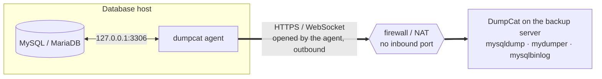
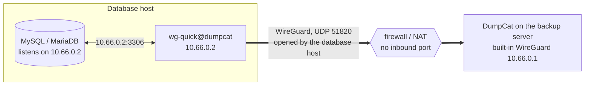

English · [Tiếng Việt](manual.vi.md) · [Back to the README](../README.md)

# DumpCat manual

The complete guide to installing, configuring and operating DumpCat. For an overview, see the [README](../README.md).

## Table of contents

1. [Features](#1-features)
2. [Choosing a backup method](#2-choosing-a-backup-method)
3. [Installation](#3-installation)
4. [Getting started](#4-getting-started)
5. [Configuring storage](#5-configuring-storage)
6. [Jobs, schedules, retention](#6-jobs-schedules-retention)
7. [Restore](#7-restore)
8. [Binlog archiving & point-in-time recovery (PITR)](#8-binlog-archiving--point-in-time-recovery-pitr)
9. [Manual recovery without DumpCat](#9-manual-recovery-without-dumpcat)
10. [Disaster recovery (reinstalling DumpCat)](#10-disaster-recovery)
11. [Security](#11-security)
12. [API & automation](#12-api--automation)
13. [System configuration](#13-system-configuration)
14. [Troubleshooting](#14-troubleshooting)
15. [Development](#15-development)

---

## 1. Features

| Area | Details |
|---|---|
| Methods | `mysqldump`/`mariadb-dump` (logical), `mydumper`/`myloader` (parallel logical), Percona XtraBackup / MariaBackup (physical, hot, **full + incremental**) |
| Scope | All databases, selected databases, all except selected databases, per-table exclusions; routines, triggers, events; **users & grants** (separate `_users.sql` file) |
| Compression / encryption | zstd (default), multi-threaded gzip, none · **age** encryption (ChaCha20-Poly1305 + scrypt) with a passphrase |
| Integrity | SHA-256 for every file, size check after upload, **Verify integrity** (re-read → decrypt → decompress → check the `Dump completed` line / tar structure) on demand or automatically after every backup (new jobs: one copy, the cheapest to read back; or every copy) |
| Storage | Several targets per job (e.g. local + S3 + Google Drive); write to local storage first and then upload, or **stream directly** to the cloud without a temporary disk; bandwidth limit; **copy** an existing backup to another storage; browse the files on a storage |
| Scheduling | Cron (`0 2 * * *`, `@daily`, `@every 6h`), a separate schedule for incrementals, configurable time zone, preview of the next 5 runs |
| Retention | Keep the last N backups / N days / the last backup of each day, week and month (GFS), **per storage** (e.g. local keeps 3 backups, S3 keeps 30 days), incremental chains respected |
| Restore | Restore to any server (**another instance, host or version**, with DEFINER / collation / GTID rewrites), **restore under new names**, partial restore, drop target databases first, no binlog, Fast mode, restore users; physical: download the full + incremental chain → prepare → (optionally) **replace the datadir automatically** with rollback |
| Point-in-time recovery | **Continuous binlog archiving** (`mysqlbinlog --raw --stop-never`, compressed/encrypted like backups, uploaded to every storage of the job), recovery to **a point in time / a binlog position / just before a GTID** — picks the newest base backup automatically, downloads and checks every binlog before changing any data; binlog retention follows the oldest kept backup |
| Connectivity | Directly, through the **agent** (the database host connects out over HTTPS) or through the **built-in WireGuard** — no inbound port on the database host ([3.7](#37-database-hosts-that-accept-no-inbound-connections-agent), [3.8](#38-built-in-wireguard)) |
| Operations | Real-time progress (bytes, speed, %), live logs, task cancellation, limit on concurrent jobs, low priority (nice/ionice), pre/post commands, timeouts |
| Notifications | Email (SMTP, HTML with a plain-text version), Telegram, Slack, Discord, Webhook (HMAC-signed) — on failure and/or success |
| Security | bcrypt passwords, HttpOnly sessions + CSRF, lockout after repeated failed logins, TOTP 2FA, API tokens, roles, audit log, every password/cloud key encrypted at rest with AES-256-GCM, database passwords never on the command line |
| Disaster recovery | Every backup carries a `manifest.json` → install a fresh DumpCat, add the storage, click **Import backup catalog** and every backup is listed again. Backup files use standard formats (zstd/gzip/age/xbstream) — they can be restored even without DumpCat |

## 2. Choosing a backup method

| | mysqldump | mydumper | Physical (XtraBackup/MariaBackup) |
|---|---|---|---|
| Locks the database? | Not for InnoDB (`--single-transaction`) | A global lock for a few milliseconds to synchronize the threads, then no locking (`--trx-tables`); or `SAFE_NO_LOCK` | No InnoDB locking; the final step takes a very brief backup lock (`LOCK INSTANCE FOR BACKUP` / `BACKUP STAGE`) |
| Backup speed | 1 thread per database (several databases in parallel) | Multi-threaded, chunked by row count | Fastest (file copy, multi-threaded) |
| Restore speed | Slowest (1 thread per database) | Fast (parallel, indexes created afterwards) | **Very fast** (file copy + prepare) |
| Incremental | — | — | ✅ |
| Restore one database / rename | ✅ | ✅ | — (whole instance) |
| Other version / migrate to another server | ✅ | ✅ | Same major version |
| Requirements | MySQL client | mydumper/myloader | Runs **on the database server itself**, tools matching the server version |

**Recommendations**

- Databases < 20–50 GB: nightly `mysqldump`, keep 7–14 backups, one copy local + one in the cloud.
- Large databases that need per-database restores: `mydumper` (8–16 threads, `chunk_rows` 500k).
- Very large databases (100 GB to several TB) or a low RTO: weekly **physical** full + hourly/daily incrementals, plus a weekly `mysqldump`/`mydumper` job for a flexible logical copy.
- Back up from a **replica** so the primary is not affected (enable `--slave-info` for physical backups).
- MyISAM/Aria tables are not guaranteed to be consistent in a lock-free logical backup — DumpCat warns when it finds them.

## 3. Installation

### 3.1 Quick install (recommended)

The latest version, its release notes and checksums are listed on [dumpcat.cc](https://dumpcat.cc/#download); the packages are
served from `https://downloads.dumpcat.cc/<version>/`.

```bash
curl -fLO https://downloads.dumpcat.cc/1.3.1/dumpcat-1.3.1-linux.tar.gz
tar xzf dumpcat-1.3.1-linux.tar.gz
cd dumpcat-1.3.1-linux
sudo ./install.sh
```

The script installs the binary to `/opt/dumpcat/dumpcat` (linked from `/usr/local/bin/dumpcat`), creates `/etc/dumpcat/dumpcat.env`, the data directory
`/var/lib/dumpcat` and the `dumpcat` systemd service, and installs the tools that match the database server on the machine:
`rclone`, the MySQL/MariaDB client, `mariadb-backup` (MariaDB) or the matching Percona XtraBackup version (MySQL 5.7/8.0/8.4), and `mydumper` (if the repositories have it).
At the end it prints the address of the web UI and the one-time setup token for creating the admin account ([4. Getting started](#4-getting-started)).

Options: `--port 9090`, `--listen 127.0.0.1`, `--tls-auto` (self-signed HTTPS), `--no-deps`, `--uninstall [--purge]`.

### 3.2 Manual install

```bash
sudo install -D -m 0755 dumpcat-linux-amd64 /opt/dumpcat/dumpcat && sudo ln -sfn /opt/dumpcat/dumpcat /usr/local/bin/dumpcat
sudo mkdir -p /etc/dumpcat /var/lib/dumpcat && sudo chmod 700 /var/lib/dumpcat
sudo cp dumpcat.env.example /etc/dumpcat/dumpcat.env
sudo cp dumpcat.service /etc/systemd/system/
sudo systemctl daemon-reload && sudo systemctl enable --now dumpcat
```

### 3.3 Backup tools (for manual installs)

```bash
# Ubuntu/Debian
sudo apt install mariadb-client mariadb-backup     # MariaDB
sudo apt install mysql-client                      # MySQL
sudo apt install mydumper                          # optional, large databases
curl https://rclone.org/install.sh | sudo bash     # for S3/Drive/OneDrive/FTP...
# Percona XtraBackup for MySQL 8.0 (8.4: pxb-84-lts / percona-xtrabackup-84)
curl -O https://repo.percona.com/apt/percona-release_latest.generic_all.deb
sudo apt install ./percona-release_latest.generic_all.deb
sudo percona-release enable pxb-80 && sudo apt update && sudo apt install percona-xtrabackup-80
```

The **System** page in the UI lists which tools are present or missing, their versions and the commands to install them.

> **The physical backup tool must match the server version**: MariaBackup the same version as MariaDB; XtraBackup 8.0 ↔ MySQL 8.0, 8.4 ↔ 8.4, 2.4 ↔ 5.7. The server detail page tells you clearly when they do not match.

### 3.4 Behind nginx + HTTPS (recommended for production)

Set `DUMPCAT_LISTEN=127.0.0.1:6369` and `DUMPCAT_TRUST_PROXY=1`, and use the sample file `/etc/dumpcat/nginx-dumpcat.conf`
(buffering is disabled so large backup files can be downloaded). Or use the built-in HTTPS: `DUMPCAT_TLS_CERT`/`DUMPCAT_TLS_KEY`, or `DUMPCAT_TLS_AUTO=1`.

### 3.5 Windows

DumpCat also runs on Windows Server 2016+ / Windows 10+ (64-bit), as a Windows service.
In PowerShell **Run as administrator**:

```powershell
Invoke-WebRequest https://downloads.dumpcat.cc/1.3.1/dumpcat-1.3.1-windows-amd64.zip -OutFile dumpcat-1.3.1-windows-amd64.zip
Expand-Archive dumpcat-1.3.1-windows-amd64.zip -DestinationPath .
cd dumpcat-1.3.1-windows-amd64
powershell -ExecutionPolicy Bypass -File .\install.ps1
```

The script:

- copies `dumpcat.exe` to `C:\Program Files\DumpCat` and downloads `rclone.exe` into `C:\Program Files\DumpCat\tools`;
- creates the configuration `C:\ProgramData\DumpCat\dumpcat.env` and the data folder `C:\ProgramData\DumpCat\data`
  (only SYSTEM and Administrators can read it: it holds the database and the master key);
- registers the **DumpCat** service (automatic delayed start, restarted on failure), starts it and prints the address of the web UI
  and the one-time setup token for creating the admin account ([4. Getting started](#4-getting-started)).

Options: `-Port 9090`, `-Listen 127.0.0.1`, `-TlsAuto` (self-signed HTTPS), `-OpenFirewall` (opens the port for Domain/Private networks),
`-NoRclone`, `-NoService` (copy the files and write the configuration only — no admin rights needed; run `dumpcat.exe serve` yourself),
`-Uninstall [-Purge]`. Running the script again upgrades DumpCat in place and keeps the configuration and data.

- Service: `Restart-Service DumpCat` (after editing `dumpcat.env`), `Get-Service DumpCat`.
- Log: `C:\ProgramData\DumpCat\data\dumpcat.log` (rotated at 20 MB); backup/restore logs are in the web UI as usual.
- Command line (elevated PowerShell): `& "C:\Program Files\DumpCat\dumpcat.exe" user passwd -u admin`.
- Backup tools are found automatically in `C:\Program Files\MySQL\MySQL Server *\bin`, `C:\Program Files\MariaDB *\bin`,
  XAMPP, Laragon and WAMP. Otherwise copy `mysqldump.exe`/`mariadb-dump.exe`, `mysql.exe`, `mysqlbinlog.exe`… into the
  `tools` folder, list extra folders in `DUMPCAT_TOOLS_DIR` (separated by `;`), or set the paths on the **Settings** page.
  The **System** page shows what was found.

What works on Windows:

| Feature | Windows |
|---|---|
| Logical backup & restore (mysqldump / mariadb-dump), schedules, retention, verification, encryption | ✅ |
| All storages (local folder, network share, S3, Google Drive, OneDrive, FTP, SFTP… via rclone) | ✅ |
| Binlog archiving & point-in-time recovery from logical backups | ✅ |
| Physical backup of MariaDB (mariabackup), incl. incremental | ✅ backup + prepare; copying it into the datadir is manual (the restore log lists the steps) |
| mydumper / myloader | ❌ no Windows version |
| Physical backup of MySQL / Percona (XtraBackup) | ❌ XtraBackup only exists for Linux |
| Automatic datadir replacement, PITR from a physical backup | ❌ Linux only |
| Lower CPU/IO priority for the backup tools (nice/ionice) | ❌ |

For large databases (hundreds of GB) and physical MySQL backups, run DumpCat on Linux.

### 3.6 Updating

DumpCat updates itself from a release server. The official packages use the project's server, `https://downloads.dumpcat.cc`.
If you build DumpCat yourself, you can host your own: any web server that serves static files will do.

**Publishing a release.** Set the version in `VERSION`, describe it under `## <version>` in `CHANGELOG.md`
(that section becomes the release notes shown in the UI), then build:

```bash
UPDATE_URL=https://downloads.dumpcat.cc ./build.sh
```

`UPDATE_URL` is optional; it becomes the default release server of the binaries you build (on Windows:
`.\build.ps1 -UpdateUrl https://…`). Upload the **content** of `dist/update/` to that address, so that it serves:

```
https://downloads.dumpcat.cc/latest.json
https://downloads.dumpcat.cc/1.3.1/dumpcat-linux-amd64    (… -linux-arm64, -windows-amd64.exe, SHA256SUMS, packages)
```

Upload the version folder first and `latest.json` last, so that installations never see a release whose files are not there yet.
The release server must use HTTPS.

**Pointing an installation at it:** **Settings → Updates** (or `DUMPCAT_UPDATE_URL`, or the address built in). DumpCat checks once a day
and shows "x.y.z available" to admins; nothing is installed automatically.

**Installing an update:** **System → Updates → Install**, or on the server:

```bash
sudo dumpcat update          # -check: only check · -yes: no prompt · -force: reinstall
```

(Windows, elevated PowerShell: `& "C:\Program Files\DumpCat\dumpcat.exe" update`.) What happens:

1. `latest.json` is read (and its **signature** checked, when a release key is configured — see below), the binary for this platform is
   downloaded and checked against its **SHA-256** and size, and the new binary is test-run.
2. DumpCat **waits for running backups, restores, verifications and copies** to finish (up to 12 hours; the update can be cancelled while it waits).
   Binlog archiving keeps running and resumes after the restart.
3. New tasks are held back for the few seconds of the restart; scheduled backups that become due meanwhile run right after it.
4. The **DumpCat database is backed up** (`<data>/update/dumpcat-<version>-<time>.db`, the last 3 are kept), together with the current binary.
5. The binary is replaced and DumpCat restarts (Linux: in place, systemd keeps tracking it; Windows: the service is restarted).
6. **Automatic rollback:** if the new version does not start — failed database upgrade, crash, port not available — the previous binary and the
   database snapshot are put back and the previous version starts again (right away after a startup error, on the 4th start after a crash loop).
   The System page shows what happened.

**Rolling back by hand:** **System → Updates → Roll back** (or `dumpcat update -rollback`) returns to the previous version and restores the
database from before the update. Changes made since the update (backup history, jobs, settings) are lost; backup files on your storages are not
touched — use **Import catalog** to list newer backups again.

With the service stopped, `dumpcat update` replaces the files directly; the update completes (or rolls back) when the service starts.
Installing a newer package with `install.sh` / `install.ps1` keeps working as before.

**Signed releases (recommended).** HTTPS and the SHA-256 values catch a broken or swapped download, but both come from the release
server: whoever takes over that server could publish a malicious binary. With a release key, installations only install a release whose
`latest.json` was signed with your **private key**, which never goes near the server (`latest.json` holds the SHA-256 of every binary, so
the signature covers the binaries too).

1. Create the key pair once, on the build machine (better: an offline machine or an encrypted disk):

   ```bash
   dumpcat release keygen -out ~/dumpcat-keys
   ```

   It writes `dumpcat-release.key` (private, mode 0600) and `dumpcat-release.pub` (public, base64) and prints the public key.

2. Build with the key:

   ```bash
   UPDATE_SIGNING_KEY=~/dumpcat-keys/dumpcat-release.key UPDATE_URL=https://downloads.dumpcat.cc ./build.sh
   ```

   (Windows: `.\build.ps1 -SigningKey D:\keys\dumpcat-release.key`, or `$env:UPDATE_SIGNING_KEY`.) The public key is built into the
   binaries and `dist/update/latest.json.sig` is written next to `latest.json`. Upload the version folder first, then `latest.json.sig`, then
   `latest.json`; a check that runs between the last two uploads fails once with a signature error and succeeds on the next one.
   Do not edit `latest.json` after signing — the signature covers its exact bytes. By hand: `dumpcat release sign -key dumpcat-release.key
   dist/update/latest.json`; to check before uploading: `dumpcat release verify -pub dumpcat-release.pub dist/update/latest.json`.

3. Installations running a build with the key refuse unsigned or modified releases from then on. Installations still running a build
   without a key accept unsigned releases until they install a signed build; to enforce signatures on them right away, set
   `DUMPCAT_UPDATE_PUBLIC_KEY=<public key>` in their env file (several keys: comma-separated). Keys from the environment are added to the
   built-in ones, they never replace them; a malformed key stops DumpCat from starting instead of silently turning the check off.
   **System → Updates** shows "Release signature: required" with the trusted keys, or "not checked" when integrity relies on HTTPS + SHA-256 only.

**Keeping the private key safe.** Whoever has `dumpcat-release.key` can push code to every installation.

- Never put it on the release server, in the source repository or in CI logs. Keep it on the build machine with mode 0600 (Windows: in a
  folder only your account can read), ideally on an encrypted or offline disk that is connected only to build a release.
- Keep an offline backup (encrypted USB stick, password manager). Without the key, installations that trust it can no longer be updated
  through the updater — only by installing a new package with `install.sh` / `install.ps1`.
- The public key and the `.pub` file are not secret.

**Rotating the key** (a new key, or the old one may have leaked). An installation accepts a release signed by **any** of its trusted keys,
and `latest.json.sig` can hold several signatures:

1. Create the new pair: `dumpcat release keygen -out ~/dumpcat-keys-new`.
2. Publish a transition release, still signed with the old key, whose binaries trust both keys:

   ```bash
   UPDATE_SIGNING_KEY=~/dumpcat-keys/dumpcat-release.key UPDATE_PUBLIC_KEYS="$(cat ~/dumpcat-keys-new/dumpcat-release.pub)" ./build.sh
   ```

   (Windows: `.\build.ps1 -SigningKey <old key file> -PublicKeys <new public key>`.) Updated installations show 2 trusted keys.
3. From the next release on, sign with the new key only: `UPDATE_SIGNING_KEY=~/dumpcat-keys-new/dumpcat-release.key ./build.sh` — those
   binaries trust only the new key. For installations that skipped the transition release, add the old signature as well:
   `dumpcat release sign -key old.key -key new.key dist/update/latest.json`.
4. Destroy the old private key once no installation trusts it anymore.

If the old key leaked, skip the double signature in step 3 and get installations onto a build without the old key quickly: until then
they would accept a release signed with it. Reinstall the package by hand where in doubt.

### 3.7 Database hosts that accept no inbound connections (agent)

When DumpCat cannot connect to the database (no port open to it, a firewall or NAT in between, MySQL listening on
127.0.0.1 only), install the **agent** on the database host. The agent is the same `dumpcat` binary: it connects **out**
to DumpCat over HTTPS (a WebSocket on the port of the web UI) and carries the database connections DumpCat asks for.
Nothing has to be opened on the database host; it only has to reach DumpCat. If you prefer a VPN, see
[3.8 Built-in WireGuard](#38-built-in-wireguard).



The agent opens the connection, so the firewall or NAT in front of the database host lets it out; the database traffic
then flows both ways inside it. DumpCat's tools connect to local ports on the backup server.

1. **Agents → Add agent** in the web UI (admins). DumpCat shows the agent key — once — and the install commands.
2. On the database host, as root:

   ```bash
   curl -fLO https://downloads.dumpcat.cc/1.3.1/dumpcat-1.3.1-linux.tar.gz
   tar xzf dumpcat-1.3.1-linux.tar.gz && cd dumpcat-1.3.1-linux
   sudo ./install.sh --agent --server https://backup.example.com --key dca_...
   ```

   On Windows, in the unzipped package, in PowerShell run as administrator:
   `powershell -ExecutionPolicy Bypass -File .\install.ps1 -Agent -Server https://backup.example.com -Key dca_...`
3. The agent shows as **Online** on the Agents page. Then **Database servers → Add server**, choose
   **Connect: Through agent …** and enter the database address **as seen from the agent host** — usually `127.0.0.1`
   port `3306`, or a socket. MySQL sees the connections coming from the agent host itself, so a backup user created for
   `'dumpcat'@'localhost'` / `'dumpcat'@'127.0.0.1'` works.

Everything that only needs a database connection works through an agent: mysqldump and mydumper backups, restores (also
to a server behind another agent), binlog archiving and point-in-time recovery. DumpCat gives its tools a local port per
database and the agent dials the database. Physical backups (XtraBackup / MariaBackup) copy the datadir: they need
DumpCat installed on the database host itself.

- **What the agent may reach.** Only the local MySQL/MariaDB by default: `127.0.0.1:3306`, `[::1]:3306` and the usual
  socket paths. Allow other addresses with `--allow` (Windows: `-Allow`), comma separated, e.g.
  `--allow 127.0.0.1:3307,10.0.0.5:3306,unix:/var/lib/mysql/mysql.sock`; `*` allows any address. A leaked key therefore
  cannot be used to reach other machines on the database host's network. A server whose address is not allowed fails
  with *… is not on this agent's allow list* in the connection test and in the backup log.
- **Configuration**: `/etc/dumpcat/agent.env` (Windows: `C:\ProgramData\DumpCat\agent.env`), readable by root /
  Administrators only: `DUMPCAT_AGENT_SERVER`, `DUMPCAT_AGENT_KEY`, `DUMPCAT_AGENT_ALLOW`, `DUMPCAT_AGENT_INSECURE`
  (see `agent.env.example`). After editing: `systemctl restart dumpcat-agent` (Windows: `Restart-Service DumpCatAgent`).
  Running the installer again with new `--server`, `--key` or `--allow` values updates the file.
- **Service**: `dumpcat-agent` on Linux — it runs as a throwaway unprivileged user (systemd `DynamicUser`) without
  access to the file system; `DumpCatAgent` on Windows. Log: `journalctl -u dumpcat-agent -f`
  (Windows: `C:\ProgramData\DumpCat\agent.log`). By hand, in the foreground:
  `dumpcat agent -server https://backup.example.com -key dca_... [-allow ...] [-insecure]`.
- **Encryption**: the database traffic travels inside the agent's connection. Serve DumpCat over HTTPS when it crosses
  an untrusted network; with a self-signed certificate (`DUMPCAT_TLS_AUTO=1`) add `--insecure` to the agent. Behind
  nginx, the sample `nginx-dumpcat.conf` already passes WebSocket upgrades on `/api/agent/` with a long timeout.
- **Address in the commands**: the **Base URL** from **Settings** when set, otherwise the address your browser uses —
  set the Base URL when the database host reaches DumpCat under another name.
- **Keys** are shown once and stored hashed. **Rotate key** issues a new one and disconnects the agent at once (put it in
  `agent.env`, or run the installer again with `--key`). An agent still used by a server cannot be deleted.
- **Offline agent**: jobs fail with *agent … is offline — start it on the database host*. The agent reconnects by
  itself (every 2 s, backing off to 1 min) and binlog archiving resumes where it stopped. The Agents page shows the
  version of each agent; upgrade it by running the installer of the new version.
- **Uninstall**: `sudo ./install.sh --agent --uninstall [--purge]`, Windows: `.\install.ps1 -Agent -Uninstall [-Purge]`.

### 3.8 Built-in WireGuard

An alternative to the agent: DumpCat can run a **WireGuard** endpoint itself, and the database hosts join it with the
standard WireGuard tools. It is **off by default** and nothing is installed for it: WireGuard runs inside DumpCat in
userspace, without a network interface, route or firewall rule on the DumpCat host — only DumpCat can reach the peers,
and only the database addresses of the servers you add.



The database host opens the tunnel and keeps it alive; DumpCat then reaches `10.66.0.2:3306` inside it.

1. **WireGuard** page (admins): tick **Turn on WireGuard**, keep or change the UDP port (`51820`) and DumpCat's VPN
   address (`10.66.0.1/24`), and set the **Endpoint for the peers** — the public name or IP the database hosts reach this
   server at (empty: the host of the Base URL). Open the UDP port in the firewall of the DumpCat host
   (`ufw allow 51820/udp`, Windows: an inbound UDP rule).
2. **Add peer** for each database host. DumpCat gives it the next free address (`10.66.0.2`…) and shows its
   `dumpcat.conf` — once, as it holds the peer's private key — with the commands to install it:

   ```bash
   apt install wireguard-tools        # RHEL / Rocky / Alma: dnf install wireguard-tools
   # save the file shown by DumpCat as /etc/wireguard/dumpcat.conf, then
   chmod 600 /etc/wireguard/dumpcat.conf
   systemctl enable --now wg-quick@dumpcat
   ```

   On Windows: install WireGuard, **Import tunnel from file**, **Activate**. The file routes only DumpCat's VPN address
   through the tunnel (`AllowedIPs = 10.66.0.1/32`) and sends a keepalive every 25 s, so the host can stay behind NAT and
   accept no inbound connections — it only needs to reach DumpCat on UDP.
3. On the database host, MySQL must accept the connections that arrive over WireGuard:
   - listen on the WireGuard address: `bind-address = 0.0.0.0`, or `127.0.0.1,10.66.0.2` (MySQL 8.0.13+, MariaDB 10.11+);
   - the backup user must be allowed from DumpCat's VPN address: `'dumpcat'@'10.66.0.1'` (DumpCat shows the SQL);
   - the host firewall must let the WireGuard interface in: `ufw allow in on dumpcat to any port 3306`.
4. **Database servers → Add server**, **Connect: Through WireGuard: <peer>**, host = the peer's address (`10.66.0.2`),
   port `3306`.

Notes:

- **Networks behind a peer**: a peer can be a gateway to other database servers on its network — add the network
  (e.g. `192.168.10.0/24`) to the peer and enter those servers' addresses. The gateway must forward the traffic
  (`net.ipv4.ip_forward=1` and a masquerade rule, or a route back to `10.66.0.1/32`).
- Through WireGuard, a server's host must be an IP address routed to its peer; unix sockets are not possible.
- **Status**: the WireGuard page shows for each peer the last handshake (connected = within 3 minutes), where it connects
  from and the traffic. DumpCat remembers where every peer was last seen, so after DumpCat restarts or WireGuard is
  turned off and on, it reconnects at once instead of waiting for the peer's next handshake.
- **Errors** are specific: *peer … has not connected yet* (WireGuard not running on the host, or UDP blocked), *no answer
  from …* (the host went away, or its firewall drops the WireGuard interface), *nothing listens on …* (MySQL does not
  listen on the WireGuard address).
- **Rotate keys** issues a new configuration for a peer; the old one stops working at once. Changing the port or the
  address of DumpCat does not change the peers' keys, but every `dumpcat.conf` must then be updated (Endpoint / AllowedIPs).
- Agent or WireGuard? The [agent](#37-database-hosts-that-accept-no-inbound-connections-agent) needs only outbound HTTPS
  and reaches MySQL on 127.0.0.1 with no MySQL changes. WireGuard uses standard, widely audited tools and UDP, but MySQL
  must listen on the WireGuard address. Physical backups need DumpCat on the database host in both cases.

## 4. Getting started

1. Open `http://<server-ip>:6369` — the default port is **6369**, which spells *MEOW* on a phone keypad. While no account exists, the first visit shows the **Initial setup** screen:
   enter the **setup token**, choose the admin username and password, and you are signed in right away.
   The setup token is a one-time code that DumpCat creates when it starts without any account, so that nobody else who reaches the port
   can create the admin first. The installer prints it; to show it again:
   - Linux: `sudo dumpcat setup-token`, or the service log `journalctl -u dumpcat`;
   - Windows (PowerShell as Administrator): `& "C:\Program Files\DumpCat\dumpcat.exe" setup-token`, or the log `C:\ProgramData\DumpCat\data\dumpcat.log`.

   Every start of DumpCat creates a new token, and the token stops working once the admin account exists. After 5 wrong tokens, that
   IP address has to wait 15 minutes. You can also skip the web setup and create the admin from the command line:
   `sudo dumpcat user add -u admin -r admin`.
2. **Create a MySQL user for backups** (minimal, read-only privileges):
   ```sql
   -- MySQL 8 / Percona
   CREATE USER 'dumpcat'@'localhost' IDENTIFIED BY 'strong_password';
   GRANT SELECT, SHOW VIEW, TRIGGER, EVENT, LOCK TABLES, PROCESS, RELOAD,
         REPLICATION CLIENT, SHOW DATABASES ON *.* TO 'dumpcat'@'localhost';
   GRANT BACKUP_ADMIN ON *.* TO 'dumpcat'@'localhost';                -- physical backup
   GRANT SELECT ON performance_schema.log_status TO 'dumpcat'@'localhost';
   -- MariaDB
   GRANT SELECT, SHOW VIEW, TRIGGER, EVENT, LOCK TABLES, PROCESS, RELOAD,
         BINLOG MONITOR, CONNECTION ADMIN, SLAVE MONITOR, SHOW DATABASES ON *.* TO 'dumpcat'@'localhost';
   ```
   For **binlog archiving / PITR** (section 8) also: `GRANT REPLICATION SLAVE ON *.* TO 'dumpcat'@'localhost';`.
   Restores need write privileges → set up a **separate restore account** in the server form (*Separate account for restores*).
3. **Database servers** → *Add server* → *Test connection*: shows the version, datadir, binlog, the size of each database, privilege warnings, non-InnoDB tables and **which backup methods can be used** on this machine.
4. **Storage** → add at least one storage → click **Test** (test write/read/delete).
5. **Backup jobs** → *New job*: choose the server, method, databases, schedule, compression/encryption, storage and retention → *Save & run now*.
6. Follow the progress and the live log on the detail page; click **Verify integrity** to verify the backup; **Restore** when needed.

## 5. Configuring storage

| Type | Notes |
|---|---|
| **Local directory / NFS** | Fastest to restore from. Put it on a different disk than the datadir; mounted NFS/SMB shares work too. |
| **S3** | Enter the Access Key/Secret, region, bucket and prefix. For R2/MinIO/Wasabi... enter the *Endpoint*. Leave the key empty to use the EC2 instance's IAM role. Large files are uploaded as parallel multipart uploads (64 MiB chunks). Enable *Don't check/create the bucket* if the key is not allowed to create buckets. Bucket Object Lock / lifecycle rules can protect backups against ransomware. |
| **Google Drive** | **Option 1 (OAuth)**: create an OAuth Client ID of type *Desktop app* in the Google Cloud Console (with the Google Drive API enabled) → enter the Client ID/Secret → *Authorize with Google* → sign in → the browser is redirected to `http://127.0.0.1:53682/...` (and reports that the page cannot be reached — this is expected) → copy the whole URL and paste it into DumpCat. **Option 2**: on a machine with a browser, run `rclone authorize "drive"` and paste the JSON into the Token field. **Option 3**: a Service Account JSON (requires a Shared Drive or a shared folder, because service accounts have no storage quota of their own). |
| **OneDrive / SharePoint** | Create an App registration in Microsoft Entra ID, platform *Mobile and desktop applications* with the redirect `http://localhost:53682/` (or use `rclone authorize "onedrive"`). The Drive ID and drive type are detected automatically. |
| **FTP / FTPS** | Host, port, user, password; choose Explicit TLS (FTPES) or Implicit TLS (990). |
| **SFTP** | Password or private key (PEM). Good for pushing backups to another server or a NAS. |
| **WebDAV / Nextcloud / B2 / Azure / Dropbox** | Fill in the corresponding form. |
| **rclone (custom)** | Paste a complete rclone config section (`type = ...`) to use the remaining 70+ backends (Mega, pCloud, Box, SMB, Swift...). |

If a **Base URL** (HTTPS) is set in **Settings**, OAuth can use the *Automatic callback* mode with the redirect `https://<base-url>/api/oauth/callback`.

rclone refreshes OAuth tokens automatically, and DumpCat saves the new token (encrypted).

## 6. Jobs, schedules, retention

- **Schedule**: 5-field cron `minute hour day month weekday`. Examples: `0 2 * * *` (2 AM every day), `30 1 * * 0` (1:30 AM on Sundays), `0 */6 * * *` (every 6 hours), `@every 30m`. Empty = manual runs only.
- **Incremental (physical)**: a full schedule (e.g. weekly) + an incremental schedule (e.g. hourly). An incremental needs the previous full/incremental backup to be intact; otherwise a full backup runs automatically.
- **Retention policy** (a backup is kept if it matches *any* rule): `Keep last N backups`, `Keep for N days`, `Last backup of each day/week/month`. The newest backup is always kept. Each storage can override the number of backups/days. An incremental chain is only deleted together with its base full backup.
- **Concurrency**: at most 2 jobs at a time by default (**Settings**). A job never overlaps itself (a scheduled run that would overlap is skipped).
- **Reducing server load**: *Low priority* (nice + ionice), upload bandwidth limit, number of threads, backing up from a replica.
- **Pre/post command** (admin only): e.g. pause the application's cron jobs; the post-command receives the variables `DUMPCAT_STATUS`, `DUMPCAT_RUN_ID`, `DUMPCAT_JOB`, `DUMPCAT_DIR`, `DUMPCAT_METHOD`, `DUMPCAT_TYPE`.

### Directory layout on the storage

```
<storage root>/
  <job-name>/
    20261018-020000-full/
      manifest.json              # metadata: databases, files, sha256, binlog/GTID, LSN, versions...
      shop.sql.zst.age           # mysqldump: 1 file per database
      crm.sql.zst.age
      _users.sql.zst.age         # users & grants
    20261018-030000-full/
      mydumper.tar.age           # mydumper: the dump directory packed as a tar (the files inside are compressed by mydumper)
    20261019-010000-incr/
      backup.xbstream.zst        # physical: xbstream
    binlog/                      # continuous binlog archive (PITR), compressed + encrypted like backups
      20261019/
        mysql-bin.000123.zst.age
```

## 7. Restore

Open **Backups** → pick a backup → **Restore**.

**Logical (mysqldump / mydumper)**
- Restore to the source server or to another server; choose the databases; **restore under new names** (e.g. `shop` → `shop_restore` to compare without touching the live database).
- *Drop target databases before restoring* (you must type `RESTORE` to confirm). Before dropping anything, DumpCat opens and test-decrypts **every file** to be restored — a wrong passphrase or an unreachable storage stops the restore, and the current databases stay intact.
- *Fast mode*: temporarily sets `innodb_flush_log_at_trx_commit=2`, `sync_binlog=0` during the load and restores them afterwards (the original values are saved, even if DumpCat restarts midway) → much faster for large databases.
- *Don't write binlog* (`sql_log_bin=0`, also applied to DROP/CREATE DATABASE) so the restore is not replicated to replicas.
- Data is streamed: download → decrypt → decompress → `mysql` (no temporary files). mydumper backups are extracted to a temporary directory and loaded by `myloader` in parallel (indexes are created after the data is loaded).

**Physical (XtraBackup / MariaBackup)** — runs on the machine where DumpCat runs:
1. Download and extract the full backup + the whole incremental chain → `--prepare` (incrementals are applied in the correct order).
2. By default it stops here; the log prints instructions for a manual copy-back.
3. (Admin) *Apply right away*: stop the service → rename the old datadir to `datadir.before-restore-<timestamp>` → `--copy-back`/`--move-back` → `chown` → start. If any step fails, it **rolls back automatically** to the old datadir.

To go back to **any moment** (not only when a backup ran), use *Point-in-time recovery* — see section 8.

### Restoring to another instance (clone, migration, staging)

A logical backup can be restored to **any server DumpCat can reach** — another host, another port on the same host,
another MySQL / MariaDB version — for example to refresh a staging copy from production or to move to new hardware.

1. Pick the target in *Restore to server*, or click **New server** to add it in place (use a restore account with write
   privileges, see *Separate account for restores*).
2. DumpCat connects to it with the restore account and shows its version and flavor, the databases already on it,
   and any compatibility notes. Every database that would be overwritten on that target is listed in red and needs the
   typed `RESTORE` confirmation, whichever server it is.
3. *Compatibility with the target* — ticked automatically from what DumpCat found, and editable:
   - **Remove DEFINER** from views, routines, triggers and events: they are created with the restore account as definer.
     Needed when the original accounts don't exist on the target, or the restore user lacks `SET_USER_ID` / `SUPER`.
     Suggested for any server other than the source.
   - **Convert collations**: MySQL 8 `utf8mb4_0900_*` and MariaDB `*_uca1400_*` → `utf8mb4_unicode_ci` (or
     `utf8mb4_bin` for case-sensitive ones), `utf8mb3_*` → `utf8_*`. Suggested for MySQL 8 → MariaDB, MySQL 8 → 5.7 and
     MariaDB → MySQL.
   - **Skip GTID_PURGED** (mysqldump): drops `SET @@GLOBAL.GTID_PURGED`, which fails on a server that already has a GTID
     history and needs `SUPER`. Suggested when the dump contains it; keep it only to build a replica of the source.

   Only schema statements are rewritten while streaming: `INSERT` lines (row data) are passed through untouched.
   For mydumper backups the schema files are rewritten after extraction.
4. Combine with *restore under new names* to keep a copy next to existing databases, and with *Point-in-time recovery*
   to clone the source as it was at a given moment (binlogs cannot be replayed across MySQL and MariaDB).

Physical backups are restored on the machine running DumpCat (another instance on the same host: choose it in the
*Apply* box, which fills its datadir, service and owner). The target must run the same flavor and version series.
To restore a physical backup on **another machine**, install DumpCat there, add the same storage and use
**Import backup catalog** (section 10).

A physical restore takes about as long as decompression + prepare + copy (no SQL is replayed statement by statement) → usually tens of times faster than a logical restore for large databases.

## 8. Binlog archiving & point-in-time recovery (PITR)

A backup only takes you back to the moment it ran. Turn on **continuous binlog archiving** for a job to recover to *any moment*
after a backup — for example just before an accidental `DROP TABLE`. It is enabled in the job form, section
**8. Binlog & point-in-time recovery** → *Continuous binlog archiving*.

### How it works

- Every job with archiving runs a background `mysqlbinlog --read-from-remote-server --raw --stop-never` (MariaDB:
  `mariadb-binlog`). It connects like a replica (its own server id: 3900000000 + job id) and copies the binary logs **byte for
  byte** into the staging directory `<staging>/binlog-<job id>/`. The password is passed through a temporary option file (0600),
  never on the command line.
- Every binlog the server has closed is compressed/encrypted like a backup file (zstd/gzip + age, with the job's passphrase),
  uploaded to **every storage of the job** at `<job>/binlog/<YYYYMMDD>/<file>`, size-checked after the upload and recorded in the
  catalog (file name, earliest/latest event time, size, SHA-256 before and after encryption, locations) before the staged copy is
  removed. A failing storage is retried (backing off up to 30 minutes); a file only leaves the staging directory once every storage
  has it.
- The file still being written is uploaded when the server rotates it. To bound how much could be lost, set
  **Close & upload the current binlog after (minutes)** (default 15): once the current file has held transactions for that long,
  DumpCat runs `FLUSH BINARY LOGS` (needs `RELOAD`). What has not been uploaded yet stays in DumpCat's staging directory and **is used
  by restores**.
- The stream restarts by itself when the connection drops (5 seconds, backing off to 2 minutes) and resumes from the partly
  received file or from the file after the last archived one. It reconnects when it stalls (the server keeps writing but nothing
  arrives for 3 minutes), and a received file whose size differs from the server's is downloaded again. Binlogs the server purged
  before they could be archived (binlog expiry too short, DumpCat stopped for long) are logged as "missing" — PITR cannot cross such
  a gap.
- First start: from the oldest binlog a kept backup of the job needs (if the server still has it), otherwise from the current one.
- mysqldump jobs with archiving always *Record binlog position*. Every backup records its binlog position (`binlog_file`,
  `binlog_pos`, GTID) and when its data was consistent (`consistent_at`). With one mysqldump file per database, **each database has
  its own snapshot position** and is replayed from exactly that position.

### Requirements

- `log_bin` and a `server_id` on the server. `binlog_format=ROW` is recommended (needed for exact *renamed* restores, see the notes).
  Keep binlogs on the server long enough for DumpCat to fetch them (`binlog_expire_logs_seconds` / `expire_logs_days`, at least a
  few hours).
- The backup user additionally needs `REPLICATION SLAVE` and `REPLICATION CLIENT` (MariaDB: `REPLICATION SLAVE`, `BINLOG MONITOR`),
  plus `RELOAD` to close binlogs periodically.
- `mysqlbinlog` (MySQL/Percona) or `mariadb-binlog` (MariaDB) on the DumpCat host, **of the same family as the server** — MySQL's
  tool cannot read MariaDB binlogs and vice versa. Check the **System** page.
- The restore user must be allowed to replay binlogs: MySQL `SYSTEM_VARIABLES_ADMIN` + `REPLICATION_APPLIER` (or ALL PRIVILEGES),
  MariaDB `SUPER` or `BINLOG REPLAY`.

### Monitoring

The **Binlog & PITR** page shows, per job: the file being received, the server's current position, the lag (bytes / seconds),
files waiting for upload, the last archived file, number of files and size, the file list (with storages) and the stream's log,
with *Close binlog now* (close & upload immediately) and *Restart*. The dashboard warns when archiving or uploads fail or more than 5
files are waiting; repeated failures send a notification (when the job notifies on failure).

### Recovering to a point in time

1. **Binlog & PITR** → *Restore to a point in time* (or the *Point-in-time recovery* card in the Restore form of a backup).
2. Choose where to stop:
   - **Point in time** — transactions *committed* before that moment are replayed, later ones are not; never half a transaction.
     The time is entered in the browser's time zone.
   - **Before a GTID** — stops just before that transaction (e.g. the GTID of the `DROP TABLE`, found with `mysqlbinlog` or
     `SHOW BINLOG EVENTS`). MariaDB: `0-1-1234`, MySQL: `uuid:23`.
   - **Binlog position** — `file` + `position`: events starting at or after it are not replayed.
   - **Latest available** — every archived binlog plus what is still being received: the most recent state that can be recovered.
3. DumpCat picks **the newest backup whose data precedes that point** (logical full, or physical full + incremental chain), checks
   that the binlogs form an unbroken sequence from that backup's position to the target and shows the plan: base backup, number and
   size of binlog files, how far the binlogs are complete.
4. Fill in the restore form as usual (rename, drop target databases first, Fast mode, no binlog…). What happens:
   - **Before the target is touched**: every binlog needed is downloaded to the work folder, both SHA-256 sums are checked (stored
     and decoded), the start offsets are checked to be event boundaries, and the exact stop position is computed (time / GTID →
     position). Any error stops here with the target unchanged.
   - The base backup is restored (like a normal restore, including its pre-DROP checks).
   - Replay: `mysqlbinlog --start-position … --stop-position … file | mysql`, all files through **one client session** (temporary
     tables and session variables survive from one file to the next).
5. Logical restores (mysqldump / mydumper) replay only the changes of **the restored databases**, each from its own snapshot
   position, under the new name when renamed (`--database` + `--rewrite-db`; `CREATE/DROP/ALTER DATABASE` statements are renamed
   too). Transactions get new GTIDs (`--skip-gtids`; MariaDB: `gtid_seq_no` dropped) so they can be replayed on the source server
   itself.
   Physical restores need *Apply right away* and a server: once MySQL runs on the new datadir, DumpCat waits for it to accept
   connections and replays **all** binlogs of the instance (keeping the original GTIDs).

### Notes

- `binlog_format=MIXED/STATEMENT`: filtering by database uses the statement's *default database* (`USE`) — statements naming
  another database explicitly (`UPDATE other.t …`) are not renamed and count for the session's default database. For **renamed**
  restores on the same server use `binlog_format=ROW` for exact results.
- Users / grants (`mysql.*`) and databases created after the backup are not replayed by logical restores (physical ones replay
  everything).
- `RESET MASTER`, or a physical restore onto the server itself, restarts the binlog numbering: DumpCat notices and starts a new
  sequence; PITR cannot cross that point — take a new backup right after it.
- Binlogs contain the changes of **every database** on the server (including databases the job does not back up); they are
  encrypted with the job's passphrase when the job encrypts.
- **Retention**: after each backup, on each storage, binlogs archived *before the oldest kept backup started* are deleted (no kept
  backup could replay them). Binlogs used by a running restore are never deleted.
- MySQL/Percona: replay needs a client of the server's major version; compressed binlogs (`binlog_transaction_compression`) need
  `mysqlbinlog` ≥ 8.0.20.

### Manual replay (without DumpCat)

```bash
# decrypt + decompress the binlogs needed
for f in mysql-bin.000038 mysql-bin.000039; do
  dumpcat decode -in $f.zst.age -out $f          # or: age -d $f.zst.age | zstd -d > $f
done
# start position: binlog_file / binlog_pos in the backup's manifest.json (per database: databases[].binlog_pos)
mysqlbinlog --start-position=331316 --stop-datetime="2026-10-18 03:36:42" \
  --database=shop mysql-bin.000038 mysql-bin.000039 | mysql -u root -p
```

`mysqlbinlog --stop-datetime` uses the time zone of the machine running it and stops at the first *event* at or after that time
(possibly inside a transaction); DumpCat computes a stop position on a transaction boundary instead.

## 9. Manual recovery without DumpCat

Backup files use open formats. All you need is the `dumpcat` binary (or `age` + `zstd`):

```bash
# decrypt + decompress one file (the passphrase is prompted for, or taken from DUMPCAT_PASSPHRASE)
dumpcat decode -in shop.sql.zst.age -out shop.sql
mysql -e "CREATE DATABASE shop" && mysql shop < shop.sql

# stream straight into mysql
DUMPCAT_PASSPHRASE='...' dumpcat decode -in shop.sql.zst.age -out - | mysql shop

# without dumpcat: use age + zstd
age -d shop.sql.zst.age | zstd -d | mysql shop

# mydumper
dumpcat decode -in mydumper.tar.age -out mydumper.tar && mkdir dump && tar xf mydumper.tar -C dump
myloader --directory dump --threads 8 --drop-table

# physical (full + incremental)
dumpcat decode -in full/backup.xbstream.zst -out - | mbstream -x -C /restore/full      # MySQL: xbstream -x
mariabackup --prepare --target-dir=/restore/full
dumpcat decode -in incr/backup.xbstream.zst -out - | mbstream -x -C /restore/inc1
mariabackup --prepare --target-dir=/restore/full --incremental-dir=/restore/inc1
# (XtraBackup: add --apply-log-only to every step except the last one)
systemctl stop mariadb && mv /var/lib/mysql /var/lib/mysql.old
mariabackup --copy-back --target-dir=/restore/full && chown -R mysql:mysql /var/lib/mysql && systemctl start mariadb
```

## 10. Disaster recovery

If the server running DumpCat is lost:
1. Install a fresh DumpCat and create an admin.
2. Add the storage again (same bucket/directory).
3. **Storage** → menu → **Import backup catalog**: DumpCat scans the `manifest.json` files and lists every backup again (including incremental chains).
4. Restore as usual — for encrypted backups, enter the passphrase in the restore form.

The archived binlog catalog (PITR) is not imported: the files stay in `<job>/binlog/` on the storage and can be replayed by hand
(section 8); turn binlog archiving on for the new job and take a new backup to get PITR back.

It is also worth backing up `/var/lib/dumpcat/master.key` and `dumpcat.db` (configuration, history) — or, at the very least, keep the encryption passphrase safe.

## 11. Security

- Put DumpCat behind HTTPS (nginx/caddy or the built-in TLS) and restrict access by IP or VPN.
- Until the first admin exists, creating it requires the one-time **setup token** (service log or `dumpcat setup-token`, see [4](#4-getting-started)), also for requests from localhost. A new token is created at every start; it is compared in constant time, 5 wrong tokens lock that IP for 15 minutes, and it is deleted once an account exists.
- Enable **2FA** for admins (**Profile & security**). **Settings** can also remind admins to enable 2FA when they sign in.
- Roles: **admin** (everything), **operator** (servers, cloud/FTP/SFTP storage, jobs, running backups/restores), **viewer** (read-only). Actions that touch the host's file system (local directory / custom rclone storage, pre/post commands, choosing the extraction directory, replacing the datadir) are admin-only.
- 5 failed logins within 15 minutes lock that account for 15 minutes; 20 failures from one IP lock that IP for 15 minutes.
- Database passwords, cloud keys, OAuth tokens and passphrases are encrypted with AES-256-GCM using `master.key` (chmod 600). The key can be supplied through `DUMPCAT_MASTER_KEY` instead of a file.
- Database passwords are passed through a temporary option file (0600) that is deleted after use — they never show up in `ps`. Logs mask secrets automatically.
- The API never returns secret values (only a "saved" flag).
- Backup encryption (age) happens on the server before upload: the cloud provider cannot read the data. Use a long passphrase (≥ 16 characters).
- Agents ([3.7](#37-database-hosts-that-accept-no-inbound-connections-agent)) authenticate with a key stored only as a hash, open only the database addresses on their own allow list, and run without privileges. Database traffic goes inside the agent's connection: use HTTPS.
- The built-in WireGuard ([3.8](#38-built-in-wireguard)) is off by default and creates no network interface on the DumpCat host: peers reach nothing on it, and DumpCat reaches only the addresses routed to each peer. Its private key is encrypted with the master key; peer configurations are shown once.
- The service runs as root so it can do physical backups/restores. If you only use logical backups, you can create a dedicated user: `useradd -r dumpcat`, `chown -R dumpcat /var/lib/dumpcat`, and set `User=dumpcat` in the unit.

## 12. API & automation

Create a token in *Profile & security → API tokens*, then:

```bash
TOKEN=mv_xxxxxxxx
# run a job
curl -X POST -H "Authorization: Bearer $TOKEN" -H "Content-Type: application/json" \
     -d '{"type":"full"}' https://backup.example.com/api/jobs/1/run
# status of a backup
curl -H "Authorization: Bearer $TOKEN" https://backup.example.com/api/runs/42
# successful backups of job 1
curl -H "Authorization: Bearer $TOKEN" "https://backup.example.com/api/runs?job_id=1&status=success"
```

Webhook notifications send the JSON `{kind, status, title, fields, error, url, time}` with the header
`X-DumpCat-Signature: sha256=<HMAC>` when a secret is set.

## 13. System configuration

`/etc/dumpcat/dumpcat.env` (run `systemctl restart dumpcat` after editing):

| Variable | Default | Description |
|---|---|---|
| `DUMPCAT_LISTEN` | `:6369` | Listen address |
| `DUMPCAT_DATA_DIR` | `/var/lib/dumpcat` | Internal database, master key, logs, temporary directories |
| `DUMPCAT_BASE_URL` | | Public URL (links in notifications, OAuth callback) |
| `DUMPCAT_TLS_CERT` / `DUMPCAT_TLS_KEY` | | HTTPS with your own certificate |
| `DUMPCAT_TLS_AUTO` | `0` | HTTPS with a self-signed certificate |
| `DUMPCAT_TRUST_PROXY` | `0` | Trust `X-Forwarded-*` headers when running behind a proxy |
| `DUMPCAT_MASTER_KEY` | | Encryption key (base64, 32 bytes) instead of the key file |
| `DUMPCAT_TOOLS_DIR` | | Extra directories to search for tools (`:`-separated, `;` on Windows) |
| `DUMPCAT_UPDATE_URL` | | Release server for updates ([3.6](#36-updating); **Settings → Updates** takes precedence) |
| `DUMPCAT_UPDATE_ALLOW_HTTP` | `0` | Allow a plain-HTTP release server (not recommended) |
| `DUMPCAT_UPDATE_PUBLIC_KEY` | | Release signing public key(s), base64, comma-separated; added to the keys built in. With a key, only signed releases are installed ([3.6](#36-updating)) |
| `DUMPCAT_LOG_FILE` | | Also write the log to this file, rotated at 20 MB (a Windows service logs to `<data>\dumpcat.log`) |

In the UI (**Settings**): time zone, number of concurrent jobs, staging directory, default thread count, idle session timeout, history retention, extra rclone flags, the path of each tool (e.g. for several xtrabackup versions).

Command line:

```bash
dumpcat serve                     # run the server (used by the systemd unit)
dumpcat user add -u bob -r operator
dumpcat user passwd -u admin      # forgotten admin password
dumpcat user reset-2fa -u admin   # lost 2FA device
dumpcat user list
dumpcat setup-token               # one-time token for creating the first admin in the web UI
dumpcat agent -server URL -key K  # on a database host that accepts no inbound connections (3.7)
dumpcat decode -in file.sql.zst.age -out file.sql
dumpcat version
```

Internal data: `/var/lib/dumpcat/dumpcat.db` (SQLite), `master.key`, `logs/`, `staging/` (temporary), `restore/` (default for physical restores),
`setup-token` (only until the first admin exists).

## 14. Troubleshooting

| Symptom | Fix |
|---|---|
| Initial setup: *incorrect setup token* | DumpCat creates a new token at every start: show the current one with `sudo dumpcat setup-token` (Windows: `dumpcat.exe setup-token` as Administrator). After 5 wrong tokens, wait 15 minutes |
| *missing tool ...* | Check the **System** page, install as instructed, click *Re-detect tools* |
| Physical backup says the datadir is not accessible | DumpCat must run on the database server itself, as root (or as a user in the `mysql` group with read access to the datadir) |
| `xtrabackup ... unsupported server version` | Install the XtraBackup series matching MySQL (8.0/8.4), at a patch level ≥ the server's |
| `Access denied` during a restore | Use a *separate restore account* with write privileges. *Don't write binlog* needs `SUPER`/`SYSTEM_VARIABLES_ADMIN`/`BINLOG ADMIN` — without it the restore stops right at the start, before changing anything. Without the privileges, *Fast mode* is skipped with a warning |
| Slow uploads | Increase `--transfers`, `--s3-upload-concurrency` in *Extra rclone flags*; check the job's bandwidth limit |
| `FLUSH TABLES WITH READ LOCK` waits a long time | A very long query is running: use *Long query guard* (mydumper) / *ftwrl-wait-timeout* (physical), or back up from a replica |
| Lost encryption passphrase | The backup cannot be decrypted — always keep the passphrase in a password manager |
| Binlog & PITR: *binary logging is disabled (log_bin=OFF)* | Enable `log_bin` and `server_id` in my.cnf and restart MySQL/MariaDB |
| Binlog & PITR: *SHOW BINARY LOGS … REPLICATION CLIENT* / `Access denied` while streaming | Grant `REPLICATION SLAVE` + `REPLICATION CLIENT` (MariaDB: `BINLOG MONITOR`) to the backup user |
| PITR: *binlogs are only archived up to …* | Click *Close binlog now* on the **Binlog & PITR** page and wait a few seconds for the upload, or choose *Latest available* |
| PITR: *… has not been archived* / *sequence is broken* | The server purged binlogs before they were archived, or the numbering was reset: keep binlogs longer on the server and take a new backup as a starting point |
| Agent: *agent … is offline* | Start the agent on the database host (`systemctl status dumpcat-agent`, `journalctl -u dumpcat-agent`). *the server refused the agent* in its log: wrong or rotated key, or the URL is not DumpCat. Behind nginx, use the `/api/agent/` block of the sample configuration |
| WireGuard: *peer … has not connected yet* / *no answer from …* / *nothing listens on …* | See [3.8](#38-built-in-wireguard): start `wg-quick@dumpcat` on the database host and open the UDP port on the DumpCat host; let the WireGuard interface in on the database host; make MySQL listen on the WireGuard address |
| Agent: *… is not on this agent's allow list* | Start the agent with `--allow host:port` for that address, or enter the address the agent allows (see [3.7](#37-database-hosts-that-accept-no-inbound-connections-agent)) |
| Service logs | `journalctl -u dumpcat -f`; per-task logs on the detail page or in `/var/lib/dumpcat/logs/` |

## 15. Development

Requires Go ≥ 1.26. See [CONTRIBUTING.md](../CONTRIBUTING.md) for how to propose changes.

```bash
go test ./...
go build -o dumpcat ./cmd/dumpcat
DUMPCAT_DATA_DIR=./data DUMPCAT_LISTEN=127.0.0.1:6369 DUMPCAT_WEB_DIR=./web ./dumpcat serve   # edit the UI without rebuilding
./build.sh        # Linux amd64/arm64 + Windows amd64 binaries, release .tar.gz and .zip in dist/
```

Source layout:

```
cmd/dumpcat        CLI (serve, agent, user, decode, update, release)
internal/api       REST API, authentication, authorization, serves the UI
internal/runner    orchestrates backup/upload/retention/verify/restore/catalog import, binlog archiving, PITR
internal/engine    mysqldump, mydumper, xtrabackup/mariabackup, mysql/myloader, mysqlbinlog (stream & replay)
internal/binlog    binlog reader: event boundaries, times, GTIDs, PITR stop points
internal/storage   local + rclone (S3, Drive, OneDrive, FTP, SFTP...), OAuth
internal/pipeline  streaming zstd/gzip compression + age encryption + sha256
internal/store     SQLite: users, servers, storages, jobs, backups, audit
internal/scheduler cron
internal/notify    Email, Telegram, Slack, Discord, Webhook
internal/update    self-update: release manifest, signatures, install & rollback
internal/agent     agents: reverse tunnel from database hosts (WebSocket), allow lists
internal/wg        built-in WireGuard (wireguard-go + gVisor netstack, no OS interface)
internal/tunnel   local tunnel ports: piping, MySQL error packets
web/               UI (plain HTML/CSS/JS, no external dependencies)
scripts/install.sh Linux installer · deploy/ systemd unit, sample env, nginx
```
