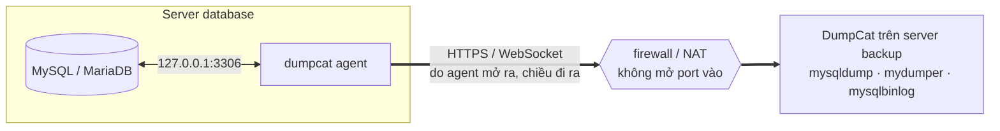
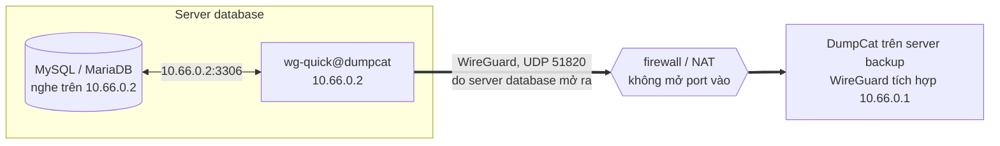

[English](manual.md) · Tiếng Việt · [Về README](../README.vi.md)

# Hướng dẫn sử dụng DumpCat

Hướng dẫn đầy đủ để cài đặt, cấu hình và vận hành DumpCat. Phần giới thiệu tổng quan nằm ở [README](../README.vi.md).

## Mục lục

1. [Tính năng](#1-tính-năng)
2. [Chọn phương thức backup](#2-chọn-phương-thức-backup)
3. [Cài đặt](#3-cài-đặt)
4. [Bắt đầu sử dụng](#4-bắt-đầu-sử-dụng)
5. [Cấu hình nơi lưu trữ](#5-cấu-hình-nơi-lưu-trữ)
6. [Job, lịch chạy, retention](#6-job-lịch-chạy-retention)
7. [Restore](#7-restore)
8. [Lưu trữ binlog & khôi phục theo thời điểm (PITR)](#8-lưu-trữ-binlog--khôi-phục-theo-thời-điểm-pitr)
9. [Khôi phục thủ công khi không có DumpCat](#9-khôi-phục-thủ-công-khi-không-có-dumpcat)
10. [Khôi phục thảm họa (cài lại DumpCat)](#10-khôi-phục-thảm-họa)
11. [Bảo mật](#11-bảo-mật)
12. [API & tự động hóa](#12-api--tự-động-hóa)
13. [Cấu hình hệ thống](#13-cấu-hình-hệ-thống)
14. [Xử lý sự cố](#14-xử-lý-sự-cố)
15. [Phát triển](#15-phát-triển)

---

## 1. Tính năng

| Nhóm | Chi tiết |
|---|---|
| Phương thức | `mysqldump`/`mariadb-dump` (logic), `mydumper`/`myloader` (logic song song), Percona XtraBackup / MariaBackup (vật lý, hot, **full + incremental**) |
| Phạm vi | Tất cả DB, chỉ một số DB, tất cả trừ một số DB, loại trừ từng bảng; routines, triggers, events; **users & GRANT** (file `_users.sql` riêng) |
| Nén / mã hóa | zstd (mặc định), gzip đa luồng, không nén · mã hóa **age** (ChaCha20-Poly1305 + scrypt) bằng passphrase |
| Toàn vẹn | SHA-256 cho mọi file, kiểm tra kích thước sau upload, **verify** (đọc lại → giải mã → giải nén → kiểm tra dòng `Dump completed`/cấu trúc tar) thủ công hoặc tự động sau mỗi backup (job mới: kiểm một bản, bản rẻ nhất để đọc lại; hoặc mọi bản) |
| Lưu trữ | Nhiều đích cho một job (vd: local + S3 + Google Drive); ghi thẳng storage local rồi upload; hoặc **stream trực tiếp** lên cloud không dùng đĩa tạm; giới hạn băng thông; **sao chép** một bản backup có sẵn sang storage khác; duyệt file trên storage |
| Lịch | Cron (`0 2 * * *`, `@daily`, `@every 6h`), lịch riêng cho incremental, múi giờ cấu hình được, xem trước 5 lần chạy kế tiếp |
| Retention | Giữ N bản gần nhất / N ngày / bản cuối mỗi ngày-tuần-tháng (GFS), **riêng cho từng storage** (vd: local giữ 3 bản, S3 giữ 30 ngày), tôn trọng chuỗi incremental |
| Restore | Restore vào server bất kỳ (**instance, máy hoặc phiên bản khác**, tự gỡ DEFINER / đổi collation / bỏ GTID), **đổi tên database**, restore một phần, xóa DB đích trước, không ghi binlog, chế độ nhanh, restore users; vật lý: tải chuỗi full+incremental → prepare → (tùy chọn) **tự thay datadir** với rollback |
| Diễn tập restore | Theo lịch, bản backup mới nhất được **restore vào sandbox** dưới tên tạm, so từng bảng và **số dòng** với backup, chạy assertion SQL tùy chọn, ghi lại thời gian restore (**RTO**) rồi xóa bản sao; backup đạt được đánh dấu **Restore-tested** |
| Khôi phục theo thời điểm (PITR) | **Lưu trữ binlog liên tục** (`mysqlbinlog --raw --stop-never`, nén/mã hóa như backup, upload lên mọi storage của job), khôi phục đến **một thời điểm / vị trí binlog / ngay trước một GTID** — tự chọn bản backup nền mới nhất, tải & kiểm tra mọi binlog trước khi thay đổi dữ liệu; retention binlog theo bản backup cũ nhất còn giữ |
| Kết nối | Trực tiếp, qua **agent** (server database chủ động kết nối ra bằng HTTPS; với `--allow-physical` agent còn chạy backup vật lý ngay trên máy đó) hoặc qua **WireGuard tích hợp** — không cần mở port vào server database ([3.7](#37-server-database-không-cho-kết-nối-vào-agent), [3.8](#38-wireguard-tích-hợp)) |
| Vận hành | Tiến độ realtime (bytes, tốc độ, %), log trực tiếp, hủy tác vụ, giới hạn số job chạy đồng thời, ưu tiên thấp (nice/ionice), pre/post command, timeout |
| Thông báo | Email (SMTP, HTML kèm bản text), Telegram, Slack, Discord, Webhook (ký HMAC) — khi lỗi và/hoặc thành công |
| Giám sát | **Cảnh báo backup quá hạn** cho từng job (theo lịch chạy, hoặc tuổi tối đa) và **cảnh báo binlog chậm**, mỗi sự cố báo một lần và báo lại khi đã hết; **báo cáo tuần** qua email; Prometheus **`/metrics`** (bearer token hoặc chỉ máy này) |
| Bảo mật | Mật khẩu bcrypt, phiên HttpOnly + CSRF, khóa đăng nhập sai nhiều lần, 2FA TOTP, API token, vai trò, audit log, mọi mật khẩu/khóa cloud mã hóa AES-256-GCM khi lưu, mật khẩu DB không bao giờ nằm trên dòng lệnh |
| Phục hồi thảm họa | Mỗi bản backup có `manifest.json` → cài DumpCat mới, thêm storage, bấm **Nhập danh mục** là thấy lại toàn bộ backup. File backup là định dạng chuẩn (zstd/gzip/age/xbstream) — restore được cả khi không có DumpCat |

## 2. Chọn phương thức backup

| | mysqldump | mydumper | Vật lý (XtraBackup/MariaBackup) |
|---|---|---|---|
| Khóa DB? | Không với InnoDB (`--single-transaction`) | Khóa toàn cục vài mili-giây để đồng bộ các luồng, sau đó không khóa (`--trx-tables`); hoặc `SAFE_NO_LOCK` | Không khóa InnoDB; bước cuối dùng backup lock (`LOCK INSTANCE FOR BACKUP` / `BACKUP STAGE`) rất ngắn |
| Tốc độ backup | 1 luồng / DB (nhiều DB song song) | Đa luồng, chia chunk theo số dòng | Nhanh nhất (copy file, đa luồng) |
| Tốc độ restore | Chậm nhất (1 luồng / DB) | Nhanh (song song, tạo index sau) | **Rất nhanh** (copy file + prepare) |
| Incremental | — | — | ✅ |
| Restore 1 DB / đổi tên | ✅ | ✅ | — (toàn instance) |
| Khác phiên bản / chuyển server | ✅ | ✅ | Cùng phiên bản lớn |
| Yêu cầu | client MySQL | mydumper/myloader | Chạy **trên chính server DB** (cài DumpCat ở đó, hoặc [agent](#backup-vật-lý-qua-agent) bật `--allow-physical`), công cụ cùng phiên bản server |

**Khuyến nghị**

- DB < 20–50 GB: `mysqldump` hằng đêm, giữ 7–14 bản, 1 bản local + 1 bản cloud.
- DB lớn, cần restore từng DB: `mydumper` (8–16 luồng, `chunk_rows` 500k).
- DB rất lớn (100 GB – nhiều TB) hoặc cần RTO thấp: **vật lý** full hằng tuần + incremental mỗi giờ/ngày, cộng thêm 1 job `mysqldump`/`mydumper` hằng tuần để có bản logic linh hoạt.
- Backup từ **replica** để không ảnh hưởng primary (bật `--slave-info` với backup vật lý).
- Bảng MyISAM/Aria không được đảm bảo nhất quán khi backup logic không khóa — DumpCat cảnh báo khi phát hiện.

## 3. Cài đặt

### 3.1 Cài nhanh (khuyến nghị)

Trên server, bằng user có `sudo`:

```bash
curl -fsSL https://dumpcat.cc/install.sh | sudo sh
```

Lệnh này tải gói mới nhất từ `https://downloads.dumpcat.cc`, kiểm tra SHA-256 theo `SHA256SUMS` của bản phát hành, giải
nén vào một thư mục tạm rồi chạy `install.sh` trong gói. Tùy chọn của `install.sh` đặt sau `sh -s --`, ví dụ
`curl -fsSL https://dumpcat.cc/install.sh | sudo sh -s -- --port 9090`. Hướng dẫn cho người mới có tại
[dumpcat.cc/vi/install](https://dumpcat.cc/vi/install/).

Hoặc tự tải gói về: phiên bản mới nhất, ghi chú phát hành và mã kiểm tra có trên [dumpcat.cc](https://dumpcat.cc/#download);
các gói cài đặt nằm ở `https://downloads.dumpcat.cc/<phiên bản>/`.

```bash
curl -fLO https://downloads.dumpcat.cc/1.4.1/dumpcat-1.4.1-linux.tar.gz
tar xzf dumpcat-1.4.1-linux.tar.gz
cd dumpcat-1.4.1-linux
sudo ./install.sh
```

Script sẽ: cài binary vào `/opt/dumpcat/dumpcat` (có link `/usr/local/bin/dumpcat`), tạo `/etc/dumpcat/dumpcat.env`, thư mục dữ liệu
`/var/lib/dumpcat`, service systemd `dumpcat`, và tự cài công cụ phù hợp với server DB trên máy:
`rclone`, client MySQL/MariaDB, `mariadb-backup` (MariaDB) hoặc Percona XtraBackup đúng phiên bản (MySQL 5.7/8.0/8.4), `mydumper` (nếu có trong repo).
Cuối cùng script in ra địa chỉ web và mã thiết lập dùng một lần để tạo tài khoản admin ([4. Bắt đầu sử dụng](#4-bắt-đầu-sử-dụng)).

Tùy chọn: `--port 9090`, `--listen 127.0.0.1`, `--tls-auto` (HTTPS tự ký), `--no-deps`, `--uninstall [--purge]`.

### 3.2 Cài thủ công

```bash
sudo install -D -m 0755 dumpcat-linux-amd64 /opt/dumpcat/dumpcat && sudo ln -sfn /opt/dumpcat/dumpcat /usr/local/bin/dumpcat
sudo mkdir -p /etc/dumpcat /var/lib/dumpcat && sudo chmod 700 /var/lib/dumpcat
sudo cp dumpcat.env.example /etc/dumpcat/dumpcat.env
sudo cp dumpcat.service /etc/systemd/system/
sudo systemctl daemon-reload && sudo systemctl enable --now dumpcat
```

### 3.3 Công cụ backup (nếu cài thủ công)

```bash
# Ubuntu/Debian
sudo apt install mariadb-client mariadb-backup     # MariaDB
sudo apt install mysql-client                      # MySQL
sudo apt install mydumper                          # tùy chọn, DB lớn
curl https://rclone.org/install.sh | sudo bash     # cho S3/Drive/OneDrive/FTP...
# Percona XtraBackup cho MySQL 8.0 (8.4: pxb-84-lts / percona-xtrabackup-84)
curl -O https://repo.percona.com/apt/percona-release_latest.generic_all.deb
sudo apt install ./percona-release_latest.generic_all.deb
sudo percona-release enable pxb-80 && sudo apt update && sudo apt install percona-xtrabackup-80
```

Trang **Hệ thống** trong giao diện liệt kê công cụ nào đã có/thiếu, phiên bản và lệnh cài.

> **Phiên bản công cụ vật lý phải khớp server**: MariaBackup cùng phiên bản MariaDB; XtraBackup 8.0 ↔ MySQL 8.0, 8.4 ↔ 8.4, 2.4 ↔ 5.7. Trang chi tiết server báo rõ nếu không khớp.

### 3.4 Đặt sau nginx + HTTPS (khuyến nghị cho môi trường thật)

Đặt `DUMPCAT_LISTEN=127.0.0.1:6369` và `DUMPCAT_TRUST_PROXY=1`, dùng file mẫu `/etc/dumpcat/nginx-dumpcat.conf`
(đã tắt buffering để tải file backup lớn). Hoặc dùng HTTPS tích hợp: `DUMPCAT_TLS_CERT`/`DUMPCAT_TLS_KEY`, hay `DUMPCAT_TLS_AUTO=1`.

### 3.5 Windows

DumpCat cũng chạy trên Windows Server 2016+ / Windows 10+ (64-bit), dưới dạng Windows Service.
Cách đơn giản nhất: tải file `.zip` trên [dumpcat.cc](https://dumpcat.cc/#download), giải nén rồi bấm đúp **Install
DumpCat** (`Install DumpCat.cmd`); file này xin quyền quản trị của Windows, chạy `install.ps1` rồi mở giao diện web. Hoặc
mở PowerShell bằng **Run as administrator** rồi dùng lệnh cài một dòng:

```powershell
irm https://dumpcat.cc/install.ps1 | iex
```

hoặc làm từng bước bằng tay:

```powershell
Invoke-WebRequest https://downloads.dumpcat.cc/1.4.1/dumpcat-1.4.1-windows-amd64.zip -OutFile dumpcat-1.4.1-windows-amd64.zip
Expand-Archive dumpcat-1.4.1-windows-amd64.zip -DestinationPath .
cd dumpcat-1.4.1-windows-amd64
powershell -ExecutionPolicy Bypass -File .\install.ps1
```

Script sẽ:

- chép `dumpcat.exe` vào `C:\Program Files\DumpCat` và tải `rclone.exe` vào `C:\Program Files\DumpCat\tools`;
- tạo file cấu hình `C:\ProgramData\DumpCat\dumpcat.env` và thư mục dữ liệu `C:\ProgramData\DumpCat\data`
  (chỉ SYSTEM và Administrators đọc được, vì chứa database và master key);
- đăng ký service **DumpCat** (tự khởi động trễ cùng Windows, tự chạy lại khi lỗi), khởi động nó, in ra địa chỉ web
  và mã thiết lập dùng một lần để tạo tài khoản admin ([4. Bắt đầu sử dụng](#4-bắt-đầu-sử-dụng)).

Tùy chọn: `-Port 9090`, `-Listen 127.0.0.1`, `-TlsAuto` (HTTPS tự ký), `-OpenFirewall` (mở cổng cho mạng Domain/Private),
`-NoRclone`, `-NoService` (chỉ chép file và tạo cấu hình, không cần quyền admin; tự chạy `dumpcat.exe serve`),
`-Uninstall [-Purge]`. Chạy lại script là nâng cấp tại chỗ, giữ nguyên cấu hình và dữ liệu.

- Service: `Restart-Service DumpCat` (sau khi sửa `dumpcat.env`), `Get-Service DumpCat`.
- Log: `C:\ProgramData\DumpCat\data\dumpcat.log` (xoay vòng mỗi 20 MB); log từng lần backup/restore vẫn xem trên web như bình thường.
- Dòng lệnh (PowerShell quyền admin): `& "C:\Program Files\DumpCat\dumpcat.exe" user passwd -u admin`.
- Công cụ backup được tìm tự động trong `C:\Program Files\MySQL\MySQL Server *\bin`, `C:\Program Files\MariaDB *\bin`,
  XAMPP, Laragon và WAMP. Nếu không có, chép `mysqldump.exe`/`mariadb-dump.exe`, `mysql.exe`, `mysqlbinlog.exe`… vào
  thư mục `tools`, khai báo thêm thư mục trong `DUMPCAT_TOOLS_DIR` (ngăn cách bằng `;`), hoặc đặt đường dẫn ở trang **Settings**.
  Trang **System** cho biết đã tìm thấy những gì.

Những gì dùng được trên Windows:

| Tính năng | Windows |
|---|---|
| Backup & restore logic (mysqldump / mariadb-dump), lịch chạy, retention, kiểm tra toàn vẹn, mã hóa | ✅ |
| Mọi nơi lưu trữ (thư mục local, ổ mạng, S3, Google Drive, OneDrive, FTP, SFTP… qua rclone) | ✅ |
| Lưu trữ binlog & khôi phục theo thời điểm từ bản backup logic | ✅ |
| Backup vật lý MariaDB (mariabackup), kể cả incremental | ✅ backup + prepare; chép vào datadir phải làm tay (log restore ghi rõ các bước) |
| mydumper / myloader | ❌ không có bản Windows |
| Backup vật lý MySQL / Percona (XtraBackup) | ❌ XtraBackup chỉ có cho Linux |
| Tự thay datadir, PITR từ bản backup vật lý | ❌ chỉ trên Linux |
| Hạ ưu tiên CPU/IO cho công cụ backup (nice/ionice) | ❌ |

Với DB lớn (hàng trăm GB) hoặc cần backup vật lý MySQL, nên chạy DumpCat trên Linux.

### 3.6 Cập nhật

DumpCat tự cập nhật từ một máy chủ phát hành. Các gói cài đặt chính thức dùng máy chủ của dự án, `https://downloads.dumpcat.cc`.
Nếu tự build DumpCat, bạn có thể dùng máy chủ của riêng mình: web server nào phục vụ file tĩnh cũng được.

**Phát hành một phiên bản.** Ghi số phiên bản vào `VERSION`, mô tả thay đổi trong mục `## <phiên bản>` của `CHANGELOG.md`
(mục này hiện thành ghi chú phát hành trên giao diện), rồi build:

```bash
UPDATE_URL=https://downloads.dumpcat.cc ./build.sh
```

`UPDATE_URL` là tùy chọn: nó thành máy chủ phát hành mặc định của các bản bạn build (Windows: `.\build.ps1 -UpdateUrl https://…`).
Upload **nội dung** thư mục `dist/update/` lên địa chỉ đó, để có:

```
https://downloads.dumpcat.cc/latest.json
https://downloads.dumpcat.cc/1.4.1/dumpcat-linux-amd64    (… -linux-arm64, -windows-amd64.exe, SHA256SUMS, các gói cài)
```

Upload thư mục phiên bản trước, `latest.json` sau cùng, để máy cài không bao giờ thấy một bản phát hành mà file chưa lên đủ.
Máy chủ phát hành phải dùng HTTPS.

**Khai báo trên máy cài:** **Settings → Updates** (hoặc `DUMPCAT_UPDATE_URL`, hoặc địa chỉ gắn sẵn lúc build). DumpCat kiểm tra mỗi ngày
một lần và báo "x.y.z available" cho admin; không tự cài gì cả.

**Cài bản cập nhật:** **System → Updates → Install**, hoặc trên server:

```bash
sudo dumpcat update          # -check: chỉ kiểm tra · -yes: không hỏi lại · -force: cài lại
```

(Windows, PowerShell quyền admin: `& "C:\Program Files\DumpCat\dumpcat.exe" update`.) Quá trình:

1. Đọc `latest.json` (và kiểm tra **chữ ký** nếu đã cấu hình khóa phát hành — xem bên dưới), tải file cho đúng nền tảng, kiểm tra
   **SHA-256** và kích thước, rồi chạy thử bản mới.
2. **Chờ các backup, restore, kiểm tra toàn vẹn, copy đang chạy xong** (tối đa 12 giờ; trong lúc chờ có thể hủy).
   Lưu trữ binlog vẫn chạy và tự nối lại sau khi khởi động lại.
3. Tác vụ mới bị giữ lại trong vài giây khởi động lại; job theo lịch đến hạn đúng lúc đó sẽ chạy ngay sau khi xong.
4. **Sao lưu database của DumpCat** (`<data>/update/dumpcat-<phiên bản>-<thời gian>.db`, giữ 3 bản gần nhất) cùng file chạy hiện tại.
5. Thay file chạy và khởi động lại (Linux: thay tại chỗ, systemd vẫn theo dõi; Windows: khởi động lại service).
6. **Tự quay lại:** nếu bản mới không chạy được — nâng cấp database lỗi, bị crash, không mở được cổng — DumpCat đặt lại file chạy cũ và
   bản sao database rồi chạy lại bản cũ (ngay lập tức nếu lỗi lúc khởi động, hoặc ở lần khởi động thứ 4 nếu crash liên tục).
   Trang System cho biết chuyện gì đã xảy ra.

**Quay lại thủ công:** **System → Updates → Roll back** (hoặc `dumpcat update -rollback`) chuyển về bản trước và khôi phục database từ trước
khi cập nhật. Những thay đổi sau khi cập nhật (lịch sử backup, job, cài đặt) sẽ mất; file backup trên các nơi lưu trữ không bị đụng tới — dùng
**Import catalog** để liệt kê lại các bản backup mới hơn.

Khi service đang dừng, `dumpcat update` thay file trực tiếp; việc cập nhật hoàn tất (hoặc tự quay lại) khi service khởi động.
Cách cũ — cài gói mới bằng `install.sh` / `install.ps1` — vẫn dùng được.

**Ký bản phát hành (khuyến nghị).** HTTPS và mã SHA-256 phát hiện được file tải về bị hỏng hay bị tráo, nhưng cả hai đều đến từ máy chủ
phát hành: ai chiếm được máy chủ đó là có thể phát hành một file chạy độc hại. Khi có khóa phát hành, máy cài chỉ cài bản phát hành có
`latest.json` được ký bằng **khóa bí mật** của bạn — khóa này không bao giờ nằm trên máy chủ (`latest.json` chứa SHA-256 của mọi file chạy,
nên chữ ký bảo vệ luôn cả các file chạy).

1. Tạo cặp khóa một lần, trên máy build (tốt hơn: một máy offline hoặc ổ đĩa mã hóa):

   ```bash
   dumpcat release keygen -out ~/dumpcat-keys
   ```

   Lệnh tạo `dumpcat-release.key` (khóa bí mật, quyền 0600) và `dumpcat-release.pub` (khóa công khai, base64) và in ra khóa công khai.

2. Build kèm khóa:

   ```bash
   UPDATE_SIGNING_KEY=~/dumpcat-keys/dumpcat-release.key UPDATE_URL=https://downloads.dumpcat.cc ./build.sh
   ```

   (Windows: `.\build.ps1 -SigningKey D:\keys\dumpcat-release.key`, hoặc `$env:UPDATE_SIGNING_KEY`.) Khóa công khai được gắn vào các file
   chạy và `dist/update/latest.json.sig` được tạo cạnh `latest.json`. Upload thư mục phiên bản trước, rồi `latest.json.sig`, rồi `latest.json`;
   lần kiểm tra nào rơi đúng giữa hai lần upload cuối sẽ báo lỗi chữ ký một lần và thành công ở lần sau.
   Đừng sửa `latest.json` sau khi ký — chữ ký áp lên đúng từng byte của file. Ký thủ công: `dumpcat release sign -key dumpcat-release.key
   dist/update/latest.json`; kiểm tra trước khi upload: `dumpcat release verify -pub dumpcat-release.pub dist/update/latest.json`.

3. Từ đó, máy cài chạy bản build có khóa sẽ từ chối bản phát hành không ký hoặc đã bị sửa. Máy cài còn chạy bản build không có khóa vẫn
   nhận bản không ký cho tới khi cài một bản đã ký; muốn bắt buộc chữ ký trên các máy đó ngay, đặt `DUMPCAT_UPDATE_PUBLIC_KEY=<khóa công khai>`
   trong file env của chúng (nhiều khóa: cách nhau bằng dấu phẩy). Khóa từ biến môi trường được cộng thêm vào khóa gắn sẵn, không bao giờ
   thay thế chúng; khóa sai định dạng khiến DumpCat không khởi động, thay vì lặng lẽ tắt việc kiểm tra.
   **System → Updates** hiện "Release signature: required" cùng các khóa tin cậy, hoặc "not checked" khi chỉ dựa vào HTTPS + SHA-256.

**Giữ an toàn khóa bí mật.** Ai có `dumpcat-release.key` là có thể đẩy code xuống mọi máy cài.

- Không bao giờ để nó trên máy chủ phát hành, trong kho mã nguồn hay trong log CI. Giữ trên máy build với quyền 0600 (Windows: trong thư
  mục chỉ tài khoản của bạn đọc được), tốt nhất trên ổ đĩa mã hóa hoặc ổ offline chỉ cắm vào khi build bản phát hành.
- Giữ một bản sao lưu offline (USB mã hóa, trình quản lý mật khẩu). Mất khóa thì các máy cài tin khóa đó không cập nhật qua trình cập nhật
  được nữa — chỉ còn cách cài gói mới bằng `install.sh` / `install.ps1`.
- Khóa công khai và file `.pub` không cần giữ bí mật.

**Đổi khóa** (khóa mới, hoặc nghi khóa cũ bị lộ). Máy cài chấp nhận bản phát hành được ký bởi **bất kỳ** khóa nào nó tin, và
`latest.json.sig` có thể chứa nhiều chữ ký:

1. Tạo cặp khóa mới: `dumpcat release keygen -out ~/dumpcat-keys-new`.
2. Phát hành một bản chuyển tiếp, vẫn ký bằng khóa cũ, nhưng file chạy tin cả hai khóa:

   ```bash
   UPDATE_SIGNING_KEY=~/dumpcat-keys/dumpcat-release.key UPDATE_PUBLIC_KEYS="$(cat ~/dumpcat-keys-new/dumpcat-release.pub)" ./build.sh
   ```

   (Windows: `.\build.ps1 -SigningKey <file khóa cũ> -PublicKeys <khóa công khai mới>`.) Máy cài đã cập nhật sẽ hiện 2 khóa tin cậy.
3. Từ bản phát hành sau, chỉ ký bằng khóa mới: `UPDATE_SIGNING_KEY=~/dumpcat-keys-new/dumpcat-release.key ./build.sh` — các file chạy này
   chỉ tin khóa mới. Với máy cài bỏ lỡ bản chuyển tiếp, thêm cả chữ ký của khóa cũ:
   `dumpcat release sign -key old.key -key new.key dist/update/latest.json`.
4. Hủy khóa bí mật cũ khi không còn máy cài nào tin nó.

Nếu khóa cũ bị lộ, bỏ bước ký kép ở bước 3 và đưa các máy cài lên bản build không còn khóa cũ càng sớm càng tốt: trước lúc đó chúng vẫn
chấp nhận bản phát hành ký bằng khóa cũ. Máy nào nghi ngờ thì cài lại gói thủ công.

### 3.7 Server database không cho kết nối vào (agent)

Khi DumpCat không kết nối được tới database (không mở port cho nó, có firewall hoặc NAT ở giữa, MySQL chỉ nghe trên
127.0.0.1), hãy cài **agent** lên server database. Agent chính là file `dumpcat`: nó **chủ động kết nối ra** DumpCat qua
HTTPS (WebSocket trên cùng port của giao diện web) và mang các kết nối database mà DumpCat cần. Không cần mở port nào trên
server database, chỉ cần server đó đi ra được tới DumpCat. Nếu thích dùng VPN, xem
[3.8 WireGuard tích hợp](#38-wireguard-tích-hợp).



Agent là bên mở kết nối, nên firewall hoặc NAT trước server database vẫn cho đi ra; dữ liệu database sau đó đi hai chiều
bên trong kết nối này. Các công cụ của DumpCat kết nối tới port local trên server backup.

1. Trên giao diện web: **Agents → Add agent** (admin). DumpCat hiện khóa của agent — chỉ một lần — cùng các lệnh cài.
2. Trên server database, bằng root:

   ```bash
   curl -fsSL https://dumpcat.cc/install.sh | sudo sh -s -- --agent --server https://backup.example.com --key dca_...
   ```

   (hoặc, trong gói đã giải nén: `sudo ./install.sh --agent --server … --key …`)

   Trên Windows, trong thư mục đã giải nén, mở PowerShell bằng quyền Administrator:
   `powershell -ExecutionPolicy Bypass -File .\install.ps1 -Agent -Server https://backup.example.com -Key dca_...`
3. Agent hiện **Online** ở trang Agents. Sau đó **Database servers → Add server**, chọn **Connect: Through agent …** và
   nhập địa chỉ database **nhìn từ máy chạy agent** — thường là `127.0.0.1` port `3306`, hoặc socket. MySQL thấy kết nối
   đến từ chính máy đó, nên user backup tạo cho `'dumpcat'@'localhost'` / `'dumpcat'@'127.0.0.1'` dùng được.

Mọi thứ chỉ cần kết nối database đều chạy qua agent: backup mysqldump và mydumper, restore (kể cả sang server nằm sau một
agent khác), lưu binlog và khôi phục theo thời điểm. DumpCat mở cho các công cụ của nó một port local cho mỗi database,
còn agent quay số tới database. Backup vật lý (XtraBackup / MariaBackup) chép datadir nên công cụ phải chạy trên chính
server database: agent khởi động với `--allow-physical` làm việc đó (xem bên dưới).

- **Agent được phép kết nối tới đâu.** Mặc định chỉ MySQL/MariaDB trên máy đó: `127.0.0.1:3306`, `[::1]:3306` và các
  đường dẫn socket thường gặp. Địa chỉ khác thì thêm bằng `--allow` (Windows: `-Allow`), phân cách bằng dấu phẩy, ví dụ
  `--allow 127.0.0.1:3307,10.0.0.5:3306,unix:/var/lib/mysql/mysql.sock`; `*` cho phép mọi địa chỉ. Nhờ vậy, lộ khóa cũng
  không dùng được để vào các máy khác trong mạng của server database. Server có địa chỉ không được phép sẽ báo
  *… is not on this agent's allow list* khi kiểm tra kết nối và trong log backup.
- **Cấu hình**: `/etc/dumpcat/agent.env` (Windows: `C:\ProgramData\DumpCat\agent.env`), chỉ root / Administrators đọc
  được: `DUMPCAT_AGENT_SERVER`, `DUMPCAT_AGENT_KEY`, `DUMPCAT_AGENT_ALLOW`, `DUMPCAT_AGENT_INSECURE`,
  `DUMPCAT_AGENT_ALLOW_PHYSICAL`, `DUMPCAT_AGENT_DATADIR` (xem `agent.env.example`). Sửa xong: `systemctl restart dumpcat-agent` (Windows: `Restart-Service DumpCatAgent`). Chạy lại bộ
  cài với `--server`, `--key` hoặc `--allow` mới cũng cập nhật file này.
- **Dịch vụ**: `dumpcat-agent` trên Linux — chạy bằng một user tạm không có quyền (systemd `DynamicUser`), không truy cập
  được hệ thống file (với `--allow-physical`: chạy bằng user sở hữu datadir); `DumpCatAgent` trên Windows. Log: `journalctl -u dumpcat-agent -f`
  (Windows: `C:\ProgramData\DumpCat\agent.log`). Chạy tay, ở foreground:
  `dumpcat agent -server https://backup.example.com -key dca_... [-allow ...] [-insecure] [-allow-physical]`.
- **Mã hóa**: dữ liệu database đi bên trong kết nối của agent. Hãy chạy DumpCat qua HTTPS khi đường truyền đi qua mạng
  không tin cậy; nếu dùng chứng chỉ tự ký (`DUMPCAT_TLS_AUTO=1`) thì thêm `--insecure` cho agent. Đặt sau nginx thì file
  mẫu `nginx-dumpcat.conf` đã chuyển tiếp WebSocket cho `/api/agent/` với timeout dài.
- **Địa chỉ trong các lệnh cài**: lấy **Base URL** trong **Cài đặt** nếu có, nếu không thì dùng địa chỉ trình duyệt đang
  mở — hãy đặt Base URL khi server database truy cập DumpCat bằng một tên khác.
- **Khóa** chỉ hiện một lần và được lưu dạng hash. **Rotate key** tạo khóa mới và ngắt agent ngay (đặt khóa mới vào
  `agent.env`, hoặc chạy lại bộ cài với `--key`). Không xóa được agent khi còn server dùng nó.
- **Agent offline**: job báo lỗi *agent … is offline — start it on the database host*. Agent tự kết nối lại (mỗi 2 giây,
  giãn dần tới 1 phút) và việc lưu binlog tiếp tục từ chỗ đã dừng. Trang Agents hiện phiên bản của từng agent; nâng cấp
  bằng cách chạy bộ cài của phiên bản mới.
- **Gỡ cài đặt**: `sudo ./install.sh --agent --uninstall [--purge]`, Windows: `.\install.ps1 -Agent -Uninstall [-Purge]`.

#### Backup vật lý qua agent

Backup vật lý đọc trực tiếp các file của database, nên XtraBackup / MariaBackup phải chạy trên chính server database. Bật
quyền này cho agent (mặc định tắt), agent sẽ chạy công cụ ngay trên máy đó khi có job yêu cầu và stream bản backup về
DumpCat:

```bash
sudo ./install.sh --agent --server https://backup.example.com --key dca_... --allow-physical
```

(Windows: `-AllowPhysical`; chạy tay: `dumpcat agent ... -allow-physical`; trong `agent.env`:
`DUMPCAT_AGENT_ALLOW_PHYSICAL=1`.) Cài công cụ backup trên server database — `mariadb-backup` cho MariaDB, dòng Percona
XtraBackup khớp với MySQL — rồi chọn phương thức **Physical** cho server kết nối qua agent.

- **Cách hoạt động**: mỗi lần backup, DumpCat gửi thiết lập của job và thông tin đăng nhập của user backup qua kết nối đã
  xác thực của agent. Agent ghi chúng vào một file option riêng, chạy `mariabackup|xtrabackup --backup --stream=xbstream`
  và stream kết quả về; file option bị xóa ngay khi công cụ kết thúc — agent không lưu gì cả. DumpCat nén, mã hóa, upload,
  kiểm tra và áp retention y như backup vật lý chạy tại chỗ, và log của chính công cụ hiện trong log của lần chạy.
  Incremental cũng vậy (`--incremental-lsn` lấy từ bản backup trước).
- **Quyền đọc datadir**: trên Linux, `--allow-physical` thêm một drop-in systemd
  (`/etc/systemd/system/dumpcat-agent.service.d/physical.conf`) để agent chạy bằng user sở hữu datadir (thường là
  `mysql`, tìm qua `my_print_defaults` hoặc `/var/lib/mysql`) thay vì user tạm. Service trên Windows chạy bằng LocalSystem.
- **Trang Agents** hiện những gì agent báo khi kết nối: công cụ backup và phiên bản, user hệ điều hành, và datadir có đọc
  được không (`DUMPCAT_AGENT_DATADIR`, mặc định `/var/lib/mysql` hoặc vị trí thường gặp; mỗi lần backup agent kiểm tra lại
  `@@datadir` của chính server). Trang server và trang sửa job ghi rõ vì sao phương thức chưa sẵn sàng:
  *start the agent with --allow-physical*, *mariabackup is not installed on …*, *cannot read the datadir …*, công cụ không
  khớp phiên bản server, hoặc agent quá cũ để chạy backup vật lý (agent các phiên bản trước vẫn chạy bình thường cho mọi
  việc khác).
- **Hủy** lần chạy sẽ dừng công cụ trên server database. Nếu mất kết nối tới agent, lần chạy báo lỗi và không giữ lại phần
  dở dang; rotate key của agent cũng dừng các bản backup đang chạy của nó.
- **Giới hạn những gì DumpCat được yêu cầu**: agent chỉ backup database nằm trong allow list, tự dựng dòng lệnh và chỉ
  chuyển *extra arguments* của job khi đó là option dạng `--name[=value]` không trỏ tới file, thư mục, chương trình hay
  server khác (vd `--galera-info`, `--use-memory=1G`, `--kill-long-queries-timeout=30`).
- **Restore** thực hiện ở máy chạy DumpCat (xem [7. Restore](#7-restore)): DumpCat tải và prepare bản backup; chép thư mục
  đã prepare sang server database rồi chạy `--copy-back` ở đó (log restore ghi sẵn các lệnh), hoặc restore vào một instance
  trên máy chạy DumpCat. *Apply right away* không dùng được qua agent.

### 3.8 WireGuard tích hợp

Một cách khác thay cho agent: DumpCat tự chạy một endpoint **WireGuard**, và các server database tham gia bằng công cụ
WireGuard chuẩn. Tính năng này **tắt mặc định** và không cần cài thêm gì: WireGuard chạy bên trong DumpCat (userspace),
không tạo network interface, route hay luật firewall nào trên máy chạy DumpCat — chỉ DumpCat vào được các peer, và chỉ
tới đúng địa chỉ database của các server bạn khai báo.



Server database mở tunnel và giữ cho nó sống; DumpCat vào `10.66.0.2:3306` bên trong tunnel đó.

1. Trang **WireGuard** (admin): tích **Turn on WireGuard**, giữ hoặc đổi port UDP (`51820`) và địa chỉ VPN của DumpCat
   (`10.66.0.1/24`), điền **Endpoint for the peers** — tên hoặc IP công khai mà server database dùng để tới máy này (để
   trống: lấy host của Base URL). Mở port UDP trên firewall của máy chạy DumpCat (`ufw allow 51820/udp`, Windows: một
   luật inbound UDP).
2. **Add peer** cho từng server database. DumpCat cấp địa chỉ trống tiếp theo (`10.66.0.2`…) và hiện file `dumpcat.conf`
   của peer — chỉ một lần, vì có khóa riêng — cùng các lệnh cài:

   ```bash
   apt install wireguard-tools        # RHEL / Rocky / Alma: dnf install wireguard-tools
   # lưu file DumpCat hiện ra thành /etc/wireguard/dumpcat.conf, rồi
   chmod 600 /etc/wireguard/dumpcat.conf
   systemctl enable --now wg-quick@dumpcat
   ```

   Trên Windows: cài WireGuard, **Import tunnel from file**, **Activate**. File này chỉ đưa địa chỉ VPN của DumpCat qua
   tunnel (`AllowedIPs = 10.66.0.1/32`) và gửi keepalive mỗi 25 giây, nên server database có thể nằm sau NAT và không nhận
   kết nối vào — chỉ cần đi ra được tới DumpCat qua UDP.
3. Trên server database, MySQL phải nhận kết nối đến qua WireGuard:
   - nghe trên địa chỉ WireGuard: `bind-address = 0.0.0.0`, hoặc `127.0.0.1,10.66.0.2` (MySQL 8.0.13+, MariaDB 10.11+);
   - user backup phải được phép từ địa chỉ VPN của DumpCat: `'dumpcat'@'10.66.0.1'` (DumpCat hiện sẵn câu SQL);
   - firewall của máy phải cho interface WireGuard vào: `ufw allow in on dumpcat to any port 3306`.
4. **Database servers → Add server**, **Connect: Through WireGuard: <peer>**, host = địa chỉ của peer (`10.66.0.2`),
   port `3306`.

Lưu ý:

- **Mạng phía sau một peer**: một peer có thể làm gateway tới các server database khác trong mạng của nó — thêm mạng đó
  (ví dụ `192.168.10.0/24`) vào peer rồi nhập địa chỉ các server đó. Gateway phải chuyển tiếp gói tin
  (`net.ipv4.ip_forward=1` và một luật masquerade, hoặc route ngược về `10.66.0.1/32`).
- Qua WireGuard, host của server phải là địa chỉ IP được route tới peer của nó; không dùng được unix socket.
- **Trạng thái**: trang WireGuard hiện với từng peer lần bắt tay gần nhất (connected = trong vòng 3 phút), kết nối từ đâu
  tới và lưu lượng. DumpCat nhớ vị trí cuối cùng của mỗi peer, nên sau khi DumpCat khởi động lại hoặc tắt/bật WireGuard,
  nó kết nối lại ngay chứ không phải đợi lần bắt tay tiếp theo của peer.
- **Lỗi** được báo cụ thể: *peer … has not connected yet* (WireGuard chưa chạy trên máy đó, hoặc UDP bị chặn),
  *no answer from …* (máy đó mất kết nối, hoặc firewall của nó chặn interface WireGuard), *nothing listens on …* (MySQL
  không nghe trên địa chỉ WireGuard).
- **Rotate keys** tạo cấu hình mới cho peer; cấu hình cũ hết hiệu lực ngay. Đổi port hoặc địa chỉ của DumpCat không đổi
  khóa của peer, nhưng phải cập nhật lại mọi file `dumpcat.conf` (Endpoint / AllowedIPs).
- Agent hay WireGuard? [Agent](#37-server-database-không-cho-kết-nối-vào-agent) chỉ cần HTTPS đi ra và vào MySQL qua
  127.0.0.1, không phải sửa cấu hình MySQL. WireGuard dùng công cụ chuẩn, đã được kiểm định rộng rãi, qua UDP, nhưng MySQL
  phải nghe trên địa chỉ WireGuard. Backup vật lý chạy được qua agent bật `--allow-physical`, không chạy được qua
  WireGuard.

## 4. Bắt đầu sử dụng

1. Mở `http://<ip-server>:6369` (cổng mặc định **6369**, bấm trên bàn phím điện thoại ra chữ *MEOW*). Khi chưa có tài khoản nào, lần đầu sẽ hiện màn hình **Initial setup**:
   nhập **mã thiết lập** (setup token), đặt tên đăng nhập và mật khẩu admin, xong là vào luôn.
   Mã thiết lập là mã dùng một lần mà DumpCat tạo ra khi khởi động lúc chưa có tài khoản nào, để người khác truy cập được cổng này
   không thể tạo admin trước bạn. Bộ cài đặt in sẵn mã này; muốn xem lại:
   - Linux: `sudo dumpcat setup-token`, hoặc log của service `journalctl -u dumpcat`;
   - Windows (PowerShell quyền Administrator): `& "C:\Program Files\DumpCat\dumpcat.exe" setup-token`, hoặc file log `C:\ProgramData\DumpCat\data\dumpcat.log`.

   Mỗi lần DumpCat khởi động sẽ tạo mã mới, và mã hết hiệu lực ngay khi đã có tài khoản admin. Nhập sai 5 lần thì IP đó phải chờ
   15 phút. Cũng có thể bỏ qua bước thiết lập trên web và tạo admin bằng dòng lệnh: `sudo dumpcat user add -u admin -r admin`.
2. **Tạo user MySQL cho backup** (quyền tối thiểu, chỉ đọc):
   ```sql
   -- MySQL 8 / Percona
   CREATE USER 'dumpcat'@'localhost' IDENTIFIED BY 'mat_khau_manh';
   GRANT SELECT, SHOW VIEW, TRIGGER, EVENT, LOCK TABLES, PROCESS, RELOAD,
         REPLICATION CLIENT, SHOW DATABASES ON *.* TO 'dumpcat'@'localhost';
   GRANT BACKUP_ADMIN ON *.* TO 'dumpcat'@'localhost';                -- backup vật lý
   GRANT SELECT ON performance_schema.log_status TO 'dumpcat'@'localhost';
   -- MariaDB
   GRANT SELECT, SHOW VIEW, TRIGGER, EVENT, LOCK TABLES, PROCESS, RELOAD,
         BINLOG MONITOR, CONNECTION ADMIN, SLAVE MONITOR, SHOW DATABASES ON *.* TO 'dumpcat'@'localhost';
   ```
   Nếu bật **lưu trữ binlog / PITR** (mục 8): thêm `GRANT REPLICATION SLAVE ON *.* TO 'dumpcat'@'localhost';`.
   Restore cần quyền ghi → khai báo **tài khoản restore riêng** trong form server (mục *Tài khoản riêng khi restore*).
3. **Database server** → *Thêm server* → *Kiểm tra kết nối*: hiển thị phiên bản, datadir, binlog, dung lượng từng DB, cảnh báo quyền, bảng không phải InnoDB và **phương thức backup nào dùng được** trên máy này.
4. **Nơi lưu trữ** → thêm ít nhất một nơi → bấm **Test** (ghi/đọc/xóa thử).
5. **Job backup** → *Tạo job*: chọn server, phương thức, DB, lịch, nén/mã hóa, storage, retention → *Lưu & chạy ngay*.
6. Theo dõi tiến độ & log trực tiếp ở trang chi tiết; bấm **Kiểm tra toàn vẹn** để verify; **Restore** khi cần.

## 5. Cấu hình nơi lưu trữ

| Loại | Ghi chú |
|---|---|
| **Thư mục local / NFS** | Nhanh nhất để restore. Đặt trên ổ khác ổ chứa datadir; NFS/SMB đã mount cũng dùng được. |
| **S3** | Nhập Access Key/Secret, region, bucket, prefix. Với R2/MinIO/Wasabi... nhập *Endpoint*. Để trống key để dùng IAM role của EC2. File lớn upload multipart song song (chunk 64 MiB). Bật *Không kiểm tra/tạo bucket* nếu key không có quyền tạo bucket. Có thể dùng Object Lock / lifecycle của bucket để chống ransomware. |
| **Google Drive** | **Cách 1 (OAuth)**: tạo OAuth Client ID loại *Desktop app* trong Google Cloud Console (bật Google Drive API) → nhập Client ID/Secret → *Xác thực với Google* → đăng nhập → trình duyệt chuyển tới `http://127.0.0.1:53682/...` (báo lỗi không mở được — bình thường) → copy toàn bộ URL dán vào DumpCat. **Cách 2**: trên máy có trình duyệt chạy `rclone authorize "drive"` và dán JSON vào ô Token. **Cách 3**: Service Account JSON (bắt buộc dùng Shared Drive hoặc thư mục được chia sẻ, vì service account không có dung lượng riêng). |
| **OneDrive / SharePoint** | Tạo App registration trong Microsoft Entra ID, nền tảng *Mobile and desktop applications* với redirect `http://localhost:53682/` (hoặc dùng `rclone authorize "onedrive"`). Drive ID và loại drive được phát hiện tự động. |
| **FTP / FTPS** | Host, port, user, pass, chọn Explicit TLS (FTPES) hoặc Implicit TLS (990). |
| **SFTP** | Mật khẩu hoặc private key (PEM). Phù hợp đẩy backup sang server khác/NAS. |
| **WebDAV / Nextcloud / B2 / Azure / Dropbox** | Theo form tương ứng. |
| **rclone (tùy chỉnh)** | Dán nguyên section cấu hình rclone (`type = ...`) để dùng 70+ backend còn lại (Mega, pCloud, Box, SMB, Swift...). |

Nếu đặt **Base URL** (HTTPS) trong *Cài đặt*, có thể dùng chế độ OAuth *callback tự động* với redirect `https://<base-url>/api/oauth/callback`.

Token OAuth được rclone tự làm mới và DumpCat lưu lại token mới (đã mã hóa).

## 6. Job, lịch chạy, retention

- **Lịch**: cron 5 trường `phút giờ ngày tháng thứ`. Ví dụ `0 2 * * *` (2h sáng hằng ngày), `30 1 * * 0` (1h30 Chủ nhật), `0 */6 * * *` (mỗi 6 giờ), `@every 30m`. Để trống = chỉ chạy thủ công.
- **Incremental (vật lý)**: lịch full (vd hằng tuần) + lịch incremental (vd mỗi giờ). Incremental cần bản full/incremental trước đó còn nguyên; nếu không, tự động chạy full.
- **Retention** (giữ nếu thỏa *bất kỳ* điều kiện): `N bản gần nhất`, `N ngày`, `bản cuối mỗi ngày/tuần/tháng`. Bản mới nhất luôn được giữ. Mỗi storage có thể ghi đè số bản/số ngày riêng. Chuỗi incremental chỉ bị xóa cùng bản full gốc.
- **Chạy đồng thời**: mặc định tối đa 2 job (Cài đặt). Một job không chạy chồng lên chính nó (lần lịch trùng sẽ bị bỏ qua).
- **Giảm tải server**: *Ưu tiên thấp* (nice + ionice), giới hạn băng thông upload, chọn số luồng, backup từ replica.
- **pre/post command** (chỉ admin): ví dụ tạm dừng cron ứng dụng; post-command nhận biến `DUMPCAT_STATUS`, `DUMPCAT_RUN_ID`, `DUMPCAT_JOB`, `DUMPCAT_DIR`, `DUMPCAT_METHOD`, `DUMPCAT_TYPE`.

### Giám sát: backup quá hạn, binlog chậm, báo cáo tuần

Bản backup lỗi tự gửi thông báo, nhưng một bản backup không hề chạy — DumpCat bị dừng, lịch bị tạm dừng nhầm, một lần
chạy bị treo — thì không gửi gì cả. Vì vậy mỗi phút DumpCat kiểm tra xem mọi job đều có bản backup gần đây.

- **Job quá hạn.** Một job quá hạn khi bản backup thành công mới nhất cũ hơn 1,5 × khoảng cách giữa hai lần chạy theo
  lịch cộng thời gian ân hạn (**Settings → Monitoring**, mặc định 60 phút): job hằng ngày `0 2 * * *` quá hạn sau 37 giờ
  kể từ bản tốt cuối cùng, job mỗi giờ sau 2,5 giờ. Chính xác hơn: bản tiếp theo phải có trước mốc nửa chu kỳ cộng ân
  hạn tính từ lần chạy đầu tiên theo lịch sau bản tốt cuối, nên các khoảng trống trong lịch được tính đúng — với
  `0 2 * * 1-5`, bản của thứ Hai phải có trước 14:00 thứ Hai + ân hạn, không phải thứ Ba. Job vật lý có incremental dùng
  lịch dày hơn. **Max age of the newest backup** trong job (*9. Notifications & status*) thay quy tắc này bằng một số giờ
  cố định, và theo dõi được cả job không có lịch (backup chạy qua API). Trang sửa job hiện khoảng thời gian đang áp dụng.
- **Binlog chậm.** Với job lưu trữ binlog, cảnh báo được gửi khi bản lưu trữ chậm hơn server quá ngưỡng (mặc định 30
  phút, 0 = không cảnh báo): luồng binlog bị ngắt hoặc không theo kịp, hoặc các binlog đã đóng đang chờ upload.
- **Mỗi sự cố một lần.** Cảnh báo được gửi một lần tới các kênh nhận thông báo lỗi (với job bật *Notify on failure*),
  kèm bản backup tốt cuối, hạn của bản tiếp theo và lỗi của lần chạy gần nhất; khi hết sự cố sẽ có tin *Backups are
  fresh again* hoặc *Binlog archiving caught up*. Sự cố đang mở vẫn được nhớ sau khi khởi động lại. Webhook nhận `kind`
  là `stale` hoặc `binlog_lag`, `status` là `failed` rồi `recovered`.
- **Dashboard.** Trang tổng quan dùng cùng quy tắc: nhãn *overdue* trên job và một cảnh báo ghi thời điểm lẽ ra phải có
  bản backup.
- **Báo cáo tuần.** Tích **Send the weekly digest** trên một kênh email (**Notifications**) để nhận, vào ngày và giờ đặt ở
  **Settings → Monitoring** (mặc định thứ Hai 08:00), bản tóm tắt 7 ngày qua: số bản backup của từng job (thành công /
  lỗi), dung lượng bản mới nhất và mức tăng trong tuần, các lần kiểm tra toàn vẹn, job quá hạn, kết quả diễn tập restore
  (đạt / lỗi, thời gian restore, lỗi của lần thất bại), dung lượng trên từng storage và chỗ trống của storage local.
  **Preview** trong Settings hiện báo cáo với dữ liệu thật; **Send digest now** trên kênh gửi ngay.

### Cấu trúc thư mục trên storage

```
<thư mục gốc storage>/
  <tên-job>/
    20261018-020000-full/
      manifest.json              # metadata: DB, file, sha256, binlog/GTID, LSN, phiên bản...
      shop.sql.zst.age           # mysqldump: 1 file / database
      crm.sql.zst.age
      _users.sql.zst.age         # users & GRANT
    20261018-030000-full/
      mydumper.tar.age           # mydumper: thư mục dump đóng gói tar (file bên trong nén bởi mydumper)
    20261019-010000-incr/
      backup.xbstream.zst        # vật lý: xbstream
    binlog/                      # lưu trữ binlog liên tục (PITR), nén + mã hóa như backup
      20261019/
        mysql-bin.000123.zst.age
```

## 7. Restore

Mở **Bản backup** → chọn bản → **Restore**.

**Logic (mysqldump / mydumper)**
- Restore vào server gốc hoặc server khác; chọn DB; **đổi tên đích** (vd `shop` → `shop_restore` để đối chiếu không ảnh hưởng DB đang chạy).
- *Xóa database đích trước* (phải gõ `RESTORE` để xác nhận). Trước khi xóa bất cứ thứ gì, DumpCat mở và giải mã thử **mọi file** sẽ restore — sai passphrase hay storage không truy cập được thì dừng lại, DB hiện tại còn nguyên.
- *Chế độ nhanh*: tạm đặt `innodb_flush_log_at_trx_commit=2`, `sync_binlog=0` trong lúc nạp rồi tự khôi phục (giá trị gốc được lưu lại, kể cả khi DumpCat khởi động lại giữa chừng) → nhanh hơn nhiều với DB lớn.
- *Không ghi binlog* (`sql_log_bin=0`, áp dụng cho cả DROP/CREATE DATABASE) để restore không lan sang replica.
- Dữ liệu được stream: tải → giải mã → giải nén → `mysql` (không cần file tạm). mydumper được giải nén ra thư mục tạm rồi `myloader` song song (tạo index sau khi nạp dữ liệu).

**Vật lý (XtraBackup / MariaBackup)** — thực hiện trên máy chạy DumpCat (kể cả bản backup lấy qua
[agent](#backup-vật-lý-qua-agent): prepare tại đây, rồi chép thư mục đã prepare sang server database và chạy `--copy-back`
ở đó):
1. Tải và giải nén bản full + toàn bộ chuỗi incremental → `--prepare` (áp dụng incremental theo đúng thứ tự).
2. Mặc định dừng ở đây; log in hướng dẫn copy-back thủ công.
3. (Admin) *Áp dụng ngay*: dừng service → đổi tên datadir cũ thành `datadir.before-restore-<thời gian>` → `--copy-back`/`--move-back` → `chown` → khởi động. Lỗi bất kỳ bước nào sẽ **tự rollback** về datadir cũ.

Muốn quay về **một thời điểm bất kỳ** (không chỉ thời điểm backup), dùng *Point-in-time recovery* — xem mục 8.

### Restore sang instance khác (nhân bản, chuyển server, staging)

Bản backup logic restore được vào **mọi server DumpCat kết nối tới được** — máy khác, port khác trên cùng máy, phiên
bản MySQL / MariaDB khác — ví dụ làm mới bản staging từ production hoặc chuyển sang máy mới.

1. Chọn đích ở *Restore to server*, hoặc bấm **New server** để thêm ngay tại chỗ (dùng tài khoản restore có quyền ghi,
   xem *Separate account for restores*).
2. DumpCat kết nối bằng tài khoản restore và hiện phiên bản, flavor, các database đang có trên đó, kèm ghi chú tương
   thích. Mọi database sẽ bị ghi đè trên server đích được liệt kê màu đỏ và phải gõ `RESTORE` để xác nhận, dù là server
   nào.
3. *Compatibility with the target* — tự tick theo những gì DumpCat thấy ở đích, có thể sửa:
   - **Remove DEFINER** khỏi view, routine, trigger, event: chúng được tạo với definer là tài khoản restore. Cần khi tài
     khoản gốc không có trên đích, hoặc user restore thiếu `SET_USER_ID` / `SUPER`. Gợi ý cho mọi server khác server gốc.
   - **Convert collations**: `utf8mb4_0900_*` của MySQL 8 và `*_uca1400_*` của MariaDB → `utf8mb4_unicode_ci` (hoặc
     `utf8mb4_bin` với loại phân biệt hoa thường), `utf8mb3_*` → `utf8_*`. Gợi ý khi MySQL 8 → MariaDB, MySQL 8 → 5.7 và
     MariaDB → MySQL.
   - **Skip GTID_PURGED** (mysqldump): bỏ `SET @@GLOBAL.GTID_PURGED` — câu này lỗi trên server đã có lịch sử GTID và cần
     `SUPER`. Gợi ý khi dump có câu này; chỉ giữ lại nếu đang dựng replica của server gốc.

   Chỉ các câu lệnh schema được viết lại khi stream: dòng `INSERT` (dữ liệu) đi qua nguyên vẹn. Với mydumper, các file
   schema được viết lại sau khi giải nén.
4. Kết hợp với *đổi tên đích* để giữ bản sao cạnh database hiện có, và với *Point-in-time recovery* để nhân bản server
   gốc tại một thời điểm (không replay binlog giữa MySQL và MariaDB được).

Backup vật lý được restore trên máy chạy DumpCat (instance khác trên cùng máy: chọn nó trong ô *Apply*, DumpCat tự điền
datadir, service, owner). Đích phải cùng flavor và cùng dòng phiên bản. Muốn restore backup vật lý sang **máy khác**,
cài DumpCat trên máy đó, thêm cùng storage rồi dùng **Import backup catalog** (mục 10).

Thời gian restore vật lý ≈ thời gian giải nén + prepare + copy (không phải nạp lại từng câu SQL) → thường nhanh hơn restore logic hàng chục lần với DB lớn.

### Diễn tập restore (restore drill theo lịch)

Một bản backup chưa từng được restore chỉ là hy vọng. **Diễn tập restore** chứng minh theo lịch rằng backup của
một job restore được thật: DumpCat lấy bản backup thành công mới nhất của job, restore vào một **server sandbox**
dưới tên tạm, kiểm tra bản sao rồi xóa đi. Mở **Restore drills** → **New drill** (hoặc **Set up a restore drill**
trên trang backup, hoặc **Restore drills** trong menu của job).

1. **Restore gì, vào đâu**: job backup, server sandbox (bất kỳ server nào trong **Database servers**; DumpCat kết
   nối bằng tài khoản restore của nó), tùy chọn một phần các database. Tốt nhất là server staging hoặc server dự phòng.
2. **Lịch**: cron giống job (vd. `0 5 * * 0`, sáng Chủ nhật hằng tuần) — chọn giờ vắng sau giờ backup; mỗi lần diễn
   tập chiếm một lượt chạy như backup. Để trống = chỉ chạy tay (**Run**, hoặc **Drill this backup** trên trang
   backup để thử đúng bản backup đó).
3. **Kiểm tra** — luôn có: restore thành công; mọi bảng của backup có trong bản sao (và không thừa bảng); mỗi bảng có
   **đúng số dòng backup đã ghi nhận**. DumpCat đếm số dòng từng bảng ngay khi ghi dump (mysqldump và mydumper dạng
   INSERT), lưu trong catalog và trong `manifest.json` (`tables`), và hiện tổng theo database trên trang backup. Tùy
   chọn thêm **assertion**: mỗi assertion là một câu `SELECT`, chạy trong phiên chỉ đọc bên trong bản sao của database
   đã chọn; đạt khi cột đầu của dòng đầu là đúng (không NULL, 0 hay rỗng), vd.
   `SELECT MAX(created_at) > NOW() - INTERVAL 1 DAY FROM orders`.
4. **Thời gian restore tối đa**: mục tiêu thời gian khôi phục (RTO) — diễn tập thất bại khi tải và nạp backup lâu hơn.
   Mỗi kết quả ghi lại thời gian restore (**RTO**) và thời gian kiểm tra.

Mỗi lần chạy có trang riêng với tiến độ, các kiểm tra (kỳ vọng / thực tế, các bảng lệch số dòng) và log. Diễn tập đạt
sẽ đánh dấu backup **Restore-tested** trong danh sách backup (thất bại: **Drill failed**); danh sách job và trang
backup hiện kết quả gần nhất; diễn tập thất bại hiện cảnh báo trên dashboard và, khi bật *Notify when a drill fails*,
được gửi qua các kênh thông báo (loại sự kiện `drill`; trạng thái `partial` khi bản sao đạt nhưng không xóa được).

**An toàn**

- Bản sao mang tên `<database>__drill_<id lần chạy>` (cắt còn 64 ký tự). Trước khi tạo gì, diễn tập kiểm tra không tên
  nào trong số đó đã có trên sandbox, nếu có thì từ chối chạy: **diễn tập chỉ xóa những database do chính nó tạo**.
  Các tên được ghi lại trước, nên bản sao của lần diễn tập bị gián đoạn do khởi động lại sẽ được xóa khi DumpCat chạy lại.
- Các định nghĩa ghi tên database nguồn (`TRIGGER shop.t … ON shop.items`, `` `shop`.`p` ``) được trỏ sang bản sao,
  nên không có gì được tạo trong database gốc (áp dụng cho mọi lần restore dưới tên mới).
- Diễn tập không bao giờ restore users & grants, không đổi cấu hình toàn cục (không dùng chế độ nhanh) và không replay
  binlog. Các tùy chọn tương thích (DEFINER, collation, GTID_PURGED) được áp dụng như gợi ý khi restore vào sandbox đó.
- Sandbox có thể chính là **server nguồn của job**: bản sao không thể trùng tên database của nó, và không có gì được ghi
  vào binary log (replica và kho binlog giữ sạch; tài khoản restore cần `SUPER` / `BINLOG ADMIN`). Dù vậy restore vẫn
  tạo tải lên server production — một sandbox riêng an toàn hơn. *Keep the drill out of the sandbox's binary log* làm
  điều tương tự với sandbox khác.
- Hỗ trợ: backup logic — mysqldump một file mỗi database, và mydumper. mysqldump dạng một file chỉ restore được dưới tên
  gốc nên không diễn tập được; backup vật lý chưa được hỗ trợ. Backup tạo trước khi DumpCat đếm dòng được so với số bảng
  và view mà server liệt kê lúc backup (lệch thì chỉ cảnh báo) và bỏ qua kiểm tra số dòng.

## 8. Lưu trữ binlog & khôi phục theo thời điểm (PITR)

Bản backup chỉ cho quay về đúng lúc backup chạy. Bật **lưu trữ binlog liên tục** cho job để khôi phục đến *bất kỳ thời điểm nào*
sau bản backup — ví dụ ngay trước một câu `DROP TABLE` lỡ tay. Bật trong form job, mục **8. Binlog & point-in-time recovery**
→ *Continuous binlog archiving*.

### Cách hoạt động

- Mỗi job bật tính năng có một tiến trình `mysqlbinlog --read-from-remote-server --raw --stop-never` (MariaDB: `mariadb-binlog`)
  chạy nền, kết nối như một replica (server id riêng: 3900000000 + id job) và chép **nguyên vẹn từng byte** binary log vào thư mục
  tạm `<staging>/binlog-<id job>/`. Mật khẩu truyền qua option file tạm (0600), không nằm trên dòng lệnh.
- Mỗi binlog mà server đã đóng được nén/mã hóa như file backup (zstd/gzip + age, passphrase của job), upload lên **mọi storage của
  job** tại `<job>/binlog/<YYYYMMDD>/<file>`, kiểm tra kích thước sau upload, ghi vào danh mục (tên file, thời gian sự kiện sớm
  nhất/muộn nhất, dung lượng, SHA-256 trước và sau mã hóa, vị trí lưu) rồi mới xóa bản tạm. Storage lỗi được thử lại (giãn dần
  tới 30 phút); file chỉ rời thư mục tạm khi mọi storage đã có.
- File đang ghi dở chỉ được upload khi server xoay vòng nó. Để giới hạn lượng dữ liệu có thể mất, đặt
  **Close & upload the current binlog after (minutes)** (mặc định 15): khi file hiện tại chứa giao dịch quá N phút, DumpCat chạy
  `FLUSH BINARY LOGS` (cần quyền `RELOAD`). Phần chưa upload vẫn nằm trong thư mục tạm của DumpCat và **được dùng khi restore**.
- Tiến trình tự khởi động lại khi mất kết nối (chờ 5 giây, tăng dần tới 2 phút) và tiếp tục từ file đang dở hoặc từ file ngay sau
  file đã lưu trữ cuối cùng; tự kết nối lại khi "treo" (server ghi tiếp nhưng 3 phút không nhận thêm byte nào); một file nhận được
  có kích thước khác server sẽ được tải lại. Binlog bị server xóa trước khi kịp lưu (giữ binlog quá ngắn, DumpCat dừng lâu) được ghi
  cảnh báo "missing" trong log — PITR không đi qua được khoảng trống đó.
- Lần đầu bật: bắt đầu từ binlog cũ nhất mà một bản backup còn giữ của job cần đến (nếu server vẫn còn), nếu không thì từ binlog
  hiện tại.
- Job mysqldump bật tính năng sẽ luôn *Record binlog position*. Mỗi bản backup ghi vị trí binlog (`binlog_file`, `binlog_pos`,
  GTID) và thời điểm dữ liệu nhất quán (`consistent_at`). Với mysqldump một file / database, **mỗi database có vị trí snapshot
  riêng** và được phát lại từ đúng vị trí đó.

### Yêu cầu

- Server bật `log_bin` và có `server_id`. Khuyến nghị `binlog_format=ROW` (cần cho restore *đổi tên* chính xác, xem lưu ý). Giữ
  binlog trên server đủ lâu để DumpCat kịp tải (`binlog_expire_logs_seconds` / `expire_logs_days`, tối thiểu vài giờ).
- User backup cần thêm `REPLICATION SLAVE` và `REPLICATION CLIENT` (MariaDB: `REPLICATION SLAVE`, `BINLOG MONITOR`), cùng `RELOAD`
  để đóng binlog định kỳ.
- Máy DumpCat có `mysqlbinlog` (MySQL/Percona) hoặc `mariadb-binlog` (MariaDB), **cùng loại với server** — công cụ của MySQL không
  đọc được binlog MariaDB và ngược lại. Kiểm tra ở trang **System**.
- User restore cần quyền phát lại binlog: MySQL `SYSTEM_VARIABLES_ADMIN` + `REPLICATION_APPLIER` (hoặc ALL PRIVILEGES), MariaDB
  `SUPER` hoặc `BINLOG REPLAY`.

### Theo dõi

Trang **Binlog & PITR** hiển thị cho từng job: file đang nhận, vị trí hiện tại của server, độ trễ (byte / giây), số file chờ upload,
file lưu trữ gần nhất, tổng số file & dung lượng, danh sách file (kèm storage), log của tiến trình; nút *Close binlog now* (đóng &
upload ngay) và *Restart*. Dashboard cảnh báo khi lưu trữ hoặc upload lỗi, hay có hơn 5 file tồn đọng; lỗi liên tiếp gửi thông báo
(nếu job bật thông báo khi lỗi).

### Khôi phục theo thời điểm

1. **Binlog & PITR** → *Restore to a point in time* (hoặc mục *Point-in-time recovery* trong form Restore của một bản backup).
2. Chọn mốc dừng:
   - **Point in time** — giao dịch *commit* trước thời điểm đó được áp dụng, các giao dịch sau thì không; không bao giờ dừng giữa
     một giao dịch. Giờ nhập theo múi giờ của trình duyệt.
   - **Before a GTID** — dừng ngay trước giao dịch đó (vd. GTID của câu `DROP TABLE`, tìm bằng `mysqlbinlog` hoặc
     `SHOW BINLOG EVENTS`). MariaDB: `0-1-1234`, MySQL: `uuid:23`.
   - **Binlog position** — `file` + `vị trí`: các sự kiện từ vị trí đó trở đi không được áp dụng.
   - **Latest available** — mọi binlog đã lưu trữ cộng phần đang nhận dở: trạng thái mới nhất có thể khôi phục.
3. DumpCat chọn **bản backup mới nhất có dữ liệu trước mốc** (full logic, hoặc chuỗi full + incremental vật lý), kiểm tra chuỗi binlog
   liền mạch từ vị trí của bản đó đến mốc và hiển thị kế hoạch: bản nền, số file / dung lượng binlog, binlog đầy đủ đến lúc nào.
4. Điền form restore như bình thường (đổi tên, xóa DB đích trước, chế độ nhanh, không ghi binlog...). Trình tự:
   - **Trước khi đụng vào server đích**: tải mọi binlog cần dùng về thư mục tạm, kiểm tra SHA-256 (bản lưu trữ và sau giải mã),
     kiểm tra vị trí bắt đầu là ranh giới sự kiện hợp lệ, tính chính xác điểm dừng (thời điểm / GTID → vị trí). Lỗi bất kỳ → dừng,
     dữ liệu đích còn nguyên.
   - Restore bản backup nền (như restore thường, cũng kiểm tra trước khi DROP).
   - Phát lại: `mysqlbinlog --start-position … --stop-position … file | mysql`, tất cả các file trong **một phiên client duy nhất**
     (bảng tạm và biến phiên được giữ giữa các file).
5. Restore logic (mysqldump / mydumper): chỉ phát lại thay đổi của **các database được restore**, mỗi database từ vị trí snapshot của
   nó, sang tên mới khi đổi tên (`--database` + `--rewrite-db`; câu lệnh `CREATE/DROP/ALTER DATABASE` cũng được đổi sang tên mới).
   Giao dịch nhận GTID mới (`--skip-gtids`; MariaDB: bỏ `gtid_seq_no`) nên phát lại được trên chính server nguồn.
   Restore vật lý: cần *Apply right away* và chọn server; sau khi MySQL khởi động với datadir mới, DumpCat chờ server nhận kết nối
   rồi phát lại **toàn bộ** binlog của instance (giữ nguyên GTID gốc).

### Lưu ý

- `binlog_format=MIXED/STATEMENT`: việc lọc theo database dựa vào *database mặc định* (`USE`) của câu lệnh — câu lệnh ghi tên
  database tường minh (`UPDATE khac.t …`) không được đổi tên và được tính cho database mặc định của phiên. Khi restore **đổi tên**
  trên cùng server, hãy dùng `binlog_format=ROW` để kết quả chính xác tuyệt đối.
- Users / grants (`mysql.*`) và database tạo sau bản backup không được phát lại trong restore logic (restore vật lý thì có).
- `RESET MASTER` hoặc restore vật lý lên chính server làm binlog được đánh số lại: DumpCat nhận ra và bắt đầu chuỗi mới; PITR không
  đi qua điểm đánh số lại — hãy chạy một bản backup mới ngay sau đó.
- Binlog chứa thay đổi của **mọi database** trên server (kể cả database mà job không backup) và được mã hóa bằng passphrase của job
  nếu job bật mã hóa.
- **Retention**: sau mỗi lần backup, trên từng storage, binlog được lưu trữ *trước khi bản backup cũ nhất còn giữ bắt đầu* bị xóa
  (không còn bản backup nào phát lại được từ đó). Binlog đang được một tác vụ restore sử dụng không bị xóa.
- MySQL/Percona: phát lại cần client cùng phiên bản lớn với server; binlog nén (`binlog_transaction_compression`) cần `mysqlbinlog` ≥ 8.0.20.

### Phát lại thủ công (không có DumpCat)

```bash
# giải mã + giải nén các binlog cần dùng
for f in mysql-bin.000038 mysql-bin.000039; do
  dumpcat decode -in $f.zst.age -out $f          # hoặc: age -d $f.zst.age | zstd -d > $f
done
# vị trí bắt đầu: binlog_file / binlog_pos trong manifest.json của bản backup (mỗi database: databases[].binlog_pos)
mysqlbinlog --start-position=331316 --stop-datetime="2026-10-18 03:36:42" \
  --database=shop mysql-bin.000038 mysql-bin.000039 | mysql -u root -p
```

`--stop-datetime` của `mysqlbinlog` tính theo múi giờ của máy chạy lệnh và dừng ở *sự kiện* đầu tiên có thời gian ≥ mốc (có thể
giữa giao dịch); DumpCat tự tính vị trí dừng ở ranh giới giao dịch.

## 9. Khôi phục thủ công khi không có DumpCat

File backup là định dạng mở. Chỉ cần binary `dumpcat` (hoặc `age` + `zstd`):

```bash
# giải mã + giải nén một file (passphrase hỏi tương tác, hoặc biến DUMPCAT_PASSPHRASE)
dumpcat decode -in shop.sql.zst.age -out shop.sql
mysql -e "CREATE DATABASE shop" && mysql shop < shop.sql

# stream thẳng vào mysql
DUMPCAT_PASSPHRASE='...' dumpcat decode -in shop.sql.zst.age -out - | mysql shop

# không có dumpcat: dùng age + zstd
age -d shop.sql.zst.age | zstd -d | mysql shop

# mydumper
dumpcat decode -in mydumper.tar.age -out mydumper.tar && mkdir dump && tar xf mydumper.tar -C dump
myloader --directory dump --threads 8 --drop-table

# vật lý (full + incremental)
dumpcat decode -in full/backup.xbstream.zst -out - | mbstream -x -C /restore/full      # MySQL: xbstream -x
mariabackup --prepare --target-dir=/restore/full
dumpcat decode -in incr/backup.xbstream.zst -out - | mbstream -x -C /restore/inc1
mariabackup --prepare --target-dir=/restore/full --incremental-dir=/restore/inc1
# (XtraBackup: thêm --apply-log-only cho các bước trừ bước cuối)
systemctl stop mariadb && mv /var/lib/mysql /var/lib/mysql.old
mariabackup --copy-back --target-dir=/restore/full && chown -R mysql:mysql /var/lib/mysql && systemctl start mariadb
```

## 10. Khôi phục thảm họa

Khi mất cả server chạy DumpCat:
1. Cài DumpCat mới, tạo admin.
2. Thêm lại storage (cùng bucket/thư mục).
3. **Nơi lưu trữ** → menu → **Nhập danh mục backup**: DumpCat quét các `manifest.json` và hiện lại toàn bộ bản backup (kể cả chuỗi incremental).
4. Restore như bình thường — với bản có mã hóa, nhập passphrase ở form restore.

Danh mục binlog đã lưu trữ (PITR) không được nhập lại: các file vẫn nằm ở `<job>/binlog/` trên storage và phát lại thủ công được
(mục 8); bật lại lưu trữ binlog cho job mới rồi chạy một bản backup mới để có PITR trở lại.

Nên sao lưu thêm `/var/lib/dumpcat/master.key` và `dumpcat.db` (cấu hình, lịch sử) — hoặc chỉ cần ghi nhớ passphrase mã hóa.

## 11. Bảo mật

- Đặt sau HTTPS (nginx/caddy hoặc TLS tích hợp), giới hạn IP truy cập/VPN.
- Khi chưa có admin, muốn tạo admin đầu tiên phải nhập **mã thiết lập** dùng một lần (trong log của service hoặc `dumpcat setup-token`, xem [mục 4](#4-bắt-đầu-sử-dụng)), kể cả khi truy cập từ localhost. Mỗi lần khởi động tạo mã mới; mã được so sánh constant-time, sai 5 lần → khóa IP đó 15 phút, và bị xóa ngay khi đã có tài khoản.
- Bật **2FA** cho admin (Hồ sơ & bảo mật). Có thể bật nhắc 2FA bắt buộc trong Cài đặt.
- Vai trò: **admin** (tất cả), **operator** (server, storage cloud/FTP/SFTP, job, chạy backup/restore), **viewer** (chỉ xem). Các thao tác chạm tới hệ thống file hoặc quyền truy cập của máy chủ (storage thư mục cục bộ / rclone tùy chỉnh, S3 không khóa vì nó dùng danh tính cloud của chính máy chủ, pre/post command, tham số thêm cho công cụ, chọn thư mục giải nén, thay datadir) chỉ dành cho admin. Thay datadir bị từ chối với thư mục hệ thống và với thư mục không giống datadir MySQL/MariaDB.
- Một địa chỉ đăng nhập sai 5 lần trong 15 phút → khóa tài khoản đó với địa chỉ đó 15 phút (người khác vẫn đăng nhập được); một IP sai 20 lần → khóa IP 15 phút. Mỗi lần thử được tính trước khi kiểm tra mật khẩu, nên gửi song song không được thêm lượt. Mỗi mã 2FA chỉ dùng được một lần.
- Khi chạy sau reverse proxy (`DUMPCAT_TRUST_PROXY=1`), địa chỉ client lấy từ `X-Real-IP` hoặc mục cuối của `X-Forwarded-For`, tức mục do proxy thêm vào.
- Tạo API token phải nhập mật khẩu tài khoản. Khi admin đặt lại mật khẩu hoặc khóa một tài khoản (hay `dumpcat user passwd` / `disable`), mọi API token của tài khoản đó bị thu hồi.
- Phải nhập lại mật khẩu của server hay storage khi đổi địa chỉ hoặc user, hạ mức TLS, đổi chứng chỉ CA hoặc tắt kiểm tra chứng chỉ.
- Mật khẩu DB, khóa cloud, token OAuth, passphrase được mã hóa AES-256-GCM bằng `master.key` (chmod 600). Có thể đặt khóa qua biến `DUMPCAT_MASTER_KEY` thay vì file. DumpCat không khởi động với một master key không thuộc về database của nó (ví dụ chép `dumpcat.db` sang máy khác mà quên `master.key`), và job có mã hóa sẽ báo lỗi chứ không lưu bản không mã hóa khi không đọc được passphrase.
- Mật khẩu DB truyền qua option file tạm (0600) và xóa sau khi dùng — không xuất hiện trong `ps`. Log tự che các bí mật.
- API không bao giờ trả về giá trị bí mật (chỉ cờ "đã lưu").
- Mã hóa backup (age) diễn ra trên server trước khi upload: nhà cung cấp cloud không đọc được dữ liệu. Passphrase nên dài (≥ 16 ký tự).
- Agent ([3.7](#37-server-database-không-cho-kết-nối-vào-agent)) xác thực bằng khóa chỉ lưu dạng hash, chỉ mở các địa chỉ database trong danh sách cho phép của chính nó, và chạy không cần quyền. Dữ liệu database đi bên trong kết nối của agent: hãy dùng HTTPS.
- WireGuard tích hợp ([3.8](#38-wireguard-tích-hợp)) tắt mặc định và không tạo network interface nào trên máy chạy DumpCat: peer không vào được gì trên máy đó, còn DumpCat chỉ vào được các địa chỉ route tới từng peer. Khóa riêng được mã hóa bằng master key; cấu hình của peer chỉ hiện một lần.
- Service chạy root để backup/restore vật lý. Nếu chỉ dùng backup logic, có thể tạo user riêng: `useradd -r dumpcat`, `chown -R dumpcat /var/lib/dumpcat`, sửa `User=dumpcat` trong unit.

## 12. API & tự động hóa

Tạo token ở *Hồ sơ & bảo mật → API token*, rồi:

```bash
TOKEN=mv_xxxxxxxx
# chạy job
curl -X POST -H "Authorization: Bearer $TOKEN" -H "Content-Type: application/json" \
     -d '{"type":"full"}' https://backup.example.com/api/jobs/1/run
# trạng thái bản backup
curl -H "Authorization: Bearer $TOKEN" https://backup.example.com/api/runs/42
# danh sách backup thành công của job 1
curl -H "Authorization: Bearer $TOKEN" "https://backup.example.com/api/runs?job_id=1&status=success"
# chạy ngay diễn tập restore số 3 (tùy chọn trên một backup: {"run_id":42}), rồi đọc kết quả
curl -X POST -H "Authorization: Bearer $TOKEN" -H "Content-Type: application/json" -d '{}' https://backup.example.com/api/drills/3/run
curl -H "Authorization: Bearer $TOKEN" https://backup.example.com/api/drill-runs/7
```

Webhook thông báo gửi JSON `{kind, status, title, fields, error, url, time}` kèm header
`X-DumpCat-Signature: sha256=<HMAC>` nếu đặt secret. `kind` là `backup`, `restore`, `verify`, `binlog`, `stale`,
`binlog_lag` hoặc `test`; `status` là `success`, `failed`, `partial` hoặc `recovered` (cảnh báo đã hết).

### Prometheus metrics

`GET /metrics` trả metrics theo định dạng text của Prometheus. Mặc định tắt; bật ở **Settings → Monitoring → Serve
/metrics**:

- **With a bearer token**: **Create token** hiện token một lần và lưu dạng hash như API token (**Replace token** làm token
  cũ hết hiệu lực). Prometheus gửi token trong header `Authorization`:

```yaml
scrape_configs:
  - job_name: dumpcat
    scheme: https
    authorization:
      credentials: dcm_xxxxxxxx
    static_configs:
      - targets: ['backup.example.com']
```

- **Only to this machine**: chỉ trả lời request từ 127.0.0.1 / ::1 không mang header `X-Forwarded-For`, `X-Real-IP` hay
  `Forwarded` (để reverse proxy trên cùng máy không vô tình mở cho mọi người) — dành cho Prometheus hoặc agent của nó chạy
  trên máy DumpCat.

| Metric | Label | Giá trị |
|---|---|---|
| `dumpcat_build_info` | `version`, `goversion`, `os`, `arch` | luôn là 1 |
| `dumpcat_start_time_seconds` | | thời điểm DumpCat khởi động |
| `dumpcat_job_enabled`, `dumpcat_job_running` | `job`, `server`, `method` | 1 hoặc 0 |
| `dumpcat_job_last_success_timestamp_seconds` | `job`, `server`, `method` | lúc bắt đầu bản backup thành công mới nhất |
| `dumpcat_job_last_run_timestamp_seconds`, `dumpcat_job_last_run_duration_seconds` | `job`, `server`, `method` | bản backup đã kết thúc mới nhất |
| `dumpcat_job_last_run_success` | `job`, `server`, `method` | 1 khi bản backup kết thúc gần nhất thành công |
| `dumpcat_job_last_run_status` | `job`, `server`, `method`, `status` | 1 cho trạng thái của bản backup kết thúc gần nhất |
| `dumpcat_job_last_backup_size_bytes`, `dumpcat_job_last_backup_raw_bytes` | `job`, `server`, `method` | dung lượng lưu trữ và dung lượng gốc của bản backup thành công mới nhất |
| `dumpcat_job_last_verify_success`, `dumpcat_job_last_verify_timestamp_seconds` | `job`, `server`, `method` | lần kiểm tra toàn vẹn gần nhất |
| `dumpcat_job_stale`, `dumpcat_job_backup_due_timestamp_seconds`, `dumpcat_job_max_age_seconds` | `job`, `server`, `method` | quy tắc kiểm tra độ mới ([6](#giám-sát-backup-quá-hạn-binlog-chậm-báo-cáo-tuần)) |
| `dumpcat_binlog_archive_lag_seconds`, `dumpcat_binlog_streaming`, `dumpcat_binlog_pending_files`, `dumpcat_binlog_archived_until_timestamp_seconds` | `job`, `server` | lưu trữ binlog |
| `dumpcat_storage_used_bytes`, `dumpcat_storage_binlog_bytes`, `dumpcat_storage_backups` | `storage`, `type` | những gì catalog ghi nhận trên từng storage |
| `dumpcat_storage_free_bytes`, `dumpcat_storage_size_bytes` | `storage`, `type` | ổ đĩa của storage local |
| `dumpcat_data_dir_free_bytes`, `dumpcat_data_dir_size_bytes` | | ổ đĩa chứa thư mục dữ liệu |
| `dumpcat_agent_online`, `dumpcat_agent_last_seen_timestamp_seconds` | `agent` | |
| `dumpcat_wireguard_up`, `dumpcat_wireguard_peer_online`, `dumpcat_wireguard_peer_last_handshake_timestamp_seconds` | `peer` | |
| `dumpcat_catalog_backups` / `dumpcat_tasks_running` / `dumpcat_alerts_open` | `status` / `kind` / `kind` | số bản backup trong catalog, tác vụ đang chạy, cảnh báo đang mở |

Thời gian tính bằng giây Unix. Ví dụ luật cảnh báo:

```yaml
groups:
  - name: dumpcat
    rules:
      - alert: DumpCatBackupOverdue
        expr: dumpcat_job_stale == 1
      - alert: DumpCatBackupFailed
        expr: dumpcat_job_last_run_success == 0
      - alert: DumpCatBinlogLag
        expr: dumpcat_binlog_archive_lag_seconds > 1800
      - alert: DumpCatAgentOffline
        expr: dumpcat_agent_online == 0
        for: 10m
```

## 13. Cấu hình hệ thống

`/etc/dumpcat/dumpcat.env` (sửa xong `systemctl restart dumpcat`):

| Biến | Mặc định | Ý nghĩa |
|---|---|---|
| `DUMPCAT_LISTEN` | `:6369` | Địa chỉ lắng nghe |
| `DUMPCAT_DATA_DIR` | `/var/lib/dumpcat` | DB nội bộ, master key, log, thư mục tạm |
| `DUMPCAT_BASE_URL` | | URL công khai (link trong thông báo, OAuth callback) |
| `DUMPCAT_TLS_CERT` / `DUMPCAT_TLS_KEY` | | HTTPS với chứng chỉ của bạn |
| `DUMPCAT_TLS_AUTO` | `0` | HTTPS với chứng chỉ tự ký |
| `DUMPCAT_TRUST_PROXY` | `0` | Tin header `X-Forwarded-*` khi đứng sau proxy |
| `DUMPCAT_MASTER_KEY` | | Khóa mã hóa (base64 32 byte) thay cho file |
| `DUMPCAT_TOOLS_DIR` | | Thư mục bổ sung để tìm công cụ (phân cách `:`, trên Windows là `;`) |
| `DUMPCAT_UPDATE_URL` | | Máy chủ phát hành cho việc cập nhật ([3.6](#36-cập-nhật); **Settings → Updates** được ưu tiên hơn) |
| `DUMPCAT_UPDATE_ALLOW_HTTP` | `0` | Cho phép máy chủ phát hành dùng HTTP thường (không khuyến nghị) |
| `DUMPCAT_UPDATE_PUBLIC_KEY` | | Khóa công khai để kiểm tra chữ ký bản phát hành (base64, cách nhau bằng dấu phẩy), cộng thêm vào khóa gắn sẵn. Có khóa thì chỉ cài bản đã ký ([3.6](#36-cập-nhật)) |
| `DUMPCAT_LOG_FILE` | | Ghi thêm log ra file này, xoay vòng mỗi 20 MB (Windows Service ghi vào `<data>\dumpcat.log`) |

Trong giao diện (**Cài đặt**): múi giờ, số job đồng thời, thư mục tạm (staging), số luồng mặc định, thời hạn phiên, lưu lịch sử, cờ rclone bổ sung, đường dẫn từng công cụ (vd. nhiều phiên bản xtrabackup).

Dòng lệnh:

```bash
dumpcat serve                     # chạy server (systemd dùng lệnh này)
dumpcat user add -u bob -r operator
dumpcat user passwd -u admin      # quên mật khẩu admin
dumpcat user reset-2fa -u admin   # mất thiết bị 2FA
dumpcat user list
dumpcat setup-token               # mã dùng một lần để tạo admin đầu tiên trên web
dumpcat agent -server URL -key K  # trên server database không cho kết nối vào (3.7)
dumpcat decode -in file.sql.zst.age -out file.sql
dumpcat version
```

Dữ liệu nội bộ: `/var/lib/dumpcat/dumpcat.db` (SQLite), `master.key`, `logs/`, `staging/` (tạm), `restore/` (restore vật lý mặc định),
`setup-token` (chỉ có cho tới khi tạo admin đầu tiên).

## 14. Xử lý sự cố

| Hiện tượng | Cách xử lý |
|---|---|
| Thiết lập ban đầu: *incorrect setup token* | Mỗi lần khởi động DumpCat tạo mã mới: xem mã hiện tại bằng `sudo dumpcat setup-token` (Windows: `dumpcat.exe setup-token` với quyền Administrator). Sai 5 lần thì chờ 15 phút |
| *Thiếu công cụ ...* | Xem trang **Hệ thống**, cài theo hướng dẫn, bấm *Dò lại công cụ* |
| Backup vật lý báo datadir không truy cập được | DumpCat phải chạy trên chính server DB, bằng root (hoặc user thuộc nhóm `mysql` có quyền đọc datadir) — hoặc kết nối server qua agent bật `--allow-physical` |
| *the agent does not allow physical backups* / *cannot read the datadir* | Chạy lại bộ cài trên server database với `--allow-physical` (agent sẽ chạy bằng user sở hữu datadir); xem trang Agents |
| `xtrabackup ... unsupported server version` | Cài XtraBackup cùng series với MySQL (8.0/8.4) và bản vá ≥ server |
| `Access denied` khi restore | Dùng *tài khoản restore riêng* có quyền ghi. *Không ghi binlog* cần `SUPER`/`SYSTEM_VARIABLES_ADMIN`/`BINLOG ADMIN` — thiếu quyền thì restore dừng ngay từ đầu, chưa thay đổi gì. *Chế độ nhanh* thiếu quyền thì được bỏ qua kèm cảnh báo |
| Upload chậm | Tăng `--transfers`, `--s3-upload-concurrency` ở *Cờ rclone bổ sung*; kiểm tra giới hạn băng thông của job |
| `FLUSH TABLES WITH READ LOCK` chờ lâu | Có truy vấn chạy rất lâu: dùng *long query guard* (mydumper) / *ftwrl-wait-timeout* (vật lý), hoặc backup từ replica |
| Mất passphrase mã hóa | Không thể giải mã — luôn lưu passphrase ở password manager |
| Binlog & PITR: *binary logging is disabled (log_bin=OFF)* | Bật `log_bin` và `server_id` trong my.cnf rồi khởi động lại MySQL/MariaDB |
| Binlog & PITR: *SHOW BINARY LOGS … REPLICATION CLIENT* / `Access denied` khi nhận binlog | Cấp `REPLICATION SLAVE` + `REPLICATION CLIENT` (MariaDB: `BINLOG MONITOR`) cho user backup |
| PITR: *binlogs are only archived up to …* | Bấm *Close binlog now* ở trang **Binlog & PITR**, chờ vài giây cho file được upload, hoặc chọn *Latest available* |
| PITR: *… has not been archived* / *sequence is broken* | Binlog đã bị server xóa trước khi lưu trữ, hoặc numbering bị đặt lại: tăng thời gian giữ binlog trên server, chạy một bản backup mới làm điểm bắt đầu |
| Agent: *agent … is offline* | Khởi động agent trên server database (`systemctl status dumpcat-agent`, `journalctl -u dumpcat-agent`). Log agent báo *the server refused the agent*: sai khóa hoặc khóa đã rotate, hoặc URL không phải DumpCat. Đặt sau nginx thì dùng khối `/api/agent/` của cấu hình mẫu |
| WireGuard: *peer … has not connected yet* / *no answer from …* / *nothing listens on …* | Xem [3.8](#38-wireguard-tích-hợp): khởi động `wg-quick@dumpcat` trên server database và mở port UDP trên máy chạy DumpCat; cho interface WireGuard vào trên server database; cho MySQL nghe trên địa chỉ WireGuard |
| Agent: *… is not on this agent's allow list* | Khởi động agent với `--allow host:port` cho địa chỉ đó, hoặc nhập địa chỉ mà agent cho phép (xem [3.7](#37-server-database-không-cho-kết-nối-vào-agent)) |
| Job quá hạn mà không có cảnh báo | Bật **Alert when a job has no recent successful backup** ở **Settings → Monitoring**, *Notify on failure* trong job, và có kênh nhận thông báo lỗi |
| `/metrics` trả 404 / 401 / 403 | 404: đang tắt (**Settings → Monitoring**). 401: tạo token và gửi dạng `Authorization: Bearer …`. 403: chế độ *Only to this machine* mà request đến từ máy khác hoặc qua reverse proxy |
| Xem log dịch vụ | `journalctl -u dumpcat -f`; log từng tác vụ ở trang chi tiết hoặc `/var/lib/dumpcat/logs/` |

## 15. Phát triển

Yêu cầu Go ≥ 1.26. Cách đóng góp thay đổi: xem [CONTRIBUTING.md](../CONTRIBUTING.md) (tiếng Anh).

```bash
go test ./...
go build -o dumpcat ./cmd/dumpcat
DUMPCAT_DATA_DIR=./data DUMPCAT_LISTEN=127.0.0.1:6369 DUMPCAT_WEB_DIR=./web ./dumpcat serve   # sửa UI không cần build lại
./build.sh        # binary Linux amd64/arm64 + Windows amd64, gói .tar.gz và .zip trong dist/
```

Cấu trúc mã nguồn:

```
cmd/dumpcat        CLI (serve, agent, user, decode, update, release)
internal/api       REST API, xác thực, phân quyền, phục vụ UI
internal/runner    điều phối backup/upload/retention/verify/restore/nhập danh mục, lưu trữ binlog, PITR
internal/engine    mysqldump, mydumper, xtrabackup/mariabackup, mysql/myloader, mysqlbinlog (stream & phát lại)
internal/binlog    đọc binlog: ranh giới sự kiện, thời gian, GTID, điểm dừng PITR
internal/storage   local + rclone (S3, Drive, OneDrive, FTP, SFTP...), OAuth
internal/pipeline  nén zstd/gzip + mã hóa age + sha256 dạng stream
internal/store     SQLite: người dùng, server, storage, job, bản backup, audit
internal/scheduler cron
internal/notify    Email, Telegram, Slack, Discord, Webhook, báo cáo tuần
internal/monitor   cảnh báo backup quá hạn và binlog chậm, lịch báo cáo tuần, Prometheus metrics
internal/update    tự cập nhật: manifest bản phát hành, chữ ký, cài đặt & rollback
internal/agent     agent: tunnel ngược từ server database (WebSocket), danh sách cho phép
internal/wg        WireGuard tích hợp (wireguard-go + netstack gVisor, không tạo interface)
internal/tunnel   port tunnel cục bộ: chuyển dữ liệu, gói lỗi MySQL
web/               giao diện (HTML/CSS/JS thuần, không phụ thuộc bên ngoài)
scripts/install.sh bộ cài Linux · deploy/ systemd, env mẫu, nginx
```
